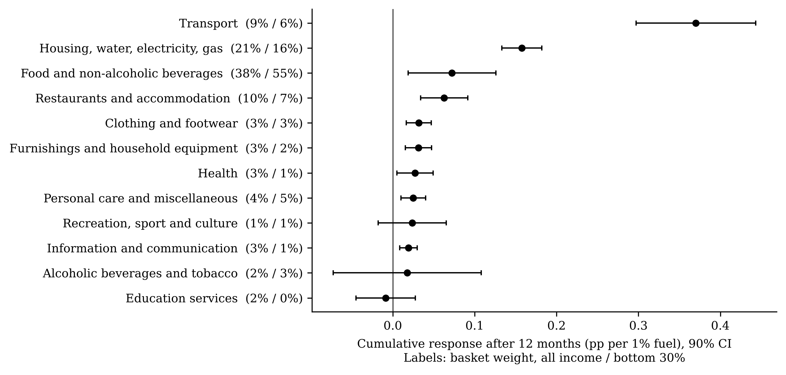
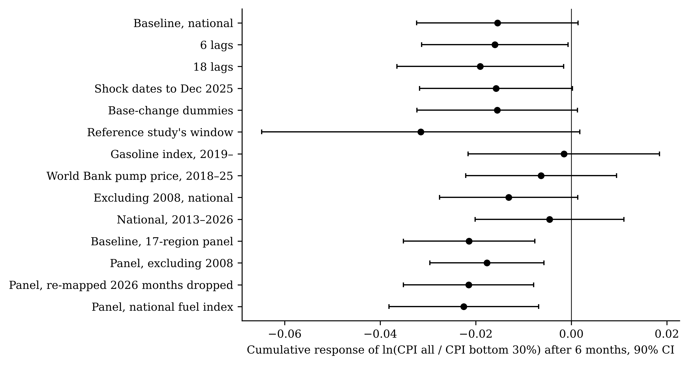
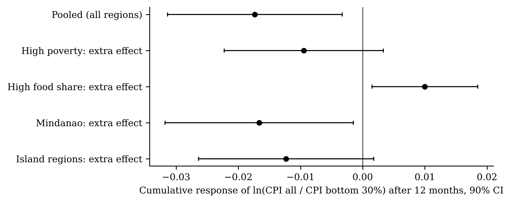
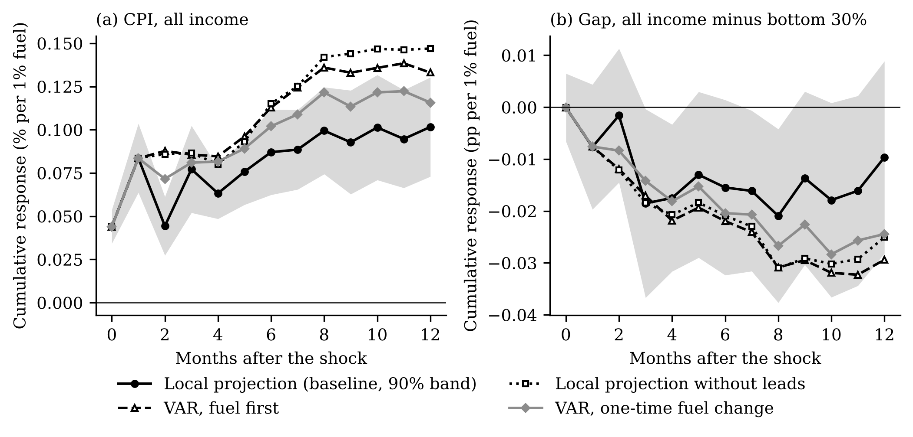
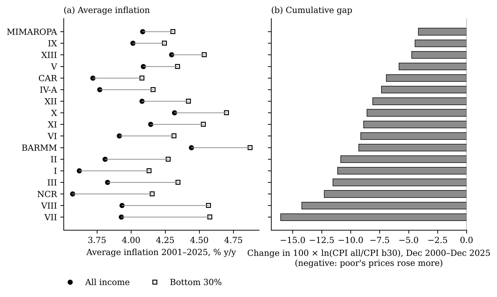

<#-- Online appendix of the article (decision D15), a separate supplementary file. Rendered by
     code/python/07_papers.py to paper/article_online_appendix.*. --#>

This appendix accompanies the article. Section A lists the 15 studies reviewed, Section B reports every supplementary estimate and robustness check, Section C the remaining descriptive statistics, and Section D the data sources and the files that produce each result.

# A. The studies reviewed

Table: Table A1. The 15 studies reviewed in Section 2

{{ t.review15 }}

::: {custom-style="Table Note"}
*Notes:* Each reference was checked against the publisher's or a bibliographic index's record in November 2026.
:::

# B. Supplementary results

## B.1 All 13 CPI divisions

Table A2 gives the twelve-month response of every division of the all-income CPI and its contribution to the gap that budget shares alone would produce (Table 4 in the text groups the nine smallest divisions). Figure A1 shows the full responses.

Table: Table A2. Response after 12 months by CPI division and the gap implied by budget shares alone

{{ t.divisions }}

::: {custom-style="Table Note"}
*Notes:* National; Newey–West standard errors in parentheses. Last column: response × (all-income weight − bottom-30% weight) ÷ 100; positive values push toward a progressive gap. Descriptive calculation outside the model. \* *p* < 0.10, \*\* *p* < 0.05, \*\*\* *p* < 0.01.
:::

{width=95%}

## B.2 Every robustness check

Table A3 reports every robustness check, grouped by what it changes: lag length, the lead convention, the shock variable, the sample, controls, and a test for asymmetry between price increases and decreases. Figure A2 plots the checks not shown in the text.

Table: Table A3. All robustness checks

{{ t.robust_full }}

::: {custom-style="Table Note"}
*Notes:* Cumulative responses per 1% shock; national checks use Newey–West and panel checks Driscoll–Kraay standard errors, in parentheses. Gasoline and the World Bank pump price are available only from 2018. The asymmetry row is the extra effect of fuel price increases (shock × 1[shock > 0]). \* *p* < 0.10, \*\* *p* < 0.05, \*\*\* *p* < 0.01.
:::

{width=85%}

## B.3 Groups of regions

Interacting the fuel shock with a group indicator tests whether the gap differs in poorer regions (2018 poverty incidence above the median), regions with a high food share, Mindanao and island regions (MIMAROPA, VI, VII and VIII). With four tests, a Bonferroni-corrected 10% test requires *p* < 0.025; no interaction meets it (Table A4, Figure A3).

Table: Table A4. The gap in groups of regions (17-region panel, Driscoll–Kraay standard errors)

{{ t.groups }}

{width=80%}

## B.4 Leaving out one region at a time

Table: Table A5. The panel gap with one region left out

{{ t.loo }}

::: {custom-style="Table Note"}
*Notes:* 17-region panel re-estimated without the named region; region fixed effects; Driscoll–Kraay standard errors in parentheses.
:::

## B.5 Local projections and a VAR

A VAR(12) in the fuel shock and the outcome, with a constant and a trend and fuel ordered first, traces the response to a fuel price innovation scaled to 1% on impact. Because a fuel price rise is usually followed by further rises, this response includes their effects; the local projection without leads targets the same response and matches it closely [@plagborg_wolf_2021]. The baseline local projection, with leads, measures instead the effect of a one-time rise; its VAR counterpart, which feeds a single 1% fuel change through the VAR's inflation equation and holds later fuel changes at zero, lies between the two (Table A6, Figure A4). All four versions give a negative gap.

Table: Table A6. Local projections and VAR: cumulative responses to a 1% fuel price increase

{{ t.var }}

::: {custom-style="Table Note"}
*Notes:* National, January 2001–August 2026. LP: baseline local projection (leads 1 to *h* − 1). VAR: twelve lags, constant and trend, fuel ordered first. VAR, one-time: response to a single 1% fuel change with later fuel changes held at zero.
:::

{width=95%}

# C. Further descriptive statistics

Table: Table A7. Annual inflation by group and fuel price change, 2001–2026

{{ t.d_annual }}

Table: Table A8. Fuel-shock episodes (at least three months with fuel prices 15% or more above a year earlier)

{{ t.d_episodes }}

Table: Table A9. Augmented Dickey–Fuller tests, 2001–2026

{{ t.d_adf }}

Table: Table A10. Correlation of the fuel shock with inflation *k* months later, 2001–2026

{{ t.d_crosscorr }}

Table: Table A11. Regional summary

{{ t.d_regional }}

{width=90%}

# D. Data appendix


The replication package (link on the title page) rebuilds everything from the raw files with one command in Python 3.11 (`run_all.sh`); the Stata 17 code (`code/stata/00_master.do`) re-estimates every result from the cleaned files. A codebook documents every raw and cleaned variable. All files were downloaded on 4 October 2026.

The replication package is the repository <https://github.com/liancataytayjk-coder/oil-shock-distribution>. The command `./run_all.sh` (Python 3.11) rebuilds everything from the raw files, and `code/stata/00_master.do` (Stata 17) re-estimates every result from the cleaned files; `codebook/codebook.xlsx` documents every raw and cleaned variable. All files were downloaded on 4 October 2026.


{{ t.sources_art }}

Table: Table A12. Sources, scripts and output files

{{ t.results_art }}

# References {-}

::: {#refs}
:::
