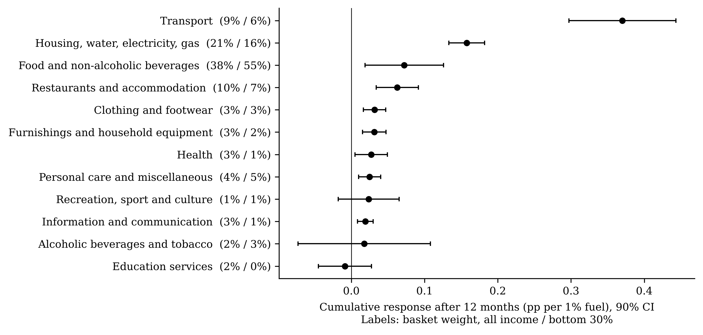
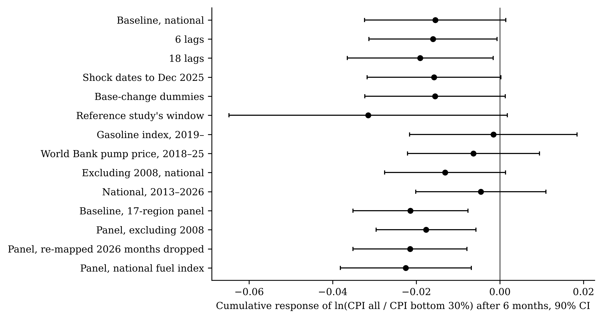
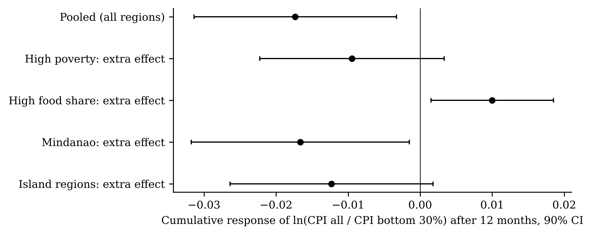
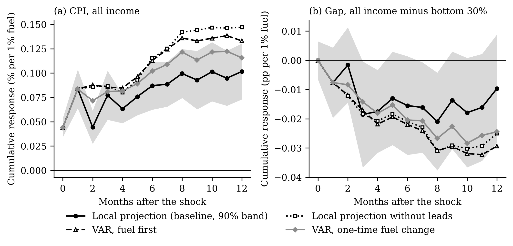
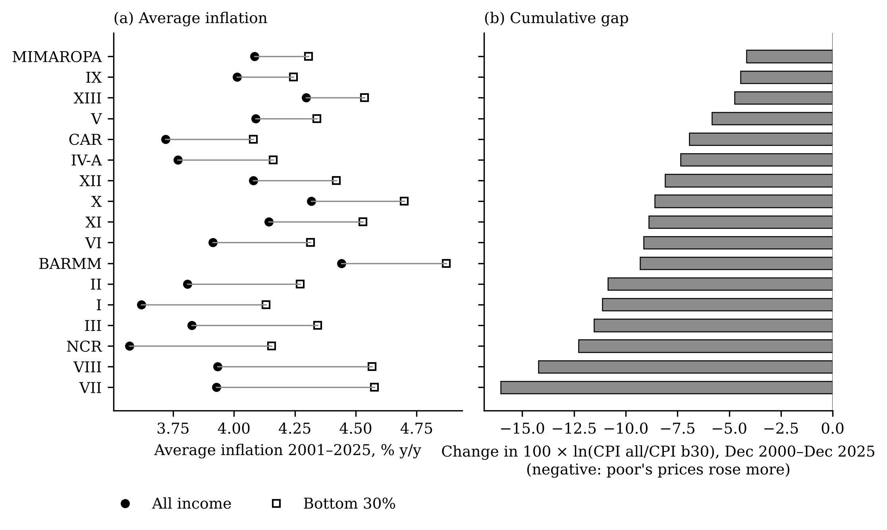

This appendix accompanies the article. Section A lists the 15 studies reviewed, Section B reports every supplementary estimate and robustness check, Section C the remaining descriptive statistics, and Section D the data sources and the files that produce each result.

# A. The studies reviewed

Table: Table A1. The 15 studies reviewed in Section 2

| Author (year) | Strand | Country / sample | Method | Key findings |
|-------------|-------------|---------------|----------------|------------------------------------|
| Kilian (2009) | Theory: how oil shocks reach prices | Global crude oil market; United States, 1973-2007 | Structural VAR separating oil supply, aggregate demand and oil-specific demand shocks | Not all oil price shocks are alike: supply, global-demand and oil-specific demand shocks have different effects on prices and activity, which explains why simple regressions on oil prices are unstable. |
| Blanchard and Galí (2010) | Theory: how oil shocks reach prices | United States and other industrial economies, 1970s-2000s | Structural VARs and a new-Keynesian model | Oil shocks had much smaller effects on inflation and output in the 2000s than in the 1970s: second-round wage effects were weaker, monetary policy more credible and the oil share of production smaller. |
| Känzig (2021) | Theory: how oil shocks reach prices | Oil market and United States economy, 1970s-2010s | High-frequency identification from OPEC announcements; VARs and local projections | Negative oil supply news raises oil prices immediately and lowers output; prices and inflation expectations rise, showing a strong expectations channel. |
| Kpodar and Liu (2022) | Evidence on pass-through to inflation | 122 countries, monthly, 2000-2019 (incl. the Philippines in the developing group) | Local projections with Teulings-Zubanov correction; quintile CPIs rebuilt from survey weights | Retail fuel prices pass through to inflation (peak about 0.04 pp per 1% in advanced and 0.02 pp in developing economies); crude prices understate it; the effect on the richest-to-poorest quintile CPI ratio is progressive. |
| Kpodar and Abdallah (2017) | Evidence on pass-through to inflation | 162 countries; monthly retail fuel prices | Local projections on a new global retail fuel price database | A one-cent rise in crude oil per litre raises retail gasoline prices by about 1.2 cents at peak, after about six months; pass-through varies by region and is larger for increases than decreases. |
| Gelos and Ustyugova (2017) | Evidence on pass-through to inflation | 31 advanced and 61 emerging and developing economies | Panel and country regressions of inflation on commodity price shocks | Fuel price shocks have larger and more persistent effects in oil-intensive economies and where inflation was already high. |
| Choi et al. (2018) | Evidence on pass-through to inflation | 72 advanced and developing economies, 1970-2015 | Local projections, panel | A 10% rise in global oil prices raises domestic inflation by about 0.4 pp on impact, fading within two years; the effect is asymmetric and has declined over time, largely because of better monetary policy. |
| Jongwanich and Park (2011) | Evidence on pass-through to inflation | Nine developing Asian economies, 2007-2008 price spike | Empirical pass-through analysis of global food and oil prices to consumer prices | The pass-through of global food and oil prices to consumer prices was limited; subsidies and price controls reduced or delayed it. |
| Valera et al. (2025) | Evidence on pass-through to inflation | Philippine provinces, monthly, 1996-2024 (with Indonesia, Thailand, India) | Quantile regression | Energy and rice prices raise inflation more when inflation is high; inflation targeting and rice tariffication weakened the rice effect, especially in high-poverty and rice-deficit areas. |
| Allon-Pineda et al. (2026) | Evidence on pass-through to inflation | Philippines, monthly | Local projections of inflation on oil, food and rice price shocks | Global oil and food shocks have significant and persistent effects on Philippine inflation; second-round effects of oil are as large as its direct effects; core inflation responds asymmetrically to oil shocks. |
| Coady et al. (2015) | Who bears fuel price changes | Updated review, developing countries | Survey of incidence studies | Newer studies confirm that higher-income households capture most of the benefits of fuel subsidies, which worsens inequality. |
| Dorband et al. (2019) | Who bears fuel price changes | 87 low- and middle-income countries | Input-output incidence analysis of carbon pricing | Carbon pricing is on average progressive in countries with incomes below about USD 15,000 per person, because energy budget shares rise and then fall with income. |
| Fujii (2013) | Who bears fuel price changes | Philippines, 2006-2008; household survey and provincial prices | Non-parametric welfare analysis of food price changes | Food price increases raised poverty, and the poorest households were hit hard whether or not they farmed. |
| Jaravel (2021) | Who bears fuel price changes | Review of the literature | Survey | Inflation rates decline with household income in the United States; measuring this needs granular prices, because aggregation hides differences in what each group buys within categories. |
| Balié et al. (2021) | Rice prices and policy | Philippines; global rice model and FIES | Simulation of rice tariffication on prices and household welfare | Rice tariffication lowered consumer and producer rice prices; most households, and the poorest quintiles and regions most, gained, while net-selling rice farmers lost. |

::: {custom-style="Table Note"}
*Notes:* Each reference was checked against the publisher's or a bibliographic index's record in November 2026.
:::

# B. Supplementary results

## B.1 All 13 CPI divisions

Table A2 gives the twelve-month response of every division of the all-income CPI and its contribution to the gap that budget shares alone would produce (Table 4 in the text groups the nine smallest divisions). Figure A1 shows the full responses.

Table: Table A2. Response after 12 months by CPI division and the gap implied by budget shares alone

| COICOP division | Weight, all income (%) | Weight, bottom 30% (%) | Response after 12 months | Contribution to the gap if prices were the same |
|------------------------------|---------|----------|------------------|---------------|
| 07 Transport | 9.0 | 6.1 | 0.370*** (0.044) | +0.0108 |
| 12 Financial services | 0.0 | 0.0 | 0.358** (0.158) | +0.0001 |
| 04 Housing, water, electricity, gas | 21.4 | 15.5 | 0.158*** (0.015) | +0.0092 |
| 01 Food and non-alcoholic beverages | 37.7 | 54.9 | 0.072** (0.033) | −0.0124 |
| 11 Restaurants and accommodation | 9.6 | 7.5 | 0.063*** (0.018) | +0.0013 |
| 03 Clothing and footwear | 3.1 | 2.5 | 0.032*** (0.009) | +0.0002 |
| 05 Furnishings and household equipment | 3.2 | 2.4 | 0.031*** (0.010) | +0.0003 |
| 06 Health | 2.9 | 1.4 | 0.027** (0.013) | +0.0004 |
| 13 Personal care and miscellaneous | 4.5 | 4.8 | 0.025*** (0.009) | −0.0001 |
| 09 Recreation, sport and culture | 1.0 | 0.7 | 0.024 (0.025) | +0.0001 |
| 08 Information and communication | 3.4 | 1.0 | 0.019*** (0.007) | +0.0005 |
| 02 Alcoholic beverages and tobacco | 2.2 | 2.6 | 0.018 (0.055) | −0.0001 |
| 10 Education services | 2.0 | 0.4 | −0.009 (0.022) | −0.0001 |
| Total | 100.0 | 100.0 |  | +0.0101 |

::: {custom-style="Table Note"}
*Notes:* National; Newey–West standard errors in parentheses. Last column: response × (all-income weight − bottom-30% weight) ÷ 100; positive values push toward a progressive gap. Descriptive calculation outside the model. \* *p* < 0.10, \*\* *p* < 0.05, \*\*\* *p* < 0.01.
:::

{width=95%}

## B.2 Every robustness check

Table A3 reports every robustness check, grouped by what it changes: lag length, the lead convention, the shock variable, the sample, controls, and a test for asymmetry between price increases and decreases. Figure A2 plots the checks not shown in the text.

Table: Table A3. All robustness checks

| Specification | Gap, h = 6 | Gap, h = 12 | CPI all, h = 12 |
|------------------------------|---------------|---------------|---------------|
| *Baseline* |  |  |  |
| National baseline | −0.0155 (0.0103) | −0.0097 (0.0113) | — |
| 17-region panel baseline | −0.0214** (0.0084) | −0.0173** (0.0085) | — |
| *Lag length* |  |  |  |
| 6 lags | −0.0160* (0.0093) | −0.0157 (0.0121) | 0.107*** (0.020) |
| 18 lags | −0.0191* (0.0106) | −0.0109 (0.0115) | 0.109*** (0.018) |
| *Lead convention* |  |  |  |
| Leads 1 to h (national) | −0.0160 (0.0105) | −0.0112 (0.0113) | 0.101*** (0.017) |
| Leads 1 to h (panel) | −0.0216** (0.0085) | −0.0179** (0.0086) | — |
| *Alternative shocks* |  |  |  |
| Dubai crude in pesos | −0.0093 (0.0056) | −0.0075 (0.0063) | 0.041*** (0.009) |
| Gasoline index 07.2.2.2, 2019–2026 | −0.0016 (0.0122) | −0.0051 (0.0125) | 0.096*** (0.027) |
| World Bank pump price, 2018–2025 | −0.0063 (0.0096) | −0.0005 (0.0054) | 0.072*** (0.019) |
| Panel with the national fuel index | −0.0225** (0.0095) | −0.0188** (0.0095) | — |
| *Samples* |  |  |  |
| Excluding 2020 | −0.0186 (0.0121) | −0.0142 (0.0129) | 0.111*** (0.017) |
| Shock dates to December 2025 | −0.0158 (0.0097) | −0.0097 (0.0113) | 0.102*** (0.017) |
| Excluding 2008 (national) | −0.0131 (0.0088) | −0.0079 (0.0115) | — |
| Excluding 2008 (panel) | −0.0177** (0.0073) | −0.0135 (0.0092) | — |
| Shock dates to June 2019 (reference study's window) | −0.0315 (0.0202) | −0.0215 (0.0191) | 0.093*** (0.016) |
| National, 2013–2026 | −0.0046 (0.0095) | 0.0031 (0.0092) | — |
| Panel, 2001–2012 | −0.0541*** (0.0197) | −0.0369** (0.0147) | — |
| Panel, 2013–2026 | −0.0091 (0.0064) | −0.0063 (0.0075) | — |
| Panel without the re-mapped 2026 months | −0.0215*** (0.0083) | −0.0173** (0.0085) | — |
| *Controls* |  |  |  |
| Exchange rate, policy rate, world food prices | −0.0046 (0.0156) | 0.0086 (0.0160) | 0.072*** (0.020) |
| Dummies for the splice months (January 2012, January 2018) | −0.0155 (0.0102) | −0.0100 (0.0114) | 0.102*** (0.018) |
| *Other* |  |  |  |
| Asymmetry: extra effect of fuel increases | 0.0586 (0.0546) | 0.0578 (0.0721) | 0.079 (0.079) |
| Panel, one region left out (range; Table A5) | −0.0227 to −0.0203 | −0.0189 to −0.0156 | — |
| VAR, fuel ordered first (Table A6) | −0.0219 | −0.0294 | 0.133 |

::: {custom-style="Table Note"}
*Notes:* Cumulative responses per 1% shock; national checks use Newey–West and panel checks Driscoll–Kraay standard errors, in parentheses. Gasoline and the World Bank pump price are available only from 2018. The asymmetry row is the extra effect of fuel price increases (shock × 1[shock > 0]). \* *p* < 0.10, \*\* *p* < 0.05, \*\*\* *p* < 0.01.
:::

{width=85%}

## B.3 Groups of regions

Interacting the fuel shock with a group indicator tests whether the gap differs in poorer regions (2018 poverty incidence above the median), regions with a high food share, Mindanao and island regions (MIMAROPA, VI, VII and VIII). With four tests, a Bonferroni-corrected 10% test requires *p* < 0.025; no interaction meets it (Table A4, Figure A3).

Table: Table A4. The gap in groups of regions (17-region panel, Driscoll–Kraay standard errors)

| Group G | Other regions, h = 12 | Extra effect in G, h = 12 |
|------------------------------|------------------|------------------|
| High poverty (2018 incidence above the median) | −0.0131 (0.0100) | −0.0095 (0.0078) |
| High food share (above the median) | −0.0216** (0.0094) | 0.0100* (0.0052) |
| Mindanao | −0.0118 (0.0096) | −0.0166* (0.0092) |
| Island regions (MIMAROPA, VI, VII, VIII) | −0.0147* (0.0079) | −0.0123 (0.0086) |

{width=80%}

## B.4 Leaving out one region at a time

Table: Table A5. The panel gap with one region left out

| Region left out | Gap, h = 6 | Gap, h = 12 |
|---|---|---|
| BARMM | −0.0213*** (0.0082) | −0.0176** (0.0085) |
| Cordillera (CAR) | −0.0206** (0.0081) | −0.0171* (0.0088) |
| National Capital Region | −0.0213** (0.0087) | −0.0185** (0.0090) |
| I Ilocos | −0.0227*** (0.0085) | −0.0189** (0.0085) |
| II Cagayan Valley | −0.0209** (0.0084) | −0.0176** (0.0087) |
| III Central Luzon | −0.0203** (0.0082) | −0.0176** (0.0084) |
| IV-A CALABARZON | −0.0218** (0.0085) | −0.0183** (0.0088) |
| MIMAROPA | −0.0220*** (0.0084) | −0.0177** (0.0085) |
| V Bicol | −0.0214** (0.0084) | −0.0181** (0.0087) |
| VI Western Visayas | −0.0215*** (0.0083) | −0.0168** (0.0084) |
| VII Central Visayas | −0.0208** (0.0086) | −0.0156* (0.0086) |
| VIII Eastern Visayas | −0.0217*** (0.0082) | −0.0176** (0.0084) |
| IX Zamboanga Peninsula | −0.0216** (0.0084) | −0.0170** (0.0085) |
| X Northern Mindanao | −0.0222** (0.0086) | −0.0161* (0.0085) |
| XI Davao | −0.0211** (0.0085) | −0.0156* (0.0084) |
| XII SOCCSKSARGEN | −0.0223*** (0.0085) | −0.0180** (0.0086) |
| XIII Caraga | −0.0208** (0.0082) | −0.0168** (0.0084) |

::: {custom-style="Table Note"}
*Notes:* 17-region panel re-estimated without the named region; region fixed effects; Driscoll–Kraay standard errors in parentheses.
:::

## B.5 Local projections and a VAR

A VAR(12) in the fuel shock and the outcome, with a constant and a trend and fuel ordered first, traces the response to a fuel price innovation scaled to 1% on impact. Because a fuel price rise is usually followed by further rises, this response includes their effects; the local projection without leads targets the same response and matches it closely [@plagborg_wolf_2021]. The baseline local projection, with leads, measures instead the effect of a one-time rise; its VAR counterpart, which feeds a single 1% fuel change through the VAR's inflation equation and holds later fuel changes at zero, lies between the two (Table A6, Figure A4). All four versions give a negative gap.

Table: Table A6. Local projections and VAR: cumulative responses to a 1% fuel price increase

| Horizon | CPI all: LP | CPI all: LP, no leads | CPI all: VAR | CPI all: VAR, one-time | Gap: LP | Gap: LP, no leads | Gap: VAR | Gap: VAR, one-time |
|---|---|---|---|---|---|---|---|---|
| 0 | 0.044 | 0.044 | 0.044 | 0.044 | −0.0000 | −0.0000 | −0.0000 | −0.0000 |
| 1 | 0.084 | 0.084 | 0.084 | 0.084 | −0.0077 | −0.0077 | −0.0076 | −0.0076 |
| 2 | 0.044 | 0.086 | 0.088 | 0.072 | −0.0016 | −0.0121 | −0.0119 | −0.0084 |
| 3 | 0.077 | 0.087 | 0.086 | 0.081 | −0.0185 | −0.0185 | −0.0171 | −0.0142 |
| 6 | 0.087 | 0.115 | 0.113 | 0.102 | −0.0155 | −0.0209 | −0.0219 | −0.0204 |
| 9 | 0.093 | 0.144 | 0.133 | 0.113 | −0.0137 | −0.0291 | −0.0295 | −0.0226 |
| 12 | 0.102 | 0.147 | 0.133 | 0.116 | −0.0097 | −0.0251 | −0.0294 | −0.0244 |

::: {custom-style="Table Note"}
*Notes:* National, January 2001–August 2026. LP: baseline local projection (leads 1 to *h* − 1). VAR: twelve lags, constant and trend, fuel ordered first. VAR, one-time: response to a single 1% fuel change with later fuel changes held at zero.
:::

{width=95%}

# C. Further descriptive statistics

Table: Table A7. Annual inflation by group and fuel price change, 2001–2026

| Year | Inflation, all income (%) | Inflation, bottom 30% (%) | Gap, b30 − all (pp) | Fuel index (% y/y) |
|---|---|---|---|---|
| 2001 | 5.41 | 5.39 | −0.02 | 11.8 |
| 2002 | 2.73 | 2.98 | +0.25 | 0.1 |
| 2003 | 2.25 | 2.40 | +0.15 | 10.9 |
| 2004 | 4.80 | 5.93 | +1.13 | 15.8 |
| 2005 | 6.61 | 7.91 | +1.30 | 23.4 |
| 2006 | 5.48 | 6.62 | +1.14 | 19.0 |
| 2007 | 2.94 | 3.26 | +0.32 | 1.4 |
| 2008 | 8.17 | 13.91 | +5.74 | 20.9 |
| 2009 | 4.26 | 5.38 | +1.12 | −15.9 |
| 2010 | 3.79 | 3.61 | −0.17 | 12.9 |
| 2011 | 4.72 | 5.13 | +0.41 | 11.9 |
| 2012 | 3.17 | 2.82 | −0.36 | 2.1 |
| 2013 | 2.58 | 3.05 | +0.46 | −1.4 |
| 2014 | 3.60 | 4.68 | +1.08 | −0.4 |
| 2015 | 0.68 | 1.32 | +0.64 | −24.3 |
| 2016 | 1.25 | 1.11 | −0.14 | −7.3 |
| 2017 | 2.85 | 2.30 | −0.55 | 14.0 |
| 2018 | 5.23 | 5.99 | +0.76 | 23.2 |
| 2019 | 2.41 | 1.91 | −0.50 | −1.0 |
| 2020 | 2.39 | 2.59 | +0.20 | −11.2 |
| 2021 | 3.93 | 4.22 | +0.29 | 20.8 |
| 2022 | 5.81 | 6.56 | +0.75 | 39.7 |
| 2023 | 6.01 | 6.77 | +0.76 | −9.1 |
| 2024 | 3.22 | 4.18 | +0.97 | −3.0 |
| 2025 | 1.66 | 0.29 | −1.37 | −4.3 |
| 2026* | 5.16 | 6.20 | +1.04 | 33.8 |

Table: Table A8. Fuel-shock episodes (at least three months with fuel prices 15% or more above a year earlier)

| Episode | Months | Peak fuel rise (% y/y) | Inflation, all (%) | Inflation, b30 (%) | Gap (pp) |
|---|---|---|---|---|---|
| 2001-01 to 2001-03 | 3 | 22.8 | 5.83 | 5.90 | +0.07 |
| 2004-06 to 2006-09 | 28 | 28.3 | 6.21 | 7.53 | +1.32 |
| 2008-02 to 2008-10 | 9 | 40.3 | 8.50 | 14.68 | +6.17 |
| 2010-01 to 2010-05 | 5 | 23.5 | 3.92 | 3.88 | −0.04 |
| 2017-01 to 2017-03 | 3 | 24.6 | 2.88 | 2.12 | −0.76 |
| 2017-09 to 2017-11 | 3 | 15.9 | 3.06 | 2.61 | −0.44 |
| 2018-02 to 2018-11 | 10 | 33.5 | 5.42 | 6.22 | +0.81 |
| 2021-04 to 2022-12 | 21 | 62.7 | 4.99 | 5.52 | +0.53 |
| 2026-03 to 2026-08 | 6 | 76.3 | 6.14 | 7.58 | +1.44 |

Table: Table A9. Augmented Dickey–Fuller tests, 2001–2026

| Series | Form | ADF statistic | p-value | Lags | N |
|---|---|---|---|---|---|
| ln fuel index | level | −2.22 | 0.480 | 2 | 305 |
| ln fuel index | first difference | −13.47 | 0.000 | 1 | 305 |
| ln CPI all | level | −1.62 | 0.786 | 1 | 306 |
| ln CPI all | first difference | −12.12 | 0.000 | 0 | 306 |
| ln CPI b30 | level | −1.91 | 0.649 | 1 | 306 |
| ln CPI b30 | first difference | −9.59 | 0.000 | 0 | 306 |
| ln(CPI all/CPI b30) | level | −1.66 | 0.770 | 4 | 303 |
| ln(CPI all/CPI b30) | first difference | −9.08 | 0.000 | 3 | 303 |

Table: Table A10. Correlation of the fuel shock with inflation *k* months later, 2001–2026

| Months later (k) | CPI, all income | CPI, bottom 30% | Gap |
|---|---|---|---|
| 0 | 0.536 | 0.428 | −0.114 |
| 1 | 0.295 | 0.271 | −0.129 |
| 2 | −0.028 | 0.012 | −0.057 |
| 3 | −0.058 | −0.023 | −0.030 |
| 4 | 0.060 | 0.036 | 0.010 |
| 5 | 0.168 | 0.092 | 0.042 |
| 6 | 0.166 | 0.139 | −0.048 |
| 7 | 0.128 | 0.127 | −0.075 |
| 8 | 0.069 | 0.093 | −0.085 |
| 9 | 0.024 | 0.026 | −0.019 |
| 10 | 0.061 | 0.066 | −0.046 |
| 11 | 0.015 | 0.009 | 0.002 |
| 12 | −0.016 | −0.025 | 0.026 |

Table: Table A11. Regional summary

| Region | Poverty 2018 (%) | Food share (%) | Inflation, all (%) | Inflation, b30 (%) | Cumulative gap | Inflation b30, Aug 2026 (%) |
|---|---|---|---|---|---|---|
| National Capital Region | 2.2 | 29.5 | 3.57 | 4.15 | −12.3 | 4.3 |
| Cordillera (CAR) | 12.0 | 35.8 | 3.72 | 4.08 | −6.9 | 8.3 |
| I Ilocos | 9.9 | 38.4 | 3.62 | 4.13 | −11.1 | 4.7 |
| II Cagayan Valley | 16.3 | 43.9 | 3.81 | 4.27 | −10.9 | 7.1 |
| III Central Luzon | 7.0 | 36.5 | 3.83 | 4.34 | −11.5 | 6.9 |
| IV-A CALABARZON | 7.1 | 33.0 | 3.77 | 4.16 | −7.3 | 6.0 |
| MIMAROPA | 15.1 | 46.4 | 4.08 | 4.31 | −4.2 | 6.8 |
| V Bicol | 27.0 | 45.6 | 4.09 | 4.34 | −5.8 | 9.3 |
| VI Western Visayas | 14.2 | 42.6 | 3.91 | 4.31 | −9.1 | 10.4 |
| VII Central Visayas | 16.1 | 37.9 | 3.93 | 4.58 | −16.0 | 9.7 |
| VIII Eastern Visayas | 30.7 | 47.4 | 3.93 | 4.57 | −14.2 | 9.9 |
| IX Zamboanga Peninsula | 32.7 | 49.6 | 4.01 | 4.24 | −4.4 | 10.0 |
| X Northern Mindanao | 23.1 | 43.1 | 4.32 | 4.70 | −8.6 | 7.2 |
| XI Davao | 19.1 | 43.0 | 4.14 | 4.53 | −8.9 | 12.1 |
| XII SOCCSKSARGEN | 27.3 | 45.7 | 4.08 | 4.42 | −8.1 | 8.6 |
| XIII Caraga | 30.5 | 46.7 | 4.30 | 4.54 | −4.7 | 10.4 |
| BARMM | 60.4 | 59.4 | 4.44 | 4.87 | −9.3 | 9.0 |
| Philippines | 16.7 | 37.7 | 3.84 | 4.41 | −13.3 | 8.2 |

{width=90%}

# D. Data appendix

The replication package is the repository <https://github.com/liancataytayjk-coder/oil-shock-distribution>. The command `./run_all.sh` (Python 3.11) rebuilds everything from the raw files, and `code/stata/00_master.do` (Stata 17) re-estimates every result from the cleaned files; `codebook/codebook.xlsx` documents every raw and cleaned variable. All files were downloaded on 4 October 2026.

**S1. CPI for All Income Households, 2018 = 100, old geographic code (17 regions).** Philippine Statistics Authority (PSA), OpenSTAT. Used for: All-income CPI, its divisions and sub-indices, and the fuel index 07.2.2 (Jan 1994-Dec 2025); 2018 basket weights. Coverage: Jan 1994-Dec 2025; Philippines and 17 regions. Files: `psa/cpi_all_2018old_backcast_1994_2017.csv`, `psa/cpi_all_2018old_2018_2025.csv`, `psa/cpi_all_2018old_weights.csv`. Link: <https://openstat.psa.gov.ph/PXWeb/api/v1/en/DB/2M/PI/CPI/2018/0012M4ACP15.px>; <https://openstat.psa.gov.ph/PXWeb/api/v1/en/DB/2M/PI/CPI/2018/0012M4ACP09.px>; <https://openstat.psa.gov.ph/PXWeb/api/v1/en/DB/2M/PI/CPI/2018/0012M4ACP12.px>

**S2. CPI for All Income Households, 2018 = 100, new geographic code (Negros Island Region separate).** PSA, OpenSTAT. Used for: Jan-Aug 2026 months (chained onto S1); gasoline index 07.2.2.2; 2018 weights for the 2026 decomposition. Coverage: Jan 2018-Aug 2026; Philippines, 17 regions and NIR. Files: `psa/cpi_all_2018new_2018_2026.csv`, `psa/cpi_all_2018new_weights.csv`. Link: <https://openstat.psa.gov.ph/PXWeb/api/v1/en/DB/2M/PI/CPI/2018NEW/0012M4ACP22.px>; <https://openstat.psa.gov.ph/PXWeb/api/v1/en/DB/2M/PI/CPI/2018NEW/0012M4ACP25.px>

**S3. CPI for the Bottom 30% Income Households, 2018 = 100, old geographic code.** PSA, OpenSTAT. Used for: Bottom-30% CPI (all items from 2000; divisions and sub-indices from 2012); 2018 basket weights. Coverage: Jan 2000-Dec 2025; Philippines and 17 regions. Files: `psa/cpi_b30_2018old_backcast_allitems_2000_2011.csv`, `psa/cpi_b30_2018old_backcast_2012_2017.csv`, `psa/cpi_b30_2018old_2018_2025.csv`, `psa/cpi_b30_2018old_weights.csv`. Link: <https://openstat.psa.gov.ph/PXWeb/api/v1/en/DB/2M/PI/BIH/2018/0022M4ABOT5.px>; <https://openstat.psa.gov.ph/PXWeb/api/v1/en/DB/2M/PI/BIH/2018/0022M4ABOT4.px>; <https://openstat.psa.gov.ph/PXWeb/api/v1/en/DB/2M/PI/BIH/2018/0022M4ABOT1.px>; <https://openstat.psa.gov.ph/PXWeb/api/v1/en/DB/2M/PI/BIH/2018/0022M4ABOT3.px>

**S4. CPI for the Bottom 30% Income Households, 2018 = 100, new geographic code.** PSA, OpenSTAT. Used for: Jan-Aug 2026 months (chained onto S3); 2018 weights for the 2026 decomposition. Coverage: Jan 2018-Aug 2026; Philippines, 17 regions and NIR. Files: `psa/cpi_b30_2018new_2018_2026.csv`, `psa/cpi_b30_2018new_weights.csv`. Link: <https://openstat.psa.gov.ph/PXWeb/api/v1/en/DB/2M/PI/BIH/2018NEW/0022M4ABIR1.px>; <https://openstat.psa.gov.ph/PXWeb/api/v1/en/DB/2M/PI/BIH/2018NEW/0022M4ABIR3.px>

**S5. Official poverty statistics by region: poverty incidence among population and annual per-capita poverty threshold.** PSA, OpenSTAT. Used for: Region groups (poverty 2018); poverty line for the peso cost (threshold 2023). Coverage: 2018, 2021, 2023; Philippines, regions and provinces. Files: `psa/poverty_population_2018_2023.csv`. Link: <https://openstat.psa.gov.ph/PXWeb/api/v1/en/DB/1F/FY/0031F3DF020.px>

**S6. Commodity Price Data (Pink Sheet), monthly.** World Bank. Used for: Dubai crude oil price, USD/barrel (robustness shock, with S8). Coverage: Jan 1960-Sep 2026. Files: `wb/CMO-Historical-Data-Monthly.xlsx`, `extracts/wb_cmo_crude_monthly.csv`. Link: <https://thedocs.worldbank.org/en/doc/74e8be41ceb20fa0da750cda2f6b9e4e-0050012026/related/CMO-Historical-Data-Monthly.xlsx>

**S7. Global Fuel Prices Database (April 2025 version).** World Bank. Used for: Manila regular gasoline (RON 91) pump price, PHP/litre: check of the fuel index; appendix robustness. Coverage: Philippines: Jan 2017-Mar 2025. Files: `wb/Global_Fuel_Prices_Database.xlsx`, `wb/Global_Fuel_Prices_Database_methodology.pdf`, `extracts/wb_gfpd_phl_gasoline.csv`. Link: <https://datacatalogfiles.worldbank.org/ddh-published/0066829/DR0095290/Global_Fuel_Prices_Database.xlsx>

**S8. Peso per US dollar exchange rate, monthly average.** Bangko Sentral ng Pilipinas (BSP). Used for: Converts Dubai crude to pesos; control variable (robustness). Coverage: Jan 1945-Sep 2026. Files: `bsp/pesodollar.xlsx`, `extracts/bsp_php_usd_monthly.csv`. Link: <https://www.bsp.gov.ph/Statistics/External/pesodollar.xlsx>

**S9. Central bank policy rates, Philippines.** Bank for International Settlements (BIS). Used for: BSP policy rate, end of month (control variable, robustness). Coverage: Jan 1986-Aug 2026. Files: `bis/bis_cbpol_ph_monthly.csv`. Link: <https://stats.bis.org/api/v1/data/WS_CBPOL/M.PH?format=csv>

**S10. FAO Food Price Index, nominal, 2014-2016 = 100.** Food and Agriculture Organization (FAO). Used for: World food prices (control variable, robustness). Coverage: Jan 1990-Sep 2026. Files: `fao/food_price_indices_data.csv`. Link: <https://www.fao.org/media/docs/worldfoodsituationlibraries/wfs-library/food_price_indices_data.csv>

**S11. 2026 policy facts (RA 12316, executive orders, subsidies, fares, policy rate).** Republic of the Philippines; news and official releases. Used for: Policy assessment (RQ3); each fact listed with its link and verification status. Coverage: Mar-Sep 2026. Files: `paper/policy_context_2026.md`. Link: <https://lawphil.net/statutes/repacts/ra2026/ra_12316_2026.html>

**S12. Published coefficients of the reference study (Annex Tables 1-2, Figure 7).** Kpodar and Liu (2021), IMF Working Paper WP/21/271. Used for: Comparison of the Philippine pass-through with the reference study's estimates. Coverage: Advanced and developing economies, 2000-2019. Files: `reference/kpodar_liu_2021_targets.csv`. Link: <https://www.imf.org/en/publications/wp/issues/2021/11/12/the-distributional-implications-of-the-impact-of-fuel-price-increases-on-inflation-506822>

Table: Table A12. Sources, scripts and output files

| Item | Content | Sources | Python script | Stata do-file |
|---|---|---|---|---|
| Figure 1 | Conceptual framework (X to Y) | - | 06_figures.py | - |
| Table 1 | Summary statistics of monthly changes by period | S1-S4 | 03_descriptive.py | 03_descriptive.do |
| Table A7 | Annual inflation of both groups, the gap and fuel | S1-S4 | 03_descriptive.py | 03_descriptive.do |
| Figure 2 | Year-on-year inflation, gap and fuel, 2001-2026 | S1-S4 | 03_descriptive.py, 06_figures.py | 03_descriptive.do |
| Table A8 | Fuel-shock episodes | S1-S4 | 03_descriptive.py | 03_descriptive.do |
| Table A11 | Regional summary | S1-S5 | 03_descriptive.py | 03_descriptive.do |
| Table A9 | Unit-root tests | S1-S4 | 03_descriptive.py | 03_descriptive.do |
| Table 2 | Pass-through to the price level, both groups | S1-S4 | 04_estimate.py | 04_estimate.do |
| Figure 3 | RQ1 cumulative responses | S1-S4 | 04_estimate.py, 06_figures.py | 04_estimate.do |
| Table 3 | Gap response, national and 17-region panel | S1-S4 | 04_estimate.py | 04_estimate.do |
| Figure 4 | RQ2 cumulative responses | S1-S4 | 04_estimate.py, 06_figures.py | 04_estimate.do |
| Tables 4 and A2 | RQ2 why: division responses x weight differences | S1, S3 | 04_estimate.py | 04_estimate.do |
| Table 5 | Divisions in both baskets, 2013-2026 (exploratory) | S1, S3 | 04_estimate.py | 04_estimate.do |
| Tables 6, A3 and A5 | Core robustness checks | S1-S10 | 04_estimate.py | 04_estimate.do |
| Figure 5 | Core robustness of the six-month gap | S1-S10 | 04_estimate.py, 06_figures.py | 04_estimate.do |
| Figure 6 | 2026: actual vs fuel-driven change (model to Dec 2025) | S1-S4 | 05_policy_2026.py | 05_policy_2026.do |
| Figure 6 | 2026: actual vs fuel-driven change | S1-S4 | 05_policy_2026.py, 06_figures.py | 05_policy_2026.do |
| Table 7 | 2026 by region; peso cost for a poverty-line family | S1-S5 | 05_policy_2026.py | 05_policy_2026.do |
| Table 8 | LPG, kerosene, solid fuels, fares, cereals: both baskets | S1, S3 | 05_policy_2026.py | 05_policy_2026.do |
| Figure 7 | Item contributions to the 2026 gap | S2, S4 | 05_policy_2026.py | 05_policy_2026.do |
| Figure 7 | Item contributions to the 2026 gap | S2, S4 | 05_policy_2026.py, 06_figures.py | 05_policy_2026.do |
| Figure A1 | All 13 CPI divisions | S1, S3 | 04_estimate.py, 06_figures.py | 04_estimate.do |
| Tables A3–A4 | Region-group interactions; other robustness checks | S1-S10 | 04_estimate.py | 04_estimate.do |
| Figure A3 | Region-group interactions | S1-S5 | 04_estimate.py, 06_figures.py | 04_estimate.do |
| Figure A2 | Other robustness checks | S1-S10 | 04_estimate.py, 06_figures.py | 04_estimate.do |
| Figure A5 | Regional inflation and cumulative gap | S1-S5 | 03_descriptive.py, 06_figures.py | 03_descriptive.do |
| Table A10 | Cross-correlations | S1-S4 | 03_descriptive.py | 03_descriptive.do |
| Table A6 | VAR with fuel ordered first next to the local projections | S1-S4 | 04_estimate.py | 06_var.do |
| Figure A4 | Local projection against VAR | S1-S4 | 04_estimate.py, 06_figures.py | 06_var.do |

# References {-}

::: {#refs}
:::
