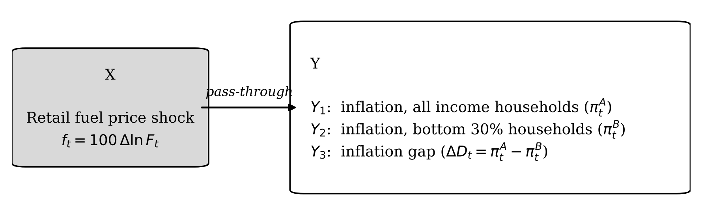
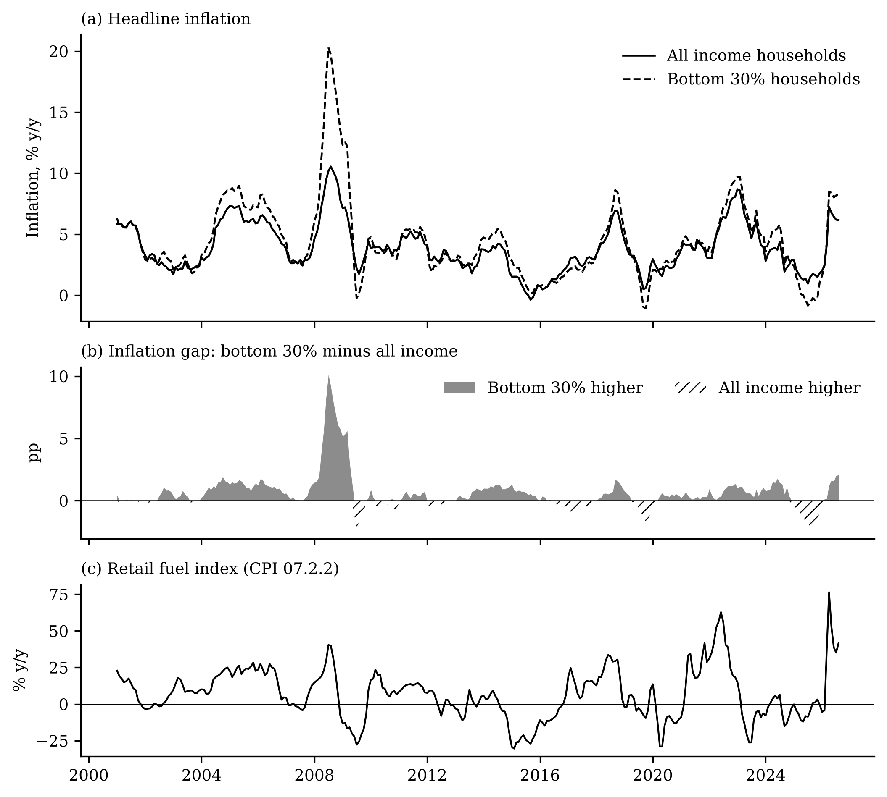
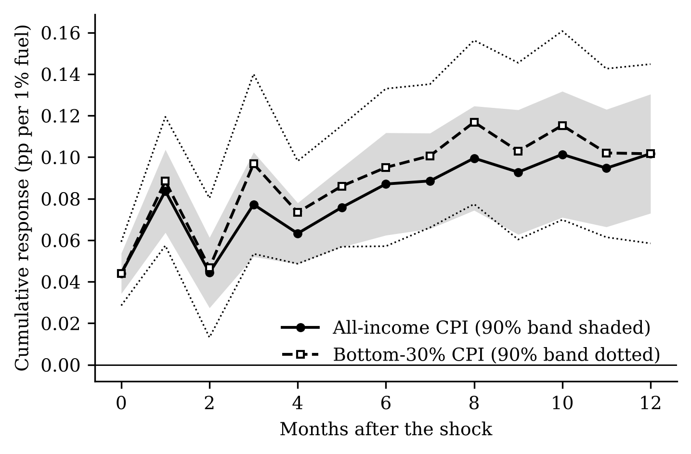
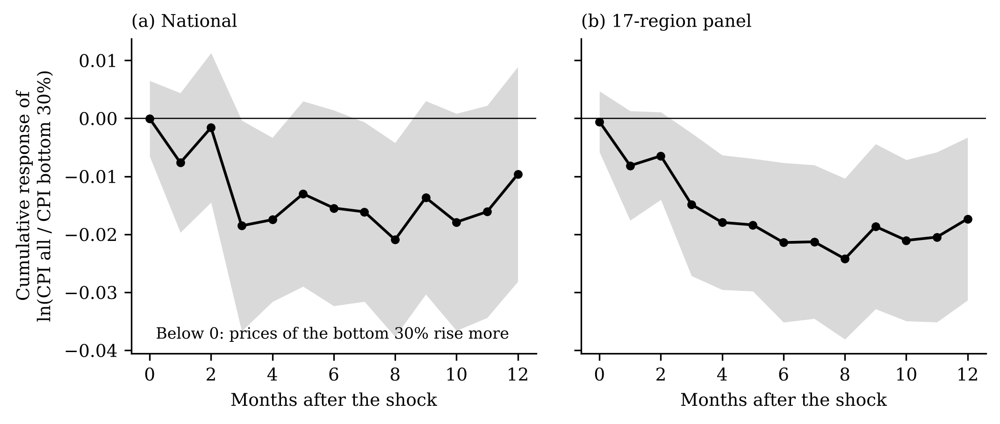
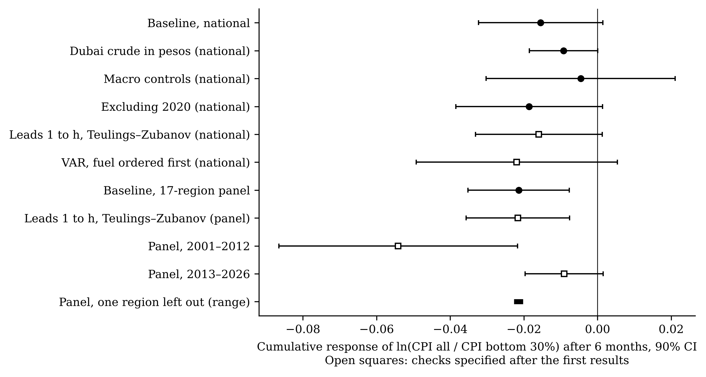
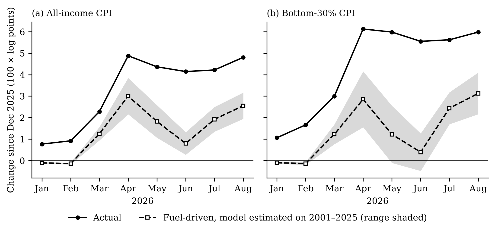
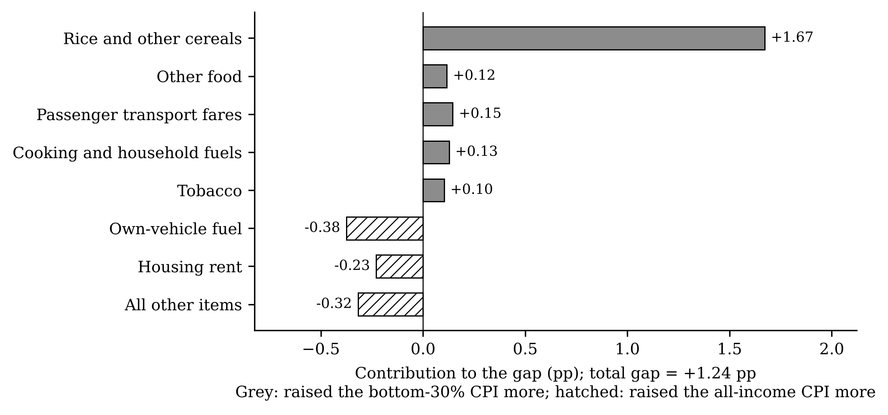

<#-- Article for the Asian Economic Journal (decision D15). Rendered by code/python/07_papers.py three ways:
     paper/article.* (reading version), paper/article_submission.* (blind = True; tables and figures moved to
     the end), with the online appendix in article_appendix_template.md. Every table and figure sits between
     <!--F--> and <!--/F--> lines so the submission version can move it. --#>


[^aff]: {{ affiliation }}.


# 1. Introduction

When oil prices rise, who pays? Every government that must decide whether to cut fuel taxes, subsidise fuel or transfer cash after an oil shock needs an answer. The best cross-country evidence gives a clear one. Using retail fuel prices for 122 countries and price indices for income quintiles rebuilt from household surveys, @kpodar_liu_2022 find that fuel price increases are *progressive*: the prices paid by the richest households rise more, because they spend more on cars and fuel. If this holds generally, broad fuel tax relief mainly helps the better-off.

This paper tests that finding within one country, the Philippines, where there are good reasons to doubt it. Poor Filipino households spend more than half of their budget on food ({{ n.w_food_b30 }}% in the 2018 basket, against {{ n.w_food_all }}% for all households) and only {{ n.w_fuel_b30 }}% on fuel for their own vehicles (against {{ n.w_fuel_all }}%). They feel oil shocks mainly through food and fares. Moreover, the cross-country method gives every income group the same price for each spending category and lets only budget shares differ, yet households with different incomes buy different items within categories, whose prices move differently [@jaravel_2021]. The Philippine Statistics Authority (PSA) publishes an official consumer price index (CPI) for the bottom 30% of households, monthly and by region, built from that group's own budget shares at a detailed item level. It allows a direct test that captures both channels.

The question became urgent in 2026. An oil shock caused by conflict in the Middle East pushed the CPI sub-index for retail motor fuels {{ n.yoy_fuel_apr }}% above its level a year earlier by April. Headline inflation rose from {{ n.yoy_all_feb }}% in February to {{ n.yoy_all_apr }}% in April, and inflation for the bottom 30% reached {{ n.yoy_b30_apr }}%. Republic Act 12316 gave the President standby authority to suspend petroleum excise taxes [@ra12316_2026]; the government used it for liquefied petroleum gas (LPG) and kerosene but not for gasoline and diesel, gave subsidies to transport drivers, and the central bank raised its policy rate {{ n.n_hikes_word }} times.

We ask three questions. How much, and how fast, do retail fuel prices pass through to the price level of all households and of the bottom 30% (RQ1)? Do the bottom 30% face larger price increases than all households, nationally and across regions, and why (RQ2)? What did the 2026 shock cost poor families, and how well were the policy responses targeted (RQ3)?

We find that fuel prices pass through quickly and lastingly: a 10% rise in retail fuel prices makes the price level about {{ n.rq1_all_c12_10pct }}% higher a year later, more than twice what crude oil prices imply. The effect is not progressive. In a panel of 17 regions, the bottom 30%'s price level rises {{ n.pan_c6|replace("−","") }} percentage points more than all households' after six months per 1% fuel price rise, a significant regressive effect; nationally the sign is the same but the estimate is less precise. Budget shares alone would make the effect progressive, so the regressive gap comes from larger price increases within the categories the poor buy. The effect is strongest in 2001–2012 and shrinks with macroeconomic controls. Applied to 2026, a model estimated only on earlier data explains about half of the price surge and predicts the direction of the gap; most of the poor's excess inflation came through rice.

The paper makes three contributions. It adds a within-country test with official income-group price indices to the cross-country evidence on fuel price pass-through, and finds the opposite sign. It shows, with a budget-share calculation and an item-level accounting, that differences within spending categories, which reconstructed indices cannot capture, decide who bears an oil shock. And it applies the estimates out of sample to the 2026 shock, putting a peso value on its cost to poor families and assessing each policy response. Section 2 reviews the literature, Section 3 sets out the framework, Section 4 the data and method, Section 5 the results, and Section 6 the 2026 application and its policy lessons; Section 7 concludes.

# 2. Related literature

**How oil shocks reach prices.** Oil prices rise for different reasons, and the reason matters. @kilian_2009 separates shocks to oil supply, to global demand for all commodities and to demand specific to oil, and shows that they have different effects on prices and activity, which is why simple regressions on oil prices are unstable. @blanchard_gali_2010 find that oil shocks had much smaller effects on inflation and output in the 2000s than in the 1970s, because wages responded less, monetary policy was more credible and oil was a smaller share of production. Using surprises in oil futures prices around OPEC announcements, @kanzig_2021 shows that news of lower future supply raises prices and inflation expectations at once. These studies imply that the response to an oil price change should be traced over time and that the price consumers actually pay matters more than the world price of crude.

**Evidence on pass-through to inflation.** @kpodar_abdallah_2017 built a database of monthly retail fuel prices for 162 countries and found, with local projections, that changes in world crude prices reach pump prices within about six months, more fully for increases than for decreases. @choi_etal_2018 estimate for 72 countries that a 10% rise in world oil prices raises inflation by about 0.4 percentage points on impact, an effect that has fallen over time. @gelos_ustyugova_2017 find larger and more persistent effects where food and fuel weigh more in the basket and inflation was already high. In developing Asia during the 2007–2008 spike, subsidies and price controls limited and delayed the pass-through [@jongwanich_park_2011]. For the Philippines, @allon_pineda_etal_2026 find with local projections that oil and food shocks have significant and persistent effects on inflation, with second-round effects of oil as large as the direct ones, and @valera_etal_2025 find, across provinces, that energy and rice prices raise inflation more when inflation is high. None of these studies distinguishes income groups. @kpodar_liu_2022 do: they rebuild a CPI for each income quintile from survey budget shares and the published CPI components of 122 countries, and find a progressive effect that lasts more than a year in developing economies.

**Who bears fuel price changes.** Studies of fuel subsidies find that richer households capture most of their benefits [@coady_etal_2015], and studies of carbon pricing find that energy price increases are progressive in poorer countries, because energy budget shares first rise and then fall with income [@dorband_etal_2019]. Both rely on budget shares and fixed input–output links, not on observed price movements. Evidence that the poor face different inflation points the other way. @jaravel_2021 shows that inflation falls with income in the United States and that measuring this requires detailed prices, because aggregation hides differences within categories. In the Philippines, food price increases in 2006–2008 raised poverty, and the poorest households were hit hardest whether or not they farmed [@fujii_2013].

**Rice prices and policy.** Rice is the largest single item in the poor's basket. @balie_etal_2021 show that the 2019 rice tariffication law lowered rice prices and that the poorest quintiles and regions gained most. Oil shocks raise the cost of growing and moving rice, but rice prices can also move with trade policy at the same time, which complicates any attempt to attribute a rice price rise to fuel.

**What is missing.** No study has measured the distributional effect of fuel price shocks with official income-group price indices. The cross-country design captures only differences in budget shares across categories; the Philippine data also capture differences within them. The 15 studies are summarised in online appendix Table A1.

# 3. Framework

Fuel enters almost every price. In the input–output price model [@miller_blair_2009], if margins and other costs are unchanged, a fuel price shock $f_t = 100\,\Delta\ln F_t$ raises the price of good *k* in proportion to its total (direct and indirect) fuel cost share $\phi_k$: $\pi_{k,t} \approx \phi_k f_t$. A group's CPI is a weighted average of item prices with that group's budget shares $w^g_k$, so its inflation is $\pi^g_t \approx \sum_k w^g_k \pi_{k,t}$, and

$$\pi^g_t \approx \Phi^g f_t, \qquad \Phi^g = \sum_k w^g_k \phi_k. \qquad\qquad (1)$$

A group's pass-through equals the fuel intensity of its basket. The shock is progressive if the average basket ($g = A$, all households) is more fuel-intensive than the poor's ($g = B$, bottom 30%), and regressive otherwise. We measure the difference with the inflation gap $D_t = 100 \ln(P^A_t / P^B_t)$, whose monthly change is $\Delta D_t = \pi^A_t - \pi^B_t$; a fall in $D$ means the poor's prices rose more. The gap splits exactly into two parts:

$$\pi^A_t - \pi^B_t = \sum_k (w^A_k - w^B_k)\, \pi^A_{k,t} + \sum_k w^B_k\, (\pi^A_{k,t} - \pi^B_{k,t}). \qquad\qquad (2)$$

The first term is a *weights effect*, which is all that indices rebuilt from survey budget shares with common category prices can capture. The second is a *within-category effect*, which arises because the groups buy different items inside each category. Finally, following @deaton_1989, the rise in a group's CPI approximates the extra spending the group needs to buy the same basket, which lets us express the burden of a shock in pesos. Because energy shocks also act through a slower indirect route and through wages and expectations [@blanchard_gali_2010], we trace their effects over a year. Figure 1 summarises the framework.

<!--F-->
{width=85%}
<!--/F-->

# 4. Data and method

## 4.1 Data

All price data are monthly PSA consumer price indices on the 2018 = 100 base [@psa_openstat_2026]: the all-income CPI and its 13 divisions (from January 1994), the bottom-30% CPI (from January 2000; divisions and items from 2012) and, as the fuel price, the CPI sub-index 07.2.2 for fuels and lubricants for personal transport, nationally and for 17 regions. The reference study's retail price database is not public; the PSA fuel index tracks pump prices closely, with monthly changes correlating at 0.87 with the World Bank's Manila pump price over 2016–2025 and at 0.99 with the PSA's gasoline-only index. The bottom-30% series join the PSA's own back-calculated series for 2000–2011 and 2012–2017 to the current series. Because the long history exists only for the 17 regions defined before the Negros Island Region was created in 2024, we keep those regions and apply the new-code monthly changes for January–August 2026; the panel is balanced. Robustness checks use Dubai crude oil converted to pesos [@worldbank_cmo_2026], the peso–dollar rate, the policy rate and the FAO Food Price Index. Poverty lines and incidence come from the PSA.

## 4.2 Local projections

For each horizon *h* = 0, …, 12 months, we estimate by ordinary least squares the local projection [@jorda_2005] specified by @kpodar_liu_2022:

$$\pi_{t+h} = \alpha_h + \beta_h f_t + \sum_{q=1}^{12} \gamma_{q}\, \pi_{t-q} + \sum_{q=1}^{12} \lambda_{q}\, f_{t-q} + \sum_{l=1}^{h-1} \rho_{l}\, f_{t+l} + \delta_h\, t + \varepsilon_{t+h}, \qquad\qquad (3)$$

where $\pi$ is the monthly log change (× 100) of a price index, $f$ the fuel price shock and *t* a linear trend. The twelve lags absorb dynamics and the seasonality of the unadjusted data. The fuel leads $f_{t+1}, \dots, f_{t+h-1}$ remove the effect of later shocks that tend to follow a first one [@teulings_zubanov_2014]; we follow the reference study's lead set and report Teulings and Zubanov's own set, leads 1 to *h*, as a robustness check. $\beta_h$ is the response of inflation *h* months after a 1% fuel price rise; we report the cumulative response $B_h = \beta_0 + \dots + \beta_h$, the effect on the price level, estimated directly by summing the outcome from *t* to *t + h*. National estimates use Newey–West standard errors with *h* + 1 lags [@newey_west_1987]. The regional version stacks the 17 regions with region fixed effects, each region's own fuel index, and Driscoll–Kraay standard errors, which allow for correlation over time and across regions [@driscoll_kraay_1998]. Bands are 90%. Shock dates run from January 2001 to August 2026. The estimator recovers known responses in simulated data.

RQ1 uses all-income and bottom-30% inflation as outcomes; RQ2 uses $\Delta D_t$, for which a negative cumulative response is regressive. As a further check we estimate a vector autoregression (VAR) with twelve lags of fuel and the outcome, fuel ordered first; local projections and VARs estimate the same impulse response in large samples [@plagborg_wolf_2021], so the two should agree once they target the same experiment.

## 4.3 Two descriptive decompositions

Both decompositions below are accounting exercises outside the regression model; they describe where a gap comes from but do not test a causal channel. The first applies the weights term of equation (2) to the regression estimates. We estimate equation (3) for each of the 13 CPI divisions *k* and compute the gap that budget shares alone would produce after twelve months, $\sum_k B^{(k)}_{12} (w^A_k - w^B_k)/100$, where $w^g_k$ are the 2018 weights. If both groups faced the same price change within each division, this would be the whole gap; the difference between the estimated gap and this number is the within-category part. To see that part directly, we compare the same divisions in the two baskets over 2013–2026, the period for which bottom-30% division indices exist (exploratory, added after the first results).

The second decomposition is the PSA's contribution accounting for the 2026 episode. For a fixed-weight index, the contribution of item *k* to the change in group *g*'s all-items index $I^g$ between December 2025 (month 0) and August 2026 (month *m*) is $w^g_k (I^g_{k,m} - I^g_{k,0}) / I^g_0$, in percentage points; the contributions add up to the percentage change in the index. The difference between the two groups' contributions shows which items drove the gap. Because bottom-30% item indices start only in 2013, the 2008 episode, the largest gap in the data, cannot be broken down this way.

## 4.4 The 2026 episode

For RQ3 we re-estimate the cumulative responses on data ending in December 2025 and apply them to the actual 2026 fuel path: the fuel-driven change in the price level between December 2025 and month *m* is $\sum_{s} B_{m-s} f_s$. We compare this with the actual change, nationally and by region. The fuel-driven rise in the bottom-30% CPI, multiplied by the official monthly poverty line for a family of five (the 2023 regional threshold carried to December 2025 with the bottom-30% CPI), gives the peso cost.

# 5. Results

## 5.1 The descriptive record

Over 2001–2026, bottom-30% prices rose by {{ n.d_b30_mean_ann }}% a year on average and all-income prices by {{ n.d_all_mean_ann }}% (Table 1, Figure 2). The poor's inflation was higher in {{ n.d_years_b30_higher }} of {{ n.d_years_total }} years and in {{ n.d_episodes_b30_higher }} of {{ n.d_n_episodes }} episodes in which fuel prices stayed at least 15% above their level a year earlier; the cumulative gap reached {{ n.d_cum_gap_ph }} log points by 2025 and was negative in every region. The gap was largest in 2008, when the oil spike coincided with the rice crisis ({{ n.d_2008_b30 }}% against {{ n.d_2008_all }}%), and second largest in 2026. Price levels are non-stationary and monthly changes stationary (online appendix), supporting the model in changes.

<!--F-->
Table: Table 1. Summary statistics of monthly changes (100 × Δln), national, January 2001–August 2026

{{ t.d_summary_full }}
<!--/F-->

<!--F-->
{width=90%}
<!--/F-->

## 5.2 Pass-through to the price level (RQ1)

A 1% rise in the retail fuel index raises the all-income price level by {{ n.rq1_all_c0 }} percentage points within the month, {{ n.rq1_all_c6 }} after six months and {{ n.rq1_all_c12 }} after a year (Table 2, Figure 3); the bottom-30% level responds similarly ({{ n.rq1_b30_c0 }}, {{ n.rq1_b30_c6 }} and {{ n.rq1_b30_c12 }}). The impact response equals the reference study's advanced-economy estimate ({{ n.kl_adv_b0 }}) and is more than twice its developing-economy estimate ({{ n.kl_dev_b0 }}). Motor fuel is {{ n.w_fuel_all }}% of the all-income basket, so the direct effect accounts for about {{ n.direct_share_all }}% of the impact response; for the bottom 30% (fuel weight {{ n.w_fuel_b30 }}%) only about {{ n.direct_share_b30 }}%: most of the poor's response comes through other prices. With Dubai crude in pesos as the shock, the twelve-month response is {{ n.crude_c12 }}, about {{ n.crude_share }}% of the retail estimate, so crude prices understate pass-through, as @kpodar_liu_2022 found across countries.

<!--F-->
Table: Table 2. Cumulative response of the price level to a 1% fuel price increase

{{ t.rq1 }}

::: {custom-style="Table Note"}
*Notes:* Cumulative response (percentage points) of 100 × ln of each index; national, January 2001–August 2026; Newey–West standard errors in parentheses. \* *p* < 0.10, \*\* *p* < 0.05, \*\*\* *p* < 0.01.
:::
<!--/F-->

<!--F-->
{width=75%}
<!--/F-->

## 5.3 Who pays more? National and regional estimates (RQ2)

Table 3 and Figure 4 set the national and regional estimates of the gap side by side. Nationally the cumulative response is negative at every horizon after the first month: {{ n.rq2_c6 }} (standard error {{ n.rq2_c6_se }}) after six months and {{ n.rq2_c12 }} ({{ n.rq2_c12_se }}) after twelve, significant at the 10% level only at horizons {{ n.rq2_sig_h }}. The panel of 17 regions, with seventeen times as many observations and each region's own fuel index, gives the same sign with much more precision: {{ n.pan_c6 }} ({{ n.pan_c6_se }}) after six months and {{ n.pan_c12 }} ({{ n.pan_c12_se }}) after twelve, significant at every horizon from {{ n.pan_sig_from }} to 12 months. A 10% fuel price rise thus raises the poor's price level about {{ n.gap6_10pct }} percentage points more than the average after six months, against a total rise of about {{ n.all6_10pct }}%. The progressive hypothesis is rejected; the regressive alternative is supported clearly in the panel and in sign nationally.

<!--F-->
Table: Table 3. Cumulative response of the gap to a 1% fuel price increase: national and 17-region panel

{{ t.gap_side }}

::: {custom-style="Table Note"}
*Notes:* Gap = 100 × ln(CPI all/CPI bottom 30%); negative values mean bottom-30% prices rise more. National: Newey–West standard errors. Panel: region fixed effects, each region's own fuel index, Driscoll–Kraay standard errors; in parentheses. \* *p* < 0.10, \*\* *p* < 0.05, \*\*\* *p* < 0.01.
:::
<!--/F-->

<!--F-->
{width=90%}
<!--/F-->

## 5.4 Why the poor pay more: a budget-share decomposition

Budget shares cannot explain the sign (Table 4). Applying each division's twelve-month response to the difference in budget shares gives a gap of {{ n.gap_weights_only }}: if both groups faced the same price changes within divisions, the shock would be *progressive*. Food pushes toward a regressive gap ({{ n.dec_food }}), because the poor spend {{ n.w_food_b30 }}% of their budget on it against {{ n.w_food_all }}%, but housing and utilities ({{ n.dec_housing }}) and transport ({{ n.dec_transport }}) push the other way, because the average household spends more on them and transport prices respond most ({{ n.div_transport }} after a year). The estimated gap is negative, so the within-category part is regressive and large: about {{ n.within12 }} nationally and {{ n.within12_pan }} with the panel estimate.

<!--F-->
Table: Table 4. The gap that budget shares alone would produce, twelve months after a 1% fuel price increase

{{ t.decomp_main }}

::: {custom-style="Table Note"}
*Notes:* Descriptive calculation outside the model. Response: cumulative response of each division's all-income index (national, Newey–West standard errors in parentheses). Contribution = response × (all-income weight − bottom-30% weight) ÷ 100; positive values push toward a progressive gap. All 13 divisions are in online appendix Table A2.
:::
<!--/F-->

The bottom-30% division indices, available from 2013, show where the within-category part comes from (Table 5). The poor's housing and utilities index, which includes household fuels, rises {{ n.why_c04_b30 }} per 1% fuel price rise against {{ n.why_c04_all }} for all households, and their food index {{ n.why_c01_b30 }} against {{ n.why_c01_all }}, while their transport index, mostly fares, rises less ({{ n.why_c07_b30 }} against {{ n.why_c07_all }}). The poor pay more not because they buy more fuel but because the items they buy within food and utilities become relatively more expensive after a fuel shock. This comparison covers only 2013–2026, when the regressive gap is weaker; the 2008 episode cannot be decomposed by item.

<!--F-->
Table: Table 5. Response after 12 months of the same divisions in the two baskets, 2013–2026

{{ t.why }}

::: {custom-style="Table Note"}
*Notes:* Cumulative response per 1% fuel price increase; national; Newey–West standard errors in parentheses. Exploratory analysis added after the first results. \* *p* < 0.10, \*\* *p* < 0.05, \*\*\* *p* < 0.01.
:::
<!--/F-->

## 5.5 Robustness

The sign survives the core checks (Table 6, Figure 5). With Dubai crude in pesos as the shock the six-month gap is {{ n.rob_crude }}; excluding 2020 it is {{ n.rob_x20 }}; leaving out one region at a time keeps it between {{ n.loo_min }} and {{ n.loo_max }}. With Teulings and Zubanov's own lead set the results barely change: the all-income response after six months is {{ n.tz_all_c6 }} instead of {{ n.rq1_all_c6 }}, the national gap {{ n.tz_gap_c6 }} instead of {{ n.rq2_c6 }} and the panel gap {{ n.tz_pan_c6 }} instead of {{ n.pan_c6 }}. The only visible difference is at one and two months, where the reference lead set leaves next month's shock uncontrolled and produces a zig-zag ({{ n.rq1_all_c1 }} then {{ n.rq1_all_c2 }} for all-income prices, against {{ n.tz_all_c1 }} and {{ n.tz_all_c2 }}). A VAR with fuel ordered first gives a gap of {{ n.var_gap_c6 }} after six months and {{ n.var_gap_c12 }} after twelve, with bands that include zero; its responses are larger than the baseline because they include the effect of the further fuel price rises that follow a first one, and they match the local projection without leads ({{ n.var_all_c6 }} against {{ n.lpnl_all_c6 }} for all-income prices after six months; online appendix Table A6).

Two results qualify the finding. With controls for the exchange rate, the policy rate and world food prices the six-month gap falls to {{ n.rob_macro }}, and splitting the panel gives {{ n.split_p1 }} ({{ n.split_p1_se }}) over 2001–2012 but {{ n.split_p2 }} ({{ n.split_p2_se }}) over 2013–2026. The regressive effect is robust in sign but concentrated in the 2000s, the decade of the 2008 rice crisis. The online appendix reports the remaining checks (6 or 18 lags; gasoline and the World Bank pump price as shocks; dropping 2026, 2008 or the months after June 2019; dummies for the two splice months; separate effects of increases and decreases) and tests of whether the gap differs in poorer, more food-dependent, Mindanao or island regions; no group difference survives a correction for testing four groups.

<!--F-->
Table: Table 6. Robustness of the gap

{{ t.robust }}

::: {custom-style="Table Note"}
*Notes:* Cumulative response of the gap per 1% fuel price increase; standard errors in parentheses (VAR: 90% Monte Carlo band in brackets). †Specified after the first results. \* *p* < 0.10, \*\* *p* < 0.05, \*\*\* *p* < 0.01.
:::
<!--/F-->

<!--F-->
{width=85%}
<!--/F-->

# 6. The 2026 oil shock and policy (RQ3)

## 6.1 How much of the surge was fuel?

Estimated only on data to December 2025, the model attributes {{ n.e1_all_fd }} log points (range {{ n.e1_all_lo }} to {{ n.e1_all_hi }}) of the {{ n.e1_all_act }}-point rise in the all-income CPI between December 2025 and August 2026 to fuel, and {{ n.e1_b30_fd }} ({{ n.e1_b30_lo }} to {{ n.e1_b30_hi }}) of the {{ n.e1_b30_act }}-point rise in the bottom-30% CPI: about half (Figure 6). It also predicts that the poor would pay more ({{ n.e1_gap_fd }} of the {{ n.e1_gap_act }}-point actual gap). Prices did not fall back when fuel eased in May–June, as the model predicted.

<!--F-->
{width=90%}
<!--/F-->

## 6.2 The cost to poor families

For a family of five at the poverty line (about PHP {{ n.e3_ph_line }} a month), the fuel-driven cost increase by August 2026 was about PHP {{ n.e3_ph_cost }} a month nationally, from PHP {{ n.e3_min }} in {{ n.e3_min_reg }} to PHP {{ n.e3_max }} in the {{ n.e3_max_reg }} (Table 7); counting all price increases it was about PHP {{ n.e3_ph_actual_cost }}. Actual bottom-30% inflation was highest in {{ n.e2_top_names }}; fuel explains about {{ n.e2_luz_share }}% of the rise in Luzon's core regions but only {{ n.e2_mind_share }}% in Mindanao.

<!--F-->
Table: Table 7. The 2026 shock by region, December 2025 to August 2026

{{ t.regional2026 }}

::: {custom-style="Table Note"}
*Notes:* 100 × log points. Fuel-driven rise from panel responses estimated to December 2025 (national model for the Philippines); indicative range in brackets. Extra cost for a family of five at the official poverty line. †Boundary changed in 2024.
:::
<!--/F-->

## 6.3 Which items drove the poor's excess inflation: contribution accounting

Between December 2025 and August 2026 the bottom-30% CPI rose {{ n.e5_b30_total }}% and the all-income CPI {{ n.e5_all_total }}%, a gap of {{ n.e5_total_gap }} points (Figure 7). In the PSA's contribution accounting, rice and other cereals contributed {{ n.e5_cereals_gap }} points to it: their prices rose {{ n.e5_cereal_pct_b30 }}% in the poor's basket, where they weigh {{ n.e5_cereal_w_b30 }}%, against {{ n.e5_cereal_pct_all }}% and {{ n.e5_cereal_w_all }}% in the average basket. Fares added {{ n.e5_fares_gap }} and household fuels {{ n.e5_hhfuel_gap }}; private vehicle fuel ({{ n.e5_ownfuel_gap }}) and rent ({{ n.e5_rent_gap }}) worked the other way. This accounting is descriptive. Historically, cereal prices barely respond to pump prices within a year (Table 8), so the 2026 rice increase likely reflects fertiliser and freight costs and import policy [@usda_fas_2026] as much as fuel; the data cannot separate these. LPG responds equally in both baskets and has almost equal budget shares ({{ n.e4_e0452_all_w }}% and {{ n.e4_e0452_b30_w }}%); kerosene responds strongly but is only {{ n.e4_e0453_b30_w }}% of the poor's basket; charcoal and wood ({{ n.e4_e0454_b30_w }}% of the poor's basket) do not respond.

<!--F-->
{width=80%}
<!--/F-->

<!--F-->
Table: Table 8. Household fuels, fares and cereals: budget shares and responses after 12 months, 2013–2026

{{ t.household }}

::: {custom-style="Table Note"}
*Notes:* Cumulative response per 1% fuel price increase, national, Newey–West standard errors in parentheses. \* *p* < 0.10, \*\* *p* < 0.05, \*\*\* *p* < 0.01.
:::
<!--/F-->

## 6.4 Assessing the policy responses

Table 9 assesses each instrument against these results. Relief on gasoline and diesel excise, which RA 12316 allows but the government did not use, would mainly benefit households that own vehicles: motor fuel is {{ n.w_fuel_all }}% of the average basket and {{ n.w_fuel_b30 }}% of the poor's. Relief on LPG is neutral between the groups, and small: about PHP 37 per 11-kg tank is roughly {{ n.lpg_relief_share }}% of the fuel-driven monthly cost for a poverty-line family. Subsidies to transport drivers reach the poor only if they hold down fares. The channels that matter most for the poor, food and especially rice, are reached by rice supply and trade measures, not by fuel policy. Transfers can be sized and allocated by region with the bottom-30% CPI: on the 2026 evidence, PHP {{ n.e3_ph_cost }}–{{ n.e3_ph_actual_cost }} a month for a poverty-line family of five, kept for at least a year because prices do not fall when fuel eases. For monetary policy, retail fuel prices, not crude prices, measure the inflationary impulse, which builds over at least a year.

<!--F-->
Table: Table 9. The 2026 policy responses assessed against the evidence

| Instrument | Part of the 2026 fuel response | What the evidence shows | Assessment |
|-----------------|----------|------------------------------|------------|
| Excise relief on gasoline and diesel (RA 12316) | No | Motor fuel is {{ n.w_fuel_all }}% of the average basket, {{ n.w_fuel_b30 }}% of the poor's; most of the poor's pass-through is indirect | Poorly targeted |
| Excise relief on LPG and kerosene | Yes | LPG: equal shares ({{ n.e4_e0452_all_w }}% and {{ n.e4_e0452_b30_w }}%) and equal responses; about {{ n.lpg_relief_share }}% of the fuel-driven cost | Neutral and small |
| Fuel subsidies for transport drivers | Yes | Fares are part of the poor's within-category burden | Useful if tied to fare restraint |
| Policy rate increases | Yes ({{ n.n_hikes_word }}) | The fuel impulse to prices builds over a year | Addresses the level, not the gap |
| Rice supply and trade measures | Not assessed here | Cereals contributed {{ n.e5_cereals_gap }} of the {{ n.e5_total_gap }}-point gap | The main channel for the poor |
| Cash transfers sized with the bottom-30% CPI | Not assessed here | PHP {{ n.e3_ph_cost }} (fuel-driven) to {{ n.e3_ph_actual_cost }} (all prices) a month for a poverty-line family of five | Best targeted |
<!--/F-->

# 7. Conclusion

Fuel price shocks pass through quickly and lastingly to Philippine consumer prices, and their burden falls at least as heavily on poor households as on others, contrary to the cross-country evidence. The reason is instructive: budget shares would make the shock progressive, but the prices the poor pay within food, utilities and fares rise more. Studies that rebuild income-group indices from survey budget shares with common prices cannot see this channel, so they may overstate how progressive fuel shocks are wherever the poor buy different items within categories. The 2026 shock confirmed the pattern and added a large rice-price channel.

The study has limitations. Retail fuel prices may partly respond to domestic conditions; crude oil gives the same sign, but a pure oil supply shock [@kilian_2009; @kanzig_2021] would strengthen the causal reading. The comparison is between the bottom 30% and all households, which understates rich–poor differences. The bottom-30% series before 2018 are back-calculated. The regressive effect is concentrated in 2001–2012 and weakens with macroeconomic controls. The decompositions are descriptive, the item-level comparison covers only 2013–2026, and the 2026 analysis covers eight months. Price indices ignore substitution and income effects. Within these limits, protecting the poor from oil shocks calls for transfers sized to their own price index, attention to rice and fares, and restraint in broad fuel tax relief.


# Declarations {-}

**Data and code availability.** All data are public. The replication package (raw data with a source log, cleaned data, Python and Stata 17 code, and a codebook) reproduces every number, table and figure; its link is given on the title page.

# Declarations {-}

**Data and code availability.** All data are public. The replication package (raw data with a source log, cleaned data, Python and Stata 17 code, and a codebook) reproduces every number, table and figure: <https://github.com/liancataytayjk-coder/oil-shock-distribution>. The online appendix lists every source with its link.

**Funding.** [To be completed.] **Conflict of interest.** [To be completed.] **Acknowledgements.** [To be completed.]


# References {-}

::: {#refs}
:::
