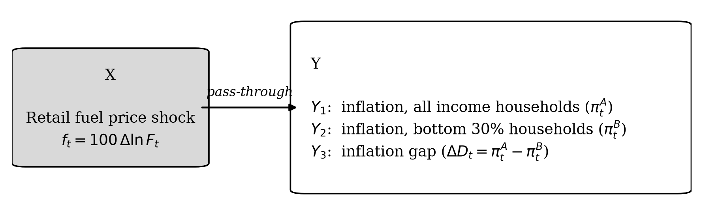
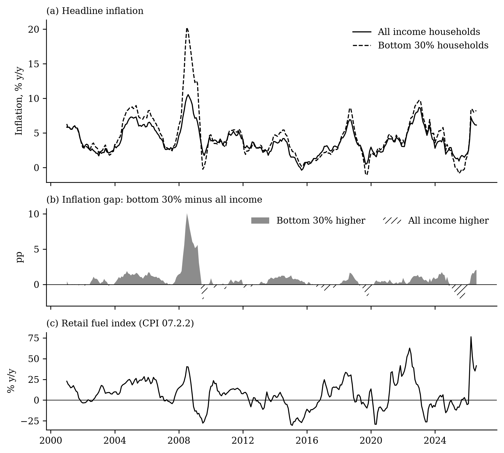
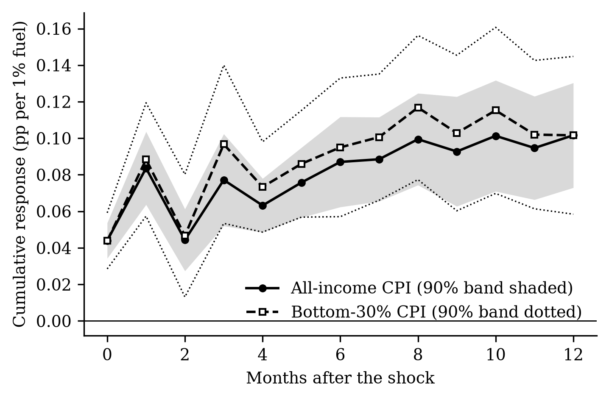
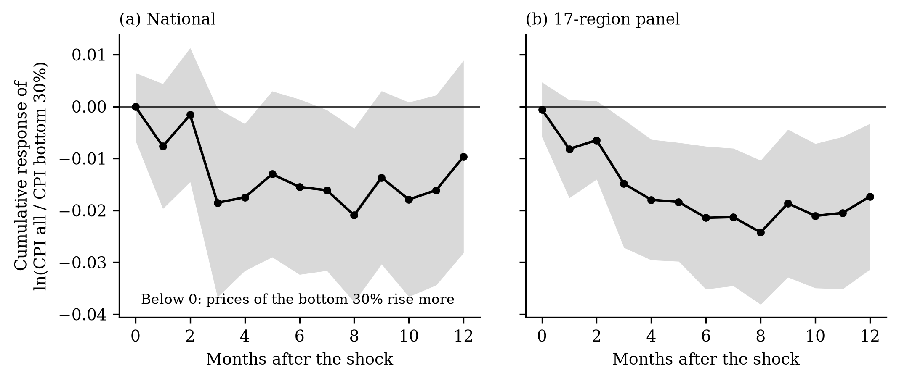
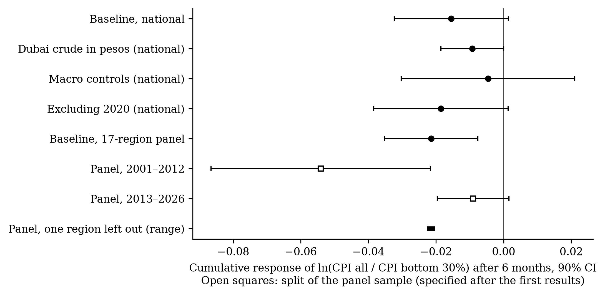
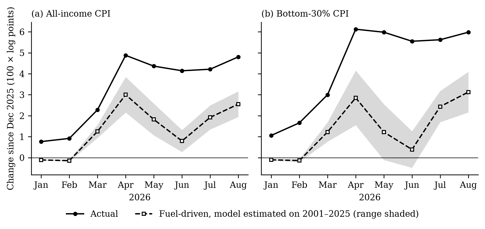
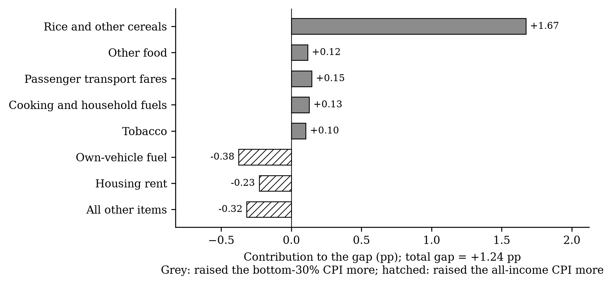
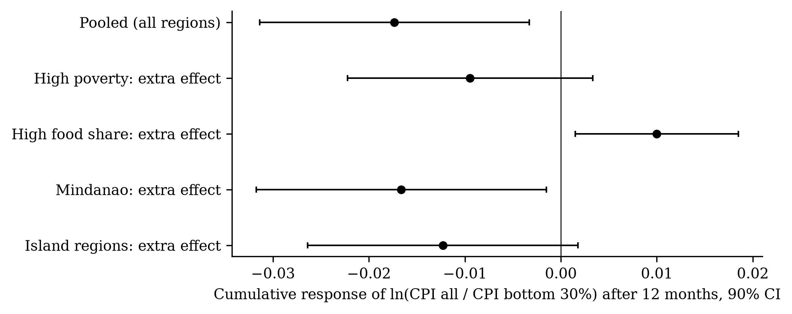
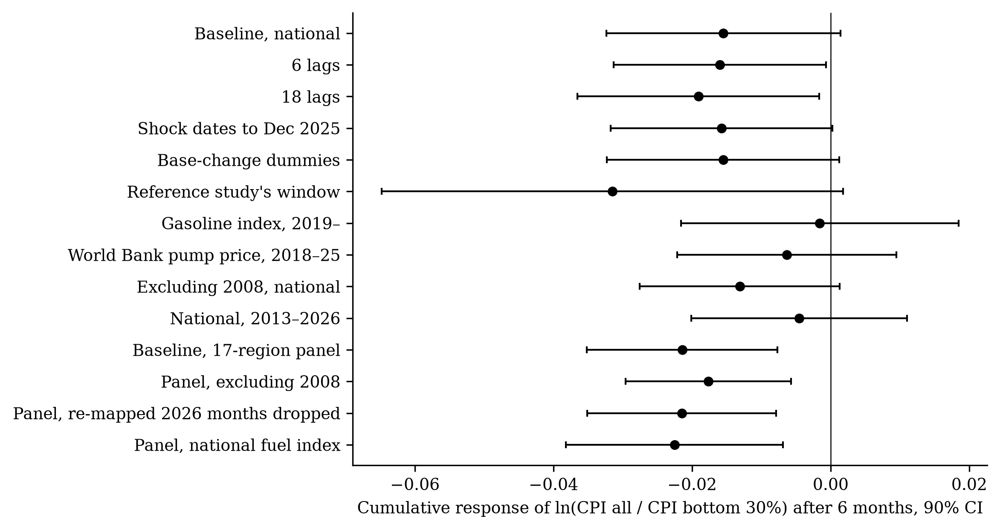

[^aff]: {{ affiliation }}.

# 1. Introduction

When oil prices rise, who pays? The question matters for every government that must decide whether to cut fuel taxes, subsidise fuel or transfer cash after an oil shock. The best cross-country evidence gives a clear answer. Using retail fuel prices for 122 countries and price indices for income quintiles rebuilt from household surveys, @kpodar_liu_2022 find that fuel price increases are *progressive*: the richest households' prices rise more, because they spend more on cars and fuel. If this holds generally, broad fuel tax relief mainly helps the better-off.

This paper tests that finding within one country, the Philippines, where it may not hold. Poor Filipino households spend more than half of their budget on food ({{ n.w_food_b30 }}% in the 2018 basket, against {{ n.w_food_all }}% for all households) and travel by public transport, so they may feel oil shocks mostly through food and fares rather than through fuel. Moreover, the cross-country method gives every income group the same price for each spending category and lets only budget shares differ. Yet households with different incomes buy different items within categories and pay different prices for them [@kaplan_schulhofer_2017; @jaravel_2021]. The Philippine Statistics Authority (PSA) publishes an official consumer price index (CPI) for the bottom 30% income households, monthly and by region, built from their own budget shares at a detailed item level. This allows a direct test that captures both channels.

The question became urgent in 2026. An oil shock caused by the conflict in the Middle East raised the CPI sub-index for retail motor fuels {{ n.yoy_fuel_apr }}% above its level a year earlier by April. Headline inflation rose from {{ n.yoy_all_feb }}% in February to {{ n.yoy_all_apr }}% in April, and inflation for the bottom 30% reached {{ n.yoy_b30_apr }}%. Republic Act 12316 gave the President standby authority to suspend petroleum excise taxes [@ra12316_2026]; the government used it for LPG and kerosene but not for gasoline and diesel, gave subsidies to transport drivers, and the central bank raised its policy rate {{ n.n_hikes_word }} times.

We ask three questions. How much, and how fast, do retail fuel prices pass through to the price level of all households and of the bottom 30% (RQ1)? Do the bottom 30% face larger price increases than all households, nationally and across regions, and why (RQ2)? What did the 2026 shock cost poor families, and how well were the policy responses targeted (RQ3)?

We find that fuel prices pass through quickly and lastingly: a 10% rise in retail fuel prices makes the price level about {{ n.rq1_all_c12_10pct }}% higher a year later, more than twice what crude oil prices imply. The effect is not progressive. In a panel of 17 regions, the bottom 30%'s price level rises {{ n.pan_c6|replace("−","") }} percentage points more than all households' after six months per 1% fuel price rise, a significant regressive effect; nationally the sign is the same but the estimate is less precise. Budget shares alone would make the effect progressive, so the regressive gap comes from larger price increases within the categories the poor buy. The effect is strongest in 2001–2012 and shrinks with macroeconomic controls. Applied to 2026, a model estimated only on earlier data explains about half of the price surge and predicts the direction of the gap; most of the poor's excess inflation came through rice.

The paper contributes to three literatures. First, it adds a within-country test with official income-group price indices to the cross-country evidence on fuel price pass-through [@kpodar_abdallah_2017; @choi_etal_2018; @kpodar_liu_2022], and finds the opposite sign. Second, it connects that literature to work on inflation inequality [@hobijn_lagakos_2005; @kaplan_schulhofer_2017; @jaravel_2021], showing that differences within categories, which reconstructed indices cannot capture, decide who bears an oil shock. Third, it extends Philippine and Asian work on oil, food and inflation [@jongwanich_park_2011; @allon_pineda_etal_2026; @valera_etal_2025; @fujii_2013; @domingo_etal_2009] to income groups and regions, and to the 2026 shock.

# 2. Framework

Fuel enters almost every price. In the input–output price model [@miller_blair_2009], if margins and other costs are unchanged, a fuel price shock $f_t = 100\,\Delta\ln F_t$ raises the price of good *k* in proportion to its total (direct and indirect) fuel cost share $\phi_k$: $\pi_{k,t} \approx \phi_k f_t$. A group's CPI is a weighted average of item prices with that group's budget shares $w^g_k$, so its inflation is $\pi^g_t \approx \sum_k w^g_k \pi_{k,t}$, and

$$\pi^g_t \approx \Phi^g f_t, \qquad \Phi^g = \sum_k w^g_k \phi_k \qquad\qquad (1)$$

A group's pass-through equals the fuel intensity of its basket. The shock is progressive if the average basket ($g = A$, all households) is more fuel-intensive than the poor's ($g = B$, bottom 30%), and regressive otherwise. We measure the difference with the inflation gap $D_t = 100 \ln(P^A_t / P^B_t)$, whose monthly change is $\Delta D_t = \pi^A_t - \pi^B_t$; a fall in $D$ means the poor's prices rose more. The gap splits exactly into two parts:

$$\pi^A_t - \pi^B_t = \sum_k (w^A_k - w^B_k)\, \pi^A_{k,t} + \sum_k w^B_k\, (\pi^A_{k,t} - \pi^B_{k,t}) \qquad\qquad (2)$$

The first term is a *weights effect*, which is all that cross-country indices built from survey budget shares can capture. The second is a *within-category effect*, which arises because the groups buy different items inside each category. Finally, following @deaton_1989, the rise in a group's CPI approximates the extra spending the group needs to buy the same basket, which lets us express the burden of a shock in pesos. Energy shocks also act through a slower indirect route and through wages and expectations [@kilian_2008; @blanchard_gali_2010], so we trace their effects over a year. Figure 1 summarises the framework.

{width=90%}

# 3. Data and method

## 3.1 Data

All price data are monthly PSA consumer price indices on the 2018 = 100 base [@psa_openstat_2026]: the all-income CPI and its 13 divisions (from January 1994), the bottom-30% CPI (from January 2000; divisions from 2012) and, as the fuel price, the CPI sub-index 07.2.2 for fuels and lubricants for personal transport, nationally and for 17 regions. The reference study's retail price database is not public; the PSA fuel index tracks pump prices closely, with monthly changes correlating at 0.87 with the World Bank's Manila pump price over 2016–2025 and at 0.99 with PSA's gasoline-only index. The bottom-30% series join PSA's own back-calculated series for 2000–2011 and 2012–2017 to the current series. Because the long history exists only for the 17 regions defined before the Negros Island Region was created in 2024, we keep those regions and apply the new-code monthly changes for January–August 2026; the panel is balanced. Robustness checks use Dubai crude oil (World Bank) converted to pesos, the peso–dollar rate (BSP), the BSP policy rate (BIS) and the FAO Food Price Index. Poverty lines and incidence come from PSA. The online appendix lists every source with its link.

## 3.2 Local projections

For each horizon *h* = 0, …, 12 months, we estimate by ordinary least squares the local projection [@jorda_2005] specified by @kpodar_liu_2022:

$$\pi_{t+h} = \alpha_h + \beta_h f_t + \sum_{q=1}^{12} \gamma_{q}\, \pi_{t-q} + \sum_{q=1}^{12} \lambda_{q}\, f_{t-q} + \sum_{l=1}^{h-1} \rho_{l}\, f_{t+l} + \delta_h\, t + \varepsilon_{t+h} \qquad\qquad (3)$$

where $\pi$ is the monthly log change (× 100) of a price index, $f$ the fuel price shock and *t* a linear trend. The twelve lags absorb dynamics and the seasonality of the unadjusted data. The fuel leads $f_{t+1}, \dots, f_{t+h-1}$ remove the effect of later shocks that tend to follow a first one [@teulings_zubanov_2014]. $\beta_h$ is the response of inflation *h* months after a 1% fuel price rise; we report the cumulative response $B_h = \beta_0 + \dots + \beta_h$, the effect on the price level, estimated directly by summing the outcome from *t* to *t + h*. National estimates use Newey–West standard errors with *h* + 1 lags [@newey_west_1987]. The regional version stacks the 17 regions with region fixed effects, each region's own fuel index, and Driscoll–Kraay standard errors, which allow for correlation over time and across regions [@driscoll_kraay_1998]. Bands are 90%. Shock dates run from January 2001 to August 2026. The estimator recovers known responses in simulated data.

RQ1 uses all-income and bottom-30% inflation as outcomes. RQ2 uses $\Delta D_t$; a negative cumulative response is regressive. To separate the two terms of equation (2), we estimate equation (3) for each of the 13 CPI divisions and compute the gap that budget shares alone would produce, $\sum_k B^{(k)}_{12} (w^A_k - w^B_k)/100$, and compare division responses in the two baskets from 2013. The estimation plan was fixed before the first estimate; analyses added afterwards are labelled.

## 3.3 The 2026 episode

For RQ3 we re-estimate the cumulative responses on data ending in December 2025 and apply them to the actual 2026 fuel path: the fuel-driven change in the price level between December 2025 and month *m* is $\sum_{s} B_{m-s} f_s$. We compare this with the actual change, nationally and by region (using the panel estimates and each region's fuel path). The fuel-driven rise in the bottom-30% CPI, multiplied by the official monthly poverty line for a family of five (the 2023 regional threshold carried to December 2025), gives the peso cost. We also estimate the responses of household fuels, fares and cereals in both baskets (2013–2026), and decompose the actual December 2025–August 2026 change in each index by item using the 2018 weights.

# 4. Results

## 4.1 The descriptive record

Over 2001–2026, bottom-30% prices rose by {{ n.d_b30_mean_ann }}% a year on average and all-income prices by {{ n.d_all_mean_ann }}% (Table 2, Figure 2). The poor's inflation was higher in {{ n.d_years_b30_higher }} of {{ n.d_years_total }} years and in {{ n.d_episodes_b30_higher }} of {{ n.d_n_episodes }} episodes in which fuel prices stayed at least 15% above their level a year earlier; the cumulative gap reached {{ n.d_cum_gap_ph }} log points by 2025 and was negative in every region. The gap was largest in 2008, when the oil spike coincided with the rice crisis ({{ n.d_2008_b30 }}% against {{ n.d_2008_all }}%), and second largest in 2026. Price levels are non-stationary and monthly changes stationary (online appendix), supporting the model in changes.

Table: Table 2. Summary statistics of monthly changes (100 × Δln), national, January 2001–August 2026

{{ t.d_summary_full }}

{width=95%}

## 4.2 Pass-through to the price level (RQ1)

A 1% rise in the retail fuel index raises the all-income price level by {{ n.rq1_all_c0 }} percentage points within the month, {{ n.rq1_all_c6 }} after six months and {{ n.rq1_all_c12 }} after a year (Table 3, Figure 3); the bottom-30% level responds similarly ({{ n.rq1_b30_c0 }}, {{ n.rq1_b30_c6 }} and {{ n.rq1_b30_c12 }}). The impact response equals the reference study's advanced-economy estimate ({{ n.kl_adv_b0 }}) and is more than twice its developing-economy estimate ({{ n.kl_dev_b0 }}); the six-month response is close to the developing-economy total ({{ n.kl_dev_cum6 }}). Motor fuel is {{ n.w_fuel_all }}% of the all-income basket, so the direct effect accounts for about {{ n.direct_share_all }}% of the impact response; for the bottom 30% (fuel weight {{ n.w_fuel_b30 }}%) only about {{ n.direct_share_b30 }}%. With Dubai crude in pesos as the shock, the twelve-month response is {{ n.crude_c12 }}, about {{ n.crude_share }}% of the retail estimate.

Table: Table 3. Cumulative responses to a 1% fuel price increase

{{ t.main }}

::: {custom-style="Table Note"}
*Notes:* Cumulative response (percentage points) of 100 × ln of each index. Gap = 100 × ln(CPI all/CPI bottom 30%); negative values mean bottom-30% prices rise more. National: Newey–West standard errors; panel: region fixed effects, Driscoll–Kraay standard errors; in parentheses. \* *p* < 0.10, \*\* *p* < 0.05, \*\*\* *p* < 0.01.
:::

{width=80%}

## 4.3 Who pays more? (RQ2)

The cumulative response of the gap is negative at every horizon after the first month (Table 3, Figure 4). Nationally it is {{ n.rq2_c6 }} (standard error {{ n.rq2_c6_se }}) after six months and {{ n.rq2_c12 }} after twelve, significant at the 10% level at horizons {{ n.rq2_sig_h }}. In the regional panel it is {{ n.pan_c6 }} ({{ n.pan_c6_se }}) after six months and {{ n.pan_c12 }} ({{ n.pan_c12_se }}) after twelve, both significant. A 10% fuel price rise thus raises the poor's price level about {{ n.gap6_10pct }} percentage points more than the average after six months, against a total rise of about {{ n.all6_10pct }}%. The progressive hypothesis is rejected.

{width=95%}

Budget shares cannot explain this sign. Transport, whose prices respond most ({{ n.div_transport }} after a year), is {{ n.w_transport_all }}% of the all-income basket but {{ n.w_transport_b30 }}% of the poor's. If both groups faced the same price changes within divisions, the twelve-month gap would be progressive ({{ n.gap_weights_only }}; online appendix Table A1). The regressive gap must therefore come from the second term of equation (2). The bottom-30% division indices confirm it (Table 4): the poor's housing and utilities index rises {{ n.why_c04_b30 }} per 1% fuel price rise against {{ n.why_c04_all }} for all households, and their food index {{ n.why_c01_b30 }} against {{ n.why_c01_all }}, while their transport index, mostly fares, rises less ({{ n.why_c07_b30 }} against {{ n.why_c07_all }}).

Table: Table 4. Response after 12 months of the same divisions in the two baskets, 2013–2026

{{ t.why }}

::: {custom-style="Table Note"}
*Notes:* Cumulative response per 1% fuel price increase; national; Newey–West standard errors in parentheses. Exploratory analysis added after the first results.
:::

## 4.4 Robustness

The sign survives the core checks (Table 5, Figure 5). With Dubai crude in pesos as the shock the six-month gap is {{ n.rob_crude }}; excluding 2020 it is {{ n.rob_x20 }}; leaving out one region at a time keeps it between {{ n.loo_min }} and {{ n.loo_max }}. Two results qualify it. With controls for the exchange rate, the policy rate and world food prices it falls to {{ n.rob_macro }}, and splitting the panel gives {{ n.split_p1 }} ({{ n.split_p1_se }}) over 2001–2012 but {{ n.split_p2 }} ({{ n.split_p2_se }}) over 2013–2026. The regressive effect is robust in sign but concentrated in the 2000s, the decade of the 2008 rice crisis. Twelve further checks, and tests of whether the gap differs in poorer, more food-dependent, Mindanao or island regions (no difference survives a correction for multiple tests), are in the online appendix.

Table: Table 5. Robustness of the gap

{{ t.robust }}

{width=85%}

## 4.5 The 2026 oil shock (RQ3)

Estimated only on data to December 2025, the model attributes {{ n.e1_all_fd }} log points (range {{ n.e1_all_lo }} to {{ n.e1_all_hi }}) of the {{ n.e1_all_act }}-point rise in the all-income CPI between December 2025 and August 2026 to fuel, and {{ n.e1_b30_fd }} ({{ n.e1_b30_lo }} to {{ n.e1_b30_hi }}) of the {{ n.e1_b30_act }}-point rise in the bottom-30% CPI: about half (Figure 6). It also predicts that the poor would pay more ({{ n.e1_gap_fd }} of the {{ n.e1_gap_act }}-point actual gap). Prices did not fall back when fuel eased in May–June, as the model predicted.

{width=95%}

For a family of five at the poverty line (about PHP {{ n.e3_ph_line }} a month), the fuel-driven cost increase by August 2026 was about PHP {{ n.e3_ph_cost }} a month nationally, from PHP {{ n.e3_min }} in {{ n.e3_min_reg }} to PHP {{ n.e3_max }} in the {{ n.e3_max_reg }} (Table 6); counting all price increases it was about PHP {{ n.e3_ph_actual_cost }}. Actual bottom-30% inflation was highest in {{ n.e2_top_names }}; fuel explains about {{ n.e2_luz_share }}% of the rise in Luzon's core regions but only {{ n.e2_mind_share }}% in Mindanao.

Table: Table 6. The 2026 shock by region, December 2025 to August 2026

{{ t.regional2026 }}

::: {custom-style="Table Note"}
*Notes:* 100 × log points. Fuel-driven rise from panel responses estimated to December 2025 (national model for the Philippines); indicative range in brackets. Extra cost for a family of five at the official poverty line. †Boundary changed in 2024.
:::

Between December 2025 and August 2026 the bottom-30% CPI rose {{ n.e5_b30_total }}% and the all-income CPI {{ n.e5_all_total }}%, a gap of {{ n.e5_total_gap }} points (Figure 7). Rice and other cereals contributed {{ n.e5_cereals_gap }}: their prices rose {{ n.e5_cereal_pct_b30 }}% in the poor's basket, where they weigh {{ n.e5_cereal_w_b30 }}%, against {{ n.e5_cereal_pct_all }}% and {{ n.e5_cereal_w_all }}% in the average basket. Fares added {{ n.e5_fares_gap }} and household fuels {{ n.e5_hhfuel_gap }}; private vehicle fuel ({{ n.e5_ownfuel_gap }}) and rent ({{ n.e5_rent_gap }}) worked the other way. Historically, cereal prices barely respond to pump prices within a year (Table 7), so the 2026 rice increase likely reflects fertilizer and freight costs and import policy [@usda_fas_2026] as much as fuel; the data cannot separate these. LPG responds equally in both baskets and has equal budget shares ({{ n.e4_e0452_all_w }}% and {{ n.e4_e0452_b30_w }}%); kerosene responds strongly but is {{ n.e4_e0453_b30_w }}% of the poor's basket; charcoal and wood ({{ n.e4_e0454_b30_w }}% of the poor's basket) do not respond.

{width=85%}

Table: Table 7. Household fuels, fares and cereals: budget shares and responses after 12 months, 2013–2026

{{ t.household }}

::: {custom-style="Table Note"}
*Notes:* Cumulative response per 1% fuel price increase, national, Newey–West standard errors in parentheses. \* *p* < 0.10, \*\* *p* < 0.05, \*\*\* *p* < 0.01.
:::

# 5. Discussion and policy implications

The cross-country finding that fuel shocks are progressive does not carry over to the Philippines. The reason is instructive: the poor's budget shares would make the shock progressive, but the prices they pay within food, utilities and fares rise more. Studies that rebuild income-group indices from survey budget shares with common prices cannot see this channel, so they may overstate how progressive fuel shocks are wherever the poor buy different items within categories.

For policy, three implications follow. First, fuel tax relief is poorly targeted, but not because the poor are spared. Relief on gasoline and diesel, which RA 12316 allows but the government did not use in 2026, would mainly benefit households that own vehicles; motor fuel is {{ n.w_fuel_all }}% of the average basket and {{ n.w_fuel_b30 }}% of the poor's. Relief on LPG is neutral between groups, and kerosene relief, though well aimed, is small: about PHP 37 per 11-kg LPG tank is roughly {{ n.lpg_relief_share }}% of the fuel-driven monthly cost for a poverty-line family. Second, the channels that matter for the poor, food, especially rice, and fares, are reached by rice supply measures and fare policy, and by transport subsidies only if they are tied to fare restraint. Third, transfers can be sized and allocated by region with the bottom-30% CPI: on the 2026 evidence, PHP {{ n.e3_ph_cost }}–{{ n.e3_ph_actual_cost }} a month for a poverty-line family of five, kept for at least a year because prices do not fall when fuel eases. For monetary policy, retail fuel prices, not crude prices, measure the inflationary impulse, which builds over at least a year.

The study has limitations. Retail fuel prices may partly respond to domestic conditions; crude oil gives the same sign, but a pure oil supply shock [@kilian_2009; @baumeister_hamilton_2019; @kanzig_2021] would strengthen the causal reading. The comparison is between the bottom 30% and all households, which understates rich–poor differences. Pre-2018 bottom-30% series are back-calculated. The regressive effect is concentrated in 2001–2012 and sensitive to macroeconomic controls. The 2026 analysis covers eight months, and its decomposition is descriptive. Price indices ignore substitution and income effects.

# 6. Conclusion

Fuel price shocks pass through quickly and lastingly to Philippine consumer prices, and their burden falls at least as heavily on poor households as on others, contrary to the cross-country evidence. The 2026 shock confirmed this pattern and added a large rice-price channel. Protecting the poor from oil shocks therefore calls for transfers sized to their own price index, attention to rice and fares, and restraint in broad fuel tax relief.

# Declarations {-}

**Data and code availability.** All data are public. The replication package (raw files with a source log, cleaned data in CSV, full code in Python and Stata 17, and a codebook) reproduces every number, table and figure; the online appendix lists every source with its link.

**Funding.** [To be completed.] **Conflict of interest.** [To be completed.] **Acknowledgements.** [To be completed.]

# References {-}

::: {#refs}
:::

# Online Appendix {-}

## A.1 Supplementary results

Table: Table A1. Response after 12 months by CPI division and the gap implied by budget shares alone

{{ t.divisions }}

::: {custom-style="Table Note"}
*Notes:* National; Newey–West standard errors in parentheses. Last column: response × (all-income share − bottom-30% share) ÷ 100; positive values push toward a progressive gap.
:::

Table: Table A2. The gap in groups of regions (17-region panel, Driscoll–Kraay standard errors)

{{ t.groups }}

{width=80%}

Table: Table A3. Further robustness checks

{{ t.robust_app }}

{width=85%}

Table: Table A4. Annual inflation by group and fuel price change, 2001–2026

{{ t.d_annual }}

Table: Table A5. Fuel-shock episodes

{{ t.d_episodes }}

Table: Table A6. Augmented Dickey–Fuller tests, 2001–2026

{{ t.d_adf }}

## A.2 Data appendix

The replication package is the repository <https://github.com/liancataytayjk-coder/oil-shock-distribution>. The command `./run_all.sh` (Python 3.11) or `code/stata/00_master.do` (Stata 17) rebuilds everything from the raw files; `codebook/codebook.xlsx` documents every raw and cleaned variable. All files were downloaded on 4 October 2026.

{{ t.sources_art }}

Table: Table A7. Sources, scripts and output files

{{ t.results_art }}
