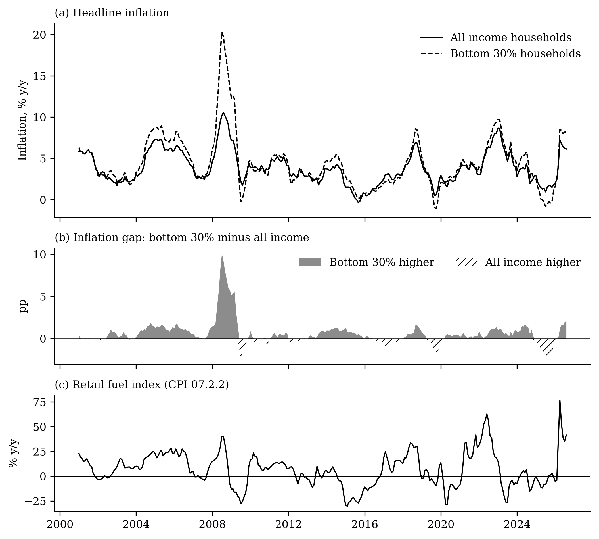
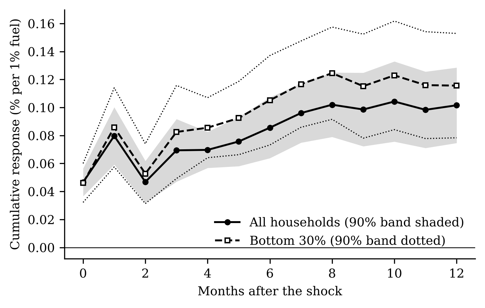
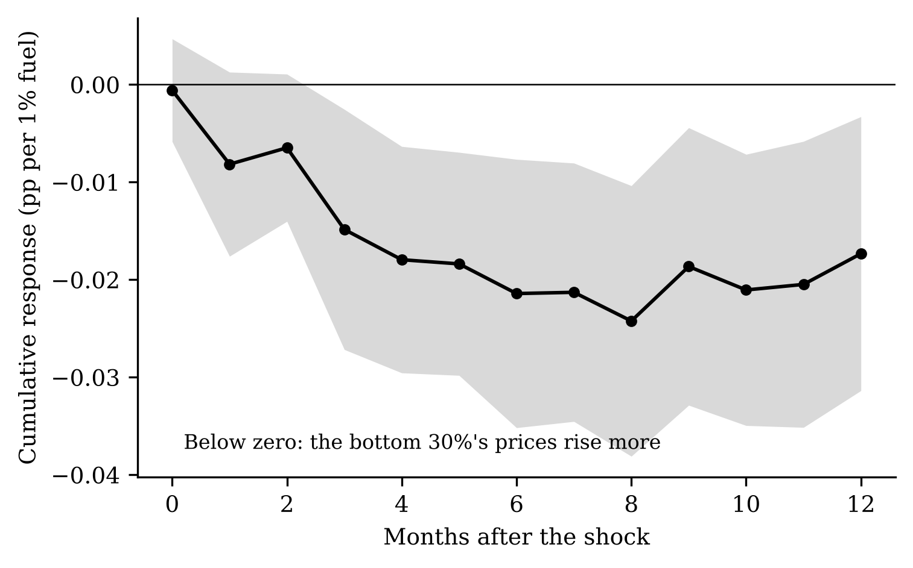
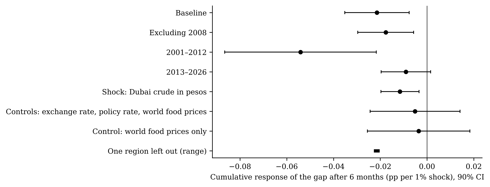
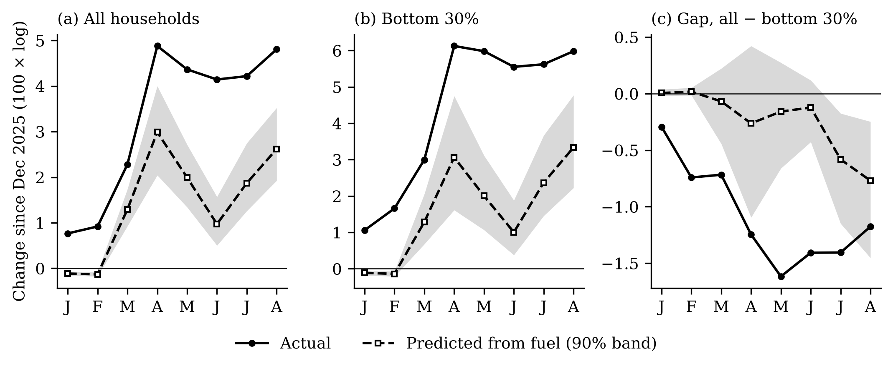
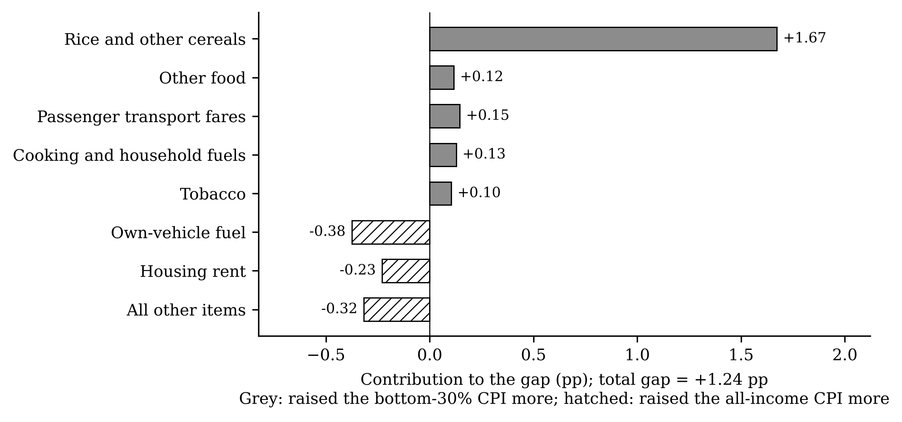

# 1. Introduction

When the price of oil rises, households pay more for fuel and, with a delay, for almost everything that fuel helps to produce and move. Whether poor households pay more than others is a question with direct policy consequences. Governments respond to oil shocks with fuel tax relief, fuel subsidies and cash transfers, and each response rests on an assumption about who bears the cost.

The most comprehensive evidence on this question comes from @kpodar_liu_2022. Using retail fuel prices for 122 countries and consumer price indices for income quintiles that they rebuild from household budget surveys, they find that fuel price increases are *progressive*: the price level of the richest households rises more than that of the poorest, because richer households spend more on vehicle fuel. Their indices, however, assign the same price change to every income group within each spending category and let only the budget shares differ. If poor households buy different items within a category, and those items respond differently to fuel prices, rebuilt indices cannot detect it [@jaravel_2021].

The Philippines offers a direct test. The Philippine Statistics Authority publishes an official consumer price index for the bottom 30% of households by income, monthly and for each of 17 regions, built from that group's own budget shares at a detailed item level. Poor Filipino households spend 54.9% of their budget on food, against 37.7% for all households, and 1.59% on fuel for their own vehicles, against 2.39%. The question also became pressing in 2026, when an oil shock raised the retail fuel price index 76% above its level a year earlier and inflation for the bottom 30% reached 8.5% in April.

We make three contributions. First, we estimate the pass-through of retail fuel prices to the price level of all households and of the bottom 30% in a panel of 17 regions, with local projections [@jorda_2005] specified as in @kpodar_liu_2022. A 1% rise in fuel prices raises the all-household price level by 0.047% in the month of the shock and by 0.102% after a year. Second, we show that the effect is regressive, the opposite of the cross-country result. Six months after a shock, the price level of the bottom 30% has risen 25% more than that of all households, and the difference is significant at every horizon from 3 to 12 months. A budget-share calculation predicts a progressive effect, so the regressive gap must arise from faster price increases within the categories the poor buy; we show that it moves with food prices. Third, we test the estimates out of sample. Responses estimated on data ending in December 2025 predict a 2026 gap of −0.77 log points (90% bootstrap band −1.45 to −0.25), against an actual −1.18, and put the fuel-driven cost to a family of five at the poverty line at PHP 499 a month.

To the best of our knowledge, this is the first study to estimate the distributional pass-through of fuel prices with an official price index for low-income households. Section 2 reviews the related literature. Section 3 sets out a simple framework. Section 4 describes the data and the method. Section 5 presents the results, and Section 6 applies them to the 2026 oil shock. Section 7 concludes.

# 2. Related literature

The first strand of literature studies how oil price shocks reach consumer prices. @kilian_2009 separates oil supply shocks from shocks to global demand for commodities and to demand specific to oil, and shows that their effects on prices and activity differ. @blanchard_gali_2010 find that oil shocks had much smaller effects on inflation in the 2000s than in the 1970s, which they attribute to weaker wage responses, more credible monetary policy and a smaller oil share in production. @kanzig_2021 identifies oil supply news from futures price movements around OPEC announcements and finds that such news raises prices and inflation expectations immediately. These studies trace effects over time and distinguish the source of the shock; they do not ask who bears it.

The second strand measures pass-through to inflation. @kpodar_abdallah_2017 build a database of monthly retail fuel prices for 162 countries and find that changes in world crude prices reach pump prices within about six months, more fully for increases than for decreases. @choi_etal_2018 estimate for 72 countries that a 10% rise in world oil prices raises inflation by about 0.4 percentage points on impact. @gelos_ustyugova_2017 find larger and more persistent effects where food and fuel weigh more in the basket. In developing Asia during the 2007–2008 price spike, subsidies and price controls limited the pass-through [@jongwanich_park_2011]. For the Philippines, @allon_pineda_etal_2026 find with local projections that oil and food price shocks have persistent effects on national inflation, and @valera_etal_2025 find across provinces that energy and rice prices raise inflation more when inflation is already high. None of these studies distinguishes income groups. @kpodar_liu_2022 do, with the rebuilt indices described above, and find a progressive effect that persists beyond a year in developing economies.

The third strand asks who bears fuel price changes. Richer households capture most of the benefit of fuel subsidies [@coady_etal_2015], and energy price increases tend to be progressive in poorer countries because energy budget shares first rise and then fall with income [@dorband_etal_2019]. Both conclusions rest on budget shares. Studies of inflation inequality point to a channel that budget shares miss: households with different incomes face different price changes within the same categories [@jaravel_2021]. In the Philippines, the food price increases of 2006–2008 raised poverty, and the poorest households were affected most whether or not they farmed [@fujii_2013]. Rice, the largest single item in the poor's basket, also responds to trade policy: the 2019 rice tariffication law lowered rice prices, and the poorest quintiles gained most [@balie_etal_2021].

Our study joins these strands. We estimate pass-through as in the second strand, ask the distributional question of the third, and answer it with official prices that capture differences within categories.

# 3. Framework

Fuel is an input to almost every good. In the input–output price model [@miller_blair_2009], if margins and other costs are unchanged, a fuel price shock $f_t = 100\,\Delta \ln F_t$ raises the price of good *k* in proportion to its total fuel cost share $\phi_k$, so that $\pi_{k,t} \approx \phi_k f_t$. A group's consumer price index weights item prices by that group's budget shares $w^g_k$, so

$$\pi^g_t \approx \Phi^g f_t, \qquad \Phi^g = \sum_k w^g_k\, \phi_k. \qquad\qquad (1)$$

Intuitively, a group's pass-through equals the fuel intensity of its basket. We measure the difference between the two groups with the *inflation gap*, $D_t = 100 \ln(P^A_t / P^B_t)$, where *A* denotes all households and *B* the bottom 30%. Its monthly change is $\Delta D_t = \pi^A_t - \pi^B_t$, so a negative response of the gap means that the poor's prices rise more; we call such an effect *regressive*. The gap splits exactly into two terms:

$$\pi^A_t - \pi^B_t = \sum_k (w^A_k - w^B_k)\, \pi^A_{k,t} + \sum_k w^B_k\, (\pi^A_{k,t} - \pi^B_{k,t}). \qquad\qquad (2)$$

The first term is a *weights effect*: the gap that arises because the groups divide their budgets differently across categories. The second is a *within-category effect*: the gap that arises because the groups buy different items within a category, whose prices change differently. Indices rebuilt from budget shares with common category prices capture only the first term. Finally, following @deaton_1989, the rise in a group's price index approximates the extra spending the group needs to buy the same basket, which lets us express the burden of a shock in pesos.

# 4. Data and method

## 4.1 Data

All price data are monthly consumer price indices of the Philippine Statistics Authority on the 2018 = 100 base [@psa_openstat_2026], for 17 regions. The shock is the change in the sub-index 07.2.2, fuels and lubricants for personal transport, which measures retail gasoline and diesel prices. Its monthly changes correlate at 0.87 with the World Bank's Manila pump price over 2016–2025. The outcomes are the all-household index and the bottom-30% index of each region. The bottom-30% series join the statistics authority's own back-calculated series for 2000–2017 to the current series.[^splice] Because these back-calculations exist only for the 17 regions defined before the Negros Island Region was created in 2024, we keep the 17-region map and extend it to August 2026 with the monthly changes published on the new map.[^nir] The panel is balanced, and the shock dates run from January 2001 to August 2026, which gives 5,219 region-months at the first horizon.

The robustness checks use Dubai crude oil in pesos [@worldbank_cmo_2026], the peso–dollar exchange rate and the policy interest rate of the central bank, and the FAO world food price index; these national series are the same for every region in a month. The budget-share calculation uses the 2018 weights of the two baskets and the national division indices. Poverty lines come from the statistics authority.

[^splice]: The back-calculated series are joined in January 2012 and January 2018. Monthly changes in the gap are larger in those two months than on average; dummies for them leave the national gap unchanged to three decimals.

[^nir]: The new map changes the boundaries of Regions VI, VII and XII and of the Bangsamoro region. Dropping their re-mapped 2026 months leaves the gap at six months unchanged to three decimals.

## 4.2 Panel local projections

For each horizon *h* = 0, 1, …, 12 months, we estimate by ordinary least squares the panel version of the specification of @kpodar_liu_2022:

$$\sum_{j=0}^{h} y_{r,t+j} = \mu_{r,h} + B_h f_{r,t} + \sum_{q=1}^{12} \gamma_{q,h}\, y_{r,t-q} + \sum_{q=1}^{12} \lambda_{q,h}\, f_{r,t-q} + \sum_{l=1}^{h-1} \rho_{l,h}\, f_{r,t+l} + \delta_h\, t + \varepsilon_{r,t+h}, \qquad\qquad (3)$$

where $y_{r,t}$ is monthly inflation (or the change in the gap) in region *r*, $f_{r,t}$ is the region's fuel shock, $\mu_{r,h}$ is a region fixed effect and *t* is a linear trend. The left-hand side is the change in the log price level from *t* − 1 to *t + h*, so $B_h$ is the *cumulative response*: the percentage change in the price level *h* months after a 1% rise in fuel prices. Intuitively, each horizon is a separate regression of the price level *h* months ahead on today's shock, holding the past constant [@jorda_2005]. The twelve lags absorb the persistence of inflation and the seasonality of the unadjusted indices. The leads $f_{r,t+1}, \dots, f_{r,t+h-1}$ hold constant the further fuel price changes that tend to follow a first one [@teulings_zubanov_2014], so that $B_h$ measures the effect of a single shock; we keep the lead set of the reference study. Lags and leads are built within regions before the sample is restricted, so the first shock dates keep their lags.

Two features of the panel matter for inference. The outcome at horizon *h* overlaps with the outcomes of neighbouring months, so the errors are serially correlated; and every region is hit by the same national events in the same month, so the errors are correlated across regions. We therefore report Driscoll–Kraay standard errors with *h* + 1 lags, which allow both forms of dependence [@driscoll_kraay_1998]. With about 300 months per region, the bias from combining fixed effects with lagged outcomes is negligible. Bands are 90%, as in the reference study. The estimator recovers known responses in simulated data.

## 4.3 The budget-share calculation

To ask whether budget shares can explain the sign of the gap, we apply the weights term of equation (2) to estimated responses. For each of the 13 divisions *k* of the national consumer price index, we estimate the twelve-month cumulative response $B^{(k)}_{12}$ with the national version of equation (3) and compute

$$G^{w} = \sum_{k=1}^{13} B^{(k)}_{12}\, \frac{w^A_k - w^B_k}{100}. \qquad\qquad (4)$$

$G^w$ is the gap that would arise if both groups faced the same price change within each division. A positive value is progressive. The difference between the estimated gap and $G^w$ is the within-category part. This calculation is an accounting exercise outside the regression model: it describes where the gap comes from and does not test a causal channel.

## 4.4 The 2026 out-of-sample test

To test the estimates on an episode they have not seen, we re-estimate equation (3) on data that end in December 2025 and apply the responses to the fuel price changes of 2026. Because responses add up, the fuel-driven change in the log price level between December 2025 and month *m* is

$$\widehat{\Delta \ln P}_{m} = \sum_{s=1}^{m} \widehat{B}_{m-s}\, f_s, \qquad\qquad (5)$$

where $f_s$ is the fuel shock in month *s* of 2026. We apply the panel responses to the national fuel path and compare the prediction with the actual change in the national indices. The prediction combines thirteen estimated coefficients whose sampling errors are correlated across horizons. We therefore compute its uncertainty with a moving-block bootstrap: we resample blocks of 12 consecutive months, with all regions of a month kept together, re-estimate all horizons and recompute equation (5), 999 times. The 90% band is the 5th to 95th percentile of the bootstrap distribution.

# 5. Results

## 5.1 The record

The inflation of the bottom 30% exceeded that of all households in 18 of the 25 years from 2001 to 2025 (Fig. 1). The largest difference occurred in 2008, when the oil price spike coincided with a rice price crisis and annual inflation reached 13.9% for the bottom 30% against 8.2% for all households. In 6 of the 9 episodes in which retail fuel prices stayed at least 15% above their level a year earlier, the poor's inflation was the higher of the two (Table 1). This descriptive record already points away from a progressive effect; the regressions below ask whether it is caused by fuel prices.

*[Figure 1 about here]*

*[Table 1 about here]*

## 5.2 Pass-through to the price level

Retail fuel prices pass through quickly and lastingly (Table 2, Fig. 2). A 1% rise raises the all-household price level by 0.047% in the month of the shock, by 0.086% after six months and by 0.102% after a year, so that a 10% rise in pump prices leaves consumer prices about 1.0% higher a year later. The bottom-30% price level responds by 0.046%, 0.105% and 0.116%. The impact response is of the same size as the advanced-economy estimate of @kpodar_liu_2022 (0.044) and more than twice their developing-economy estimate (0.018). When Dubai crude oil in pesos replaces the retail price as the shock, the twelve-month response falls to 0.041, about 41% of the retail estimate; studies that measure oil shocks with crude prices therefore understate the pass-through to consumers.

*[Table 2 about here]*

*[Figure 2 about here]*

## 5.3 Who pays more?

The gap responds negatively at every horizon (Table 2, Fig. 3). Six months after a 1% fuel price rise, the price level of the bottom 30% has risen 0.0214 percentage points more than that of all households (standard error 0.0084, *t* = 2.56); after a year the difference is 0.0173 points (0.0085). The 90% band excludes zero at every horizon from 3 to 12 months. In relative terms, the poor's price level rises about 25% more than the average household's: a 10% rise in pump prices raises average prices by 0.86% after six months and the prices of the bottom 30% by about 0.21 percentage points more.[^sep] The progressive effect found across countries does not hold in the Philippines; the effect is regressive.

[^sep]: The difference between the separate responses in Table 2 is 0.0196 at six months, close to the direct estimate of the gap. The two need not coincide, because the separate regressions control for each group's own past inflation while the gap regression controls for the past gap.

*[Figure 3 about here]*

## 5.4 Why the poor pay more

Budget shares predict the opposite sign (Table 3). If both groups faced the same price change within each division, the twelve-month gap would be +0.0101, a progressive effect. Food pushes the gap toward regressive (−0.0124), because the poor spend more on it. Housing and utilities (+0.0092) and transport (+0.0108) push it the other way, because the average household spends more on them and transport prices respond most to fuel (0.370 after a year). Since the estimated gap is −0.0173, the within-category part is about −0.0274: prices rise faster within the categories the poor buy, by more than enough to reverse the sign implied by their budget shares.

*[Table 3 about here]*

The bottom-30% division indices, which the statistics authority publishes nationally from 2013, point to the same channel. Over 2013–2026, the twelve-month response of the poor's housing and utilities index, which includes cooking fuels, is 0.182 against 0.142 for all households, and that of their food index is 0.067 against 0.055. Their transport index, mostly fares, responds less (0.196 against 0.300).[^why] The poor pay more because the goods they buy within food and utilities become relatively more expensive, not because they buy more fuel.

[^why]: These comparisons are exploratory: they were added after the first results and cover only the period for which bottom-30% division indices exist. Because item-level indices for the bottom 30% start in 2013, the 2008 episode cannot be decomposed by item.

## 5.5 Robustness

Table 4 and Fig. 4 report five checks on the gap. The result does not depend on any single region: leaving out each region in turn keeps the six-month gap between −0.0227 and −0.0203. It does not depend on 2008: excluding the shock dates of that year gives −0.0177 (0.0073). It survives a shock measured by a price set in world markets: with Dubai crude oil in pesos, the gap is −0.0116 (0.0050) after six months and −0.0103 (0.0049) after a year. The effect is, however, concentrated in the first half of the sample: −0.0541 (0.0197) for shock dates in 2001–2012, against −0.0091 (0.0064) in 2013–2026.

*[Table 4 about here]*

*[Figure 4 about here]*

The fifth check qualifies the result. When the regression controls for the exchange rate, the policy rate and world food prices, the six-month gap falls to −0.0051 (0.0117); world food prices alone have the same effect (−0.0036, 0.0133). The poor's extra burden therefore moves with world food prices, and the data admit two readings. In the first, food is the channel through which fuel prices reach the poor: fuel is an input to growing, processing and moving food, and twelve-month changes in world food prices correlate at 0.56 with retail fuel prices and at 0.64 with crude oil in pesos over 2001–2026. Conditioning on a variable that the shock itself moves removes part of the effect being measured [@angrist_pischke_2009]. In the second reading, a common commodity cycle, such as a rise in global demand [@kilian_2009], raises oil and food prices together, and part of the gap reflects that cycle rather than fuel. Our data cannot separate the two readings. We therefore state the result as follows: fuel price shocks in the Philippines are not progressive, and the additional burden on the poor arrives together with, and plausibly through, food prices.

# 6. The 2026 oil shock

## 6.1 An out-of-sample test

Between December 2025 and April 2026 retail fuel prices rose 53.7 log points. The responses estimated on data to December 2025 predict 2.62 of the 4.81-point rise in the all-household price level by August 2026 and 3.34 of the 5.98-point rise in the bottom-30% level, a little more than half in both cases (Table 5, Fig. 5). They also predict the direction and most of the size of the gap: −0.77 log points, with a 90% bootstrap band from −1.45 to −0.25 that excludes zero, against an actual −1.18. A model that never saw 2026 thus anticipated that the poor would pay more. The unexplained part of the surge is consistent with the observation that prices did not fall back when fuel prices eased in May and June.

*[Table 5 about here]*

*[Figure 5 about here]*

## 6.2 The cost to poor families

For a family of five living at the poverty line, about PHP 14,714 a month at December 2025 prices, the fuel-driven rise in the bottom-30% price level implies an extra cost of PHP 499 a month by August 2026 (90% band PHP 331 to 719). About PHP 109 of it (band PHP 24 to 228) is the excess over what the same family would pay at the average household's inflation. Counting every price increase, not only the fuel-driven part, the extra cost was PHP 907. Across regions, applying the same responses to each region's fuel path, the fuel-driven cost ranges from PHP 390 in XII SOCCSKSARGEN to PHP 633 in the National Capital Region (Table 6). The burden is thus large for everyone, and about a quarter larger for the poor.

*[Table 6 about here]*

## 6.3 Which prices drove the gap

A descriptive accounting of the 2026 episode identifies the items behind the gap. For a fixed-weight index, the contribution of item *k* to the change in group *g*'s index between December 2025 and August 2026 is $w^g_k (I^g_{k,m} - I^g_{k,0}) / I^g_0$, and the contributions add up to the change in the index. By this accounting, the bottom-30% index rose 6.16% and the all-household index 4.92%, a difference of +1.24 points (Fig. 6). Rice and other cereals contributed +1.67 points: cereal prices rose 18.3% in the poor's basket, where cereals weigh 19.6%, against 15.7% and 9.4% in the average basket. Fares added +0.15 and household fuels +0.13, while fuel for private vehicles (−0.38) and rent (−0.23) narrowed the gap. The 2026 rice increase also reflects fertiliser and freight costs and import policy [@usda_fas_2026]; the accounting describes the gap and does not attribute it to fuel.

*[Figure 6 about here]*

## 6.4 Implications for policy

The results bear on the policy responses of 2026. Republic Act 12316 allows the President to suspend fuel excise taxes when world oil prices are high [@ra12316_2026]; the government suspended the excise on liquefied petroleum gas and kerosene but not on gasoline and diesel, subsidised transport drivers, and raised the policy rate three times. Relief on gasoline and diesel would mainly benefit households that own vehicles, since motor fuel is 2.39% of the average basket and 1.59% of the poor's. The suspension on liquefied petroleum gas saves a family about PHP 37 per 11-kg tank, roughly 7% of the fuel-driven monthly cost estimated above. Because the poor's extra burden arrives through food and fares, measures on rice supply and fares reach it more directly than fuel tax relief. Transfers can be sized with the bottom-30% index and the estimates of Section 6.2, and kept for at least a year, because prices did not fall when fuel prices eased.

# 7. Conclusion

We estimated the pass-through of retail fuel prices to the price level of poor and average households in a panel of 17 Philippine regions. Three findings stand out. First, pass-through is fast and lasting: a 10% rise in pump prices leaves consumer prices about 1.0% higher a year later, more than twice what crude prices imply. Second, the effect is regressive, contrary to cross-country evidence built on budget shares: the price level of the bottom 30% rises about a quarter more, and budget shares alone would predict the opposite sign. Third, responses estimated before 2026 predicted most of the poor's excess inflation during the 2026 shock.

The study has limitations. The regressive gap moves with world food prices, and our data cannot separate a food channel from a common commodity cycle; an exogenous measure of oil supply shocks [@kilian_2009; @kanzig_2021] would sharpen the causal reading. The gap is concentrated in 2001–2012 and is small and imprecise after 2013. The comparison is between the bottom 30% and all households, which understates the difference between the poorest and the richest. The bottom-30% series before 2018 are back-calculated, and the decompositions are descriptive. Future work could use household survey data to separate net buyers from net sellers of rice, whose exposure to an oil shock differs.

# Declarations {-}

**Data and code availability.** All data are public. A replication package with the raw data, a source log, the cleaned data, Python and Stata 17 code and a codebook reproduces every number, table and figure; its location is given on the title page.

# References {-}

::: {#refs}
:::


```{=openxml}
<w:p><w:r><w:br w:type="page"/></w:r></w:p>
```

{width=88%}

```{=openxml}
<w:p><w:r><w:br w:type="page"/></w:r></w:p>
```

Table: Table 1. Fuel price episodes: at least three months with retail fuel prices 15% or more above their level a year earlier

| Episode | Months | Peak fuel price change, y/y (%) | Inflation, all (%) | Inflation, bottom 30% (%) | Gap, bottom 30% − all (pp) |
|----------------|-------|-------------|----------|------------|-------------|
| 2001-01 to 2001-03 | 3 | 22.8 | 5.83 | 5.90 | +0.07 |
| 2004-06 to 2006-09 | 28 | 28.3 | 6.21 | 7.53 | +1.32 |
| 2008-02 to 2008-10 | 9 | 40.3 | 8.50 | 14.68 | +6.17 |
| 2010-01 to 2010-05 | 5 | 23.5 | 3.92 | 3.88 | −0.04 |
| 2017-01 to 2017-03 | 3 | 24.6 | 2.88 | 2.12 | −0.76 |
| 2017-09 to 2017-11 | 3 | 15.9 | 3.06 | 2.61 | −0.44 |
| 2018-02 to 2018-11 | 10 | 33.5 | 5.42 | 6.22 | +0.81 |
| 2021-04 to 2022-12 | 21 | 62.7 | 4.99 | 5.52 | +0.53 |
| 2026-03 to 2026-08 | 6 | 76.3 | 6.14 | 7.58 | +1.44 |

::: {custom-style="Table Note"}
*Notes:* National series. Inflation is the average year-on-year rate during the episode.
:::

```{=openxml}
<w:p><w:r><w:br w:type="page"/></w:r></w:p>
```

Table: Table 2. Cumulative response of the price level to a 1% rise in retail fuel prices, 17-region panel

| Months after the shock (*h*) | All households | Bottom 30% | Gap (all − bottom 30%) |
|-------------|------------------|------------------|-------------------|
| 0 | 0.047*** (0.006) | 0.046*** (0.008) | −0.0006 (0.0032) |
| 1 | 0.080*** (0.012) | 0.086*** (0.017) | −0.0082 (0.0057) |
| 3 | 0.069*** (0.014) | 0.082*** (0.020) | −0.0149** (0.0075) |
| 6 | 0.086*** (0.013) | 0.105*** (0.019) | −0.0214** (0.0084) |
| 9 | 0.099*** (0.016) | 0.115*** (0.023) | −0.0187** (0.0086) |
| 12 | 0.102*** (0.016) | 0.116*** (0.023) | −0.0173** (0.0085) |

::: {custom-style="Table Note"}
*Notes:* Percentage change in the price level (gap: percentage points) *h* months after the shock; equation (3), shock dates January 2001–August 2026, region fixed effects; Driscoll–Kraay standard errors in parentheses. \* *p* < 0.10, \*\* *p* < 0.05, \*\*\* *p* < 0.01.
:::

```{=openxml}
<w:p><w:r><w:br w:type="page"/></w:r></w:p>
```

{width=72%}

```{=openxml}
<w:p><w:r><w:br w:type="page"/></w:r></w:p>
```

{width=72%}

```{=openxml}
<w:p><w:r><w:br w:type="page"/></w:r></w:p>
```

Table: Table 3. The gap implied by budget shares alone, twelve months after a 1% rise in retail fuel prices

| CPI division | Weight, all (%) | Weight, bottom 30% (%) | Response, 12 months | Contribution to the gap |
|------------------------------|---------|----------|---------------|--------------|
| Food and non-alcoholic beverages | 37.7 | 54.9 | 0.072** (0.033) | −0.0124 |
| Housing, water, electricity, gas and other fuels | 21.4 | 15.5 | 0.158*** (0.015) | +0.0092 |
| Transport | 9.0 | 6.1 | 0.370*** (0.044) | +0.0108 |
| Restaurants and accommodation | 9.6 | 7.5 | 0.063*** (0.018) | +0.0013 |
| Other nine divisions | 22.2 | 15.9 |  | +0.0012 |
| (a) Gap implied by budget shares |  |  |  | +0.0101 |
| (b) Estimated gap, panel |  |  |  | −0.0173 |
| (c) Within-category part, (b) − (a) |  |  |  | −0.0274 |

::: {custom-style="Table Note"}
*Notes:* Descriptive calculation, equation (4). Response: cumulative twelve-month response of the national all-household division index (Newey–West standard errors in parentheses). Contribution = response × (weight, all − weight, bottom 30%) ÷ 100; positive values push toward a progressive gap. Weights: 2018 baskets.
:::

```{=openxml}
<w:p><w:r><w:br w:type="page"/></w:r></w:p>
```

Table: Table 4. Robustness of the gap

| Specification | Gap, 6 months | Gap, 12 months |
|---------------------------------|------------------|------------------|
| Baseline | −0.0214** (0.0084) | −0.0173** (0.0085) |
| One region left out (range over 17 regions) | −0.0227 to −0.0203 | −0.0189 to −0.0156 |
| Excluding 2008 | −0.0177** (0.0073) | −0.0135 (0.0092) |
| Shock dates 2001–2012 | −0.0541*** (0.0197) | −0.0369** (0.0147) |
| Shock dates 2013–2026 | −0.0091 (0.0064) | −0.0063 (0.0075) |
| Shock: Dubai crude oil in pesos | −0.0116** (0.0050) | −0.0103** (0.0049) |
| Controls: exchange rate, policy rate, world food prices | −0.0051 (0.0117) | 0.0057 (0.0138) |
| Control: world food prices only | −0.0036 (0.0133) | 0.0115 (0.0182) |

::: {custom-style="Table Note"}
*Notes:* Cumulative response of the gap per 1% shock, 17-region panel; Driscoll–Kraay standard errors in parentheses. Controls enter with their current value and twelve lags. \* *p* < 0.10, \*\* *p* < 0.05, \*\*\* *p* < 0.01.
:::

```{=openxml}
<w:p><w:r><w:br w:type="page"/></w:r></w:p>
```

{width=82%}

```{=openxml}
<w:p><w:r><w:br w:type="page"/></w:r></w:p>
```

Table: Table 5. The 2026 shock: predicted and actual change in the price level, December 2025 to August 2026 (100 × log points)

| Price index | Predicted from fuel | 90% bootstrap band | Actual | Share predicted (%) |
|------------------|-------------|---------------|---------|------------|
| All households | 2.62 | [1.92, 3.52] | 4.81 | 54 |
| Bottom 30% | 3.34 | [2.22, 4.77] | 5.98 | 56 |
| Gap (all − bottom 30%) | −0.77 | [−1.45, −0.25] | −1.18 | 65 |

::: {custom-style="Table Note"}
*Notes:* Prediction from equation (5) with panel responses estimated on shock dates January 2001–December 2025, applied to the national fuel path; actual change in the national indices. Bands: moving-block bootstrap, 999 replications, blocks of 12 months.
:::

```{=openxml}
<w:p><w:r><w:br w:type="page"/></w:r></w:p>
```

{width=95%}

```{=openxml}
<w:p><w:r><w:br w:type="page"/></w:r></w:p>
```

Table: Table 6. The 2026 shock by region, December 2025 to August 2026

| Region | Poverty 2018 (%) | Fuel price change (%) | Bottom 30%: predicted | Bottom 30%: actual | Cost (PHP/month) |
|-------------------------|---------|----------|------------|------------|----------|
| National Capital Region | 2.2 | 34.5 | 3.68 | 3.47 | 633 |
| III Central Luzon | 7.0 | 33.9 | 3.50 | 6.00 | 605 |
| IV-A CALABARZON | 7.1 | 34.6 | 3.52 | 4.96 | 596 |
| I Ilocos | 9.9 | 36.3 | 3.68 | 3.82 | 571 |
| II Cagayan Valley | 16.3 | 34.1 | 3.47 | 4.64 | 503 |
| V Bicol | 27.0 | 33.9 | 3.30 | 6.21 | 503 |
| VI Western Visayas† | 14.2 | 31.6 | 3.20 | 7.48 | 478 |
| X Northern Mindanao | 23.1 | 31.7 | 3.17 | 5.30 | 474 |
| Cordillera Administrative Region | 12.0 | 30.7 | 3.30 | 6.36 | 470 |
| IX Zamboanga Peninsula | 32.7 | 29.4 | 3.07 | 7.07 | 457 |
| Bangsamoro Autonomous Region in Muslim Mindanao† | 60.4 | 33.5 | 3.30 | 7.88 | 444 |
| MIMAROPA | 15.1 | 30.9 | 3.13 | 6.44 | 425 |
| VII Central Visayas† | 16.1 | 25.9 | 2.65 | 5.90 | 419 |
| XI Davao | 19.1 | 29.3 | 2.97 | 8.52 | 417 |
| VIII Eastern Visayas | 30.7 | 27.4 | 2.85 | 6.80 | 410 |
| XIII Caraga | 30.5 | 31.1 | 3.11 | 7.10 | 409 |
| XII SOCCSKSARGEN† | 27.3 | 29.6 | 3.00 | 6.10 | 390 |

::: {custom-style="Table Note"}
*Notes:* Predicted: change in 100 × ln of the region's bottom-30% index implied by equation (5) and the region's fuel path. Cost: extra monthly spending of a family of five at the region's official poverty line. †Boundary changed in 2024; 2026 months extended with the new map.
:::

```{=openxml}
<w:p><w:r><w:br w:type="page"/></w:r></w:p>
```

{width=80%}
