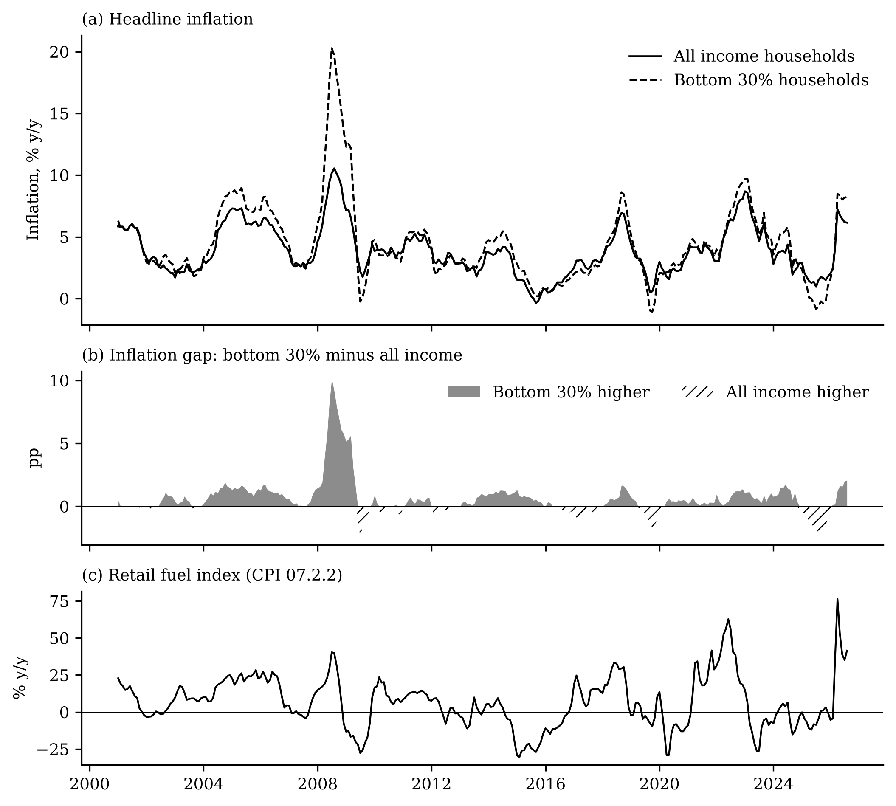
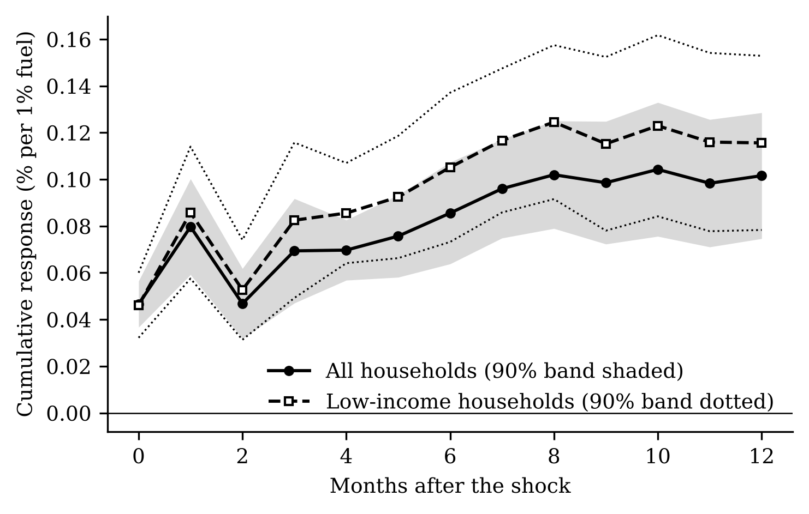

<#-- Manuscript for the Asian Economic Journal (decisions D16-D17). Rendered by code/python/11_manuscript.py:
     paper/manuscript.* (reading version), paper/manuscript_submission.* (blind = True; every block between
     <!--F--> and <!--/F--> moves to the end) and paper/manuscript_title_page.*. Numbers: pn = panel_numbers.json,
     n = paper_numbers.json, x = computed in 11_manuscript.py. Every equation is followed by a "where" list. --#>


[^aff]: {{ affiliation }}.


# 1. Introduction

When the price of oil rises, households pay more for fuel and, after a delay, for almost everything that fuel helps to produce and move. Whether poorer households pay more than others has direct consequences for policy. Governments respond to oil shocks with fuel tax relief, fuel subsidies and cash transfers, and each response assumes an answer to that question.

The most comprehensive evidence comes from @kpodar_liu_2022, who find across 122 countries that fuel price increases are *progressive*: they raise the cost of living of richer households more than that of poorer households. Their measure of each income group's cost of living, however, gives every group the same price change within a spending category and lets only the groups' spending shares differ. If poorer households buy different goods within a category, and those goods respond differently to fuel prices, this measure cannot detect it.

The Philippines allows a direct test. The Philippine Statistics Authority publishes, every month and for each of 17 regions, a consumer price index for *low-income households*, defined as the 30% of households with the lowest income per person, alongside the *headline index* for all households. The low-income index uses that group's own spending pattern, item by item. Low-income households spend {{ n.w_food_b30 }}% of their budget on food, against {{ n.w_food_all }}% for all households, and {{ n.w_fuel_b30 }}% on fuel for their own vehicles, against {{ n.w_fuel_all }}%. The question also became pressing in 2026, when an oil shock raised retail fuel prices {{ n.yoy_fuel_apr }}% above their level a year earlier and inflation for low-income households reached {{ n.yoy_b30_apr }}% in April.

We make three contributions. First, we estimate how much, and how fast, retail fuel prices raise the price level of low-income households and of all households, using local projections [@jorda_2005] specified as in @kpodar_liu_2022 and estimated on the 17-region panel. A 1% rise in fuel prices raises the price level of all households by {{ pn.p_all_c0 }}% within the month and by {{ pn.p_all_c12 }}% after a year. Second, we show that low-income households pay more, the opposite of the cross-country result, and measure by how much: six months after a shock their price level has risen about {{ pn.gap_rel_pct }}% more than that of all households. Spending shares alone predict the opposite sign, so the difference arises from faster price increases within the categories that low-income households buy. Third, we ask whether geography matters. The response differs across regions, and the differences are statistically significant, but they are unrelated to regional poverty or food spending.

To the best of our knowledge, this is the first study to estimate the pass-through of fuel prices with an official price index for low-income households. Section 2 reviews the related literature. Section 3 sets out the framework. Section 4 describes the data and builds the method step by step. Section 5 presents the results, and Section 6 discusses their implications. Section 7 summarises the findings and their limitations.

# 2. Related literature

The study closest to ours is @kpodar_liu_2022. Using monthly retail fuel prices and consumer price indices for 122 countries over 2000–2019, they build a price index for each income fifth by combining the published price changes of the main spending categories with the spending shares of each fifth from household surveys. They then estimate local projections of each index on retail fuel price changes. They find that a 1% rise in retail fuel prices raises inflation by about {{ n.kl_adv_b0 }} percentage points on impact in advanced economies and {{ n.kl_dev_b0 }} in developing economies, that crude oil prices understate this effect, and that the effect is progressive, lasting beyond a year in developing economies. Their design implies that broad fuel tax relief benefits richer households most. Its limitation, for our question, is that all income groups share the same price change within each category, so the design can detect differences in spending shares but not differences in what households buy within a category.

Two studies document how oil prices reach consumers. @kpodar_abdallah_2017 assemble monthly retail gasoline prices for 162 countries and estimate, with local projections, how changes in world crude prices pass through to pump prices. Pass-through peaks after about six months and is larger for price increases than for decreases, which implies that retail prices, not crude prices, are the relevant measure of the shock consumers face. @choi_etal_2018 estimate, for 72 economies over 1970–2015 and again with local projections, that a 10% rise in world oil prices raises domestic inflation by about 0.4 percentage points on impact, an effect that fades within two years and has declined over time; the share of transport in the consumer basket and energy subsidies explain most differences across countries. Neither study distinguishes income groups.

For the Philippines, @allon_pineda_etal_2026 estimate local projections of headline and core inflation and of inflation expectations on world oil, world food and domestic rice price shocks, using monthly national data. Oil and food shocks have significant and persistent effects, and the indirect, or second-round, effects of oil are larger than its direct effects. Their results show that the Philippine price level responds strongly and lastingly to oil, but they do not ask which households bear the increase.

Studies of who bears energy price changes have mostly relied on spending shares. @dorband_etal_2019 combine household surveys of 87 low- and middle-income countries with input–output tables, which trace how an energy price rise raises the price of every good, and find that carbon pricing is progressive in countries with incomes below about USD 15,000 per person, because energy spending shares first rise and then fall with income. @jaravel_2021 reviews the evidence on *inflation inequality*, the difference in inflation rates across income groups, and shows with detailed price data for the United States that inflation falls with income and that aggregating goods into broad categories hides much of this difference. For the Philippines, @fujii_2013 combines household survey data with provincial prices and finds that the food price increases of 2006–2008 raised poverty, with the poorest households hit hardest whether or not they farmed. Together, these studies suggest that spending-share calculations can misstate who bears a price shock when poorer households buy different goods within a category; an official low-income index allows this to be tested directly.

# 3. Framework

Fuel is an input to almost every good. To see how a fuel price shock reaches each household group, we follow the input–output price model [@miller_blair_2009] and define two shares.

The *budget share* of good *k* for group *g* is the percentage of the group's spending that goes to that good:

$$w^g_k = 100 \times \frac{E^g_k}{\sum_{j} E^g_j}, \qquad\qquad (1)$$

where $E^g_k$ is the total spending of households in group *g* on good *k*, the sum in the denominator runs over all goods *j*, *g* = *A* denotes all households and *g* = *L* low-income households. For example, food takes {{ n.w_food_b30 }}% of the budget of low-income households and {{ n.w_food_all }}% of the budget of all households.

The *fuel cost share* of good *k* is the share of its production and distribution cost that is spent on fuel, directly and through its inputs. If margins and other costs do not change, a fuel price shock raises the price of good *k* in proportion to it:

$$\pi_{k,t} \approx \phi_k\, f_t, \qquad\qquad (2)$$

where $\pi_{k,t}$ is the percentage change in the price of good *k* in month *t*, $\phi_k$ is its fuel cost share (between 0 and 1) and $f_t$ is the percentage change in the retail fuel price. For example, if fuel made up 30% of the cost of a bus ride, a 10% rise in fuel prices would raise the fare by about 3%.

A group's inflation is the budget-share-weighted average of the price changes of the goods it buys. Combining this with equation (2) gives

$$\pi^g_t \approx \sum_k \frac{w^g_k}{100}\, \pi_{k,t} \approx \Phi^g f_t, \qquad \Phi^g = \sum_k \frac{w^g_k}{100}\, \phi_k, \qquad\qquad (3)$$

where $\pi^g_t$ is the inflation rate of group *g* and $\Phi^g$ is the *fuel intensity* of the group's basket, the budget-share-weighted average of the fuel cost shares. Intuitively, a group's prices respond more to fuel the more of its budget goes to fuel-intensive goods.

We compare the groups with the *inflation gap*, the difference between the two inflation rates,

$$\Delta D_t = \pi^A_t - \pi^L_t, \qquad\qquad (4)$$

where $\pi^A_t$ and $\pi^L_t$ are the inflation rates of all households and of low-income households in month *t*. A negative gap means that low-income households' prices rose more; we call such an effect *regressive*, and a positive one *progressive*. The gap splits exactly into two parts:

$$\pi^A_t - \pi^L_t = \underbrace{\sum_k \frac{w^A_k - w^L_k}{100}\, \pi^A_{k,t}}_{\text{weights effect}} + \underbrace{\sum_k \frac{w^L_k}{100}\, (\pi^A_{k,t} - \pi^L_{k,t})}_{\text{within-category effect}}, \qquad\qquad (5)$$

where *k* now indexes spending categories, $\pi^A_{k,t}$ and $\pi^L_{k,t}$ are the price changes of category *k* in each group's index, and the other symbols are as above. The *weights effect* is the gap that arises because the groups divide their budgets differently across categories. The *within-category effect* arises because the groups buy different goods within a category, for example rice rather than meat, whose prices change differently. The cross-country measure of @kpodar_liu_2022 captures only the weights effect.

# 4. Data and method

## 4.1 Data

All price data are monthly consumer price indices of the Philippine Statistics Authority on the 2018 = 100 base [@psa_openstat_2026], for each of 17 regions. Three of these indices define our variables.

The *retail fuel price*, also called the *pump price*, is the price consumers pay for gasoline and diesel at filling stations, including taxes and dealer margins. We measure it with the consumer price sub-index 07.2.2, "fuels and lubricants for personal transport". The monthly changes in this index correlate at 0.87 with the World Bank's Manila pump price over 2016–2025. The *world crude price* is the price of unrefined oil traded internationally; we use the Dubai benchmark, the reference price for crude oil imported into Asia, converted from US dollars per barrel to pesos [@worldbank_cmo_2026].

The outcomes are the headline index for all households and the low-income index, by region. The low-income series join the statistics authority's own back-calculated series for 2000–2017 to the current series.[^splice] The back-calculations exist only for the 17 regions defined before the Negros Island Region was created in 2024, so we keep the 17-region map and extend it to August 2026 with the monthly changes published on the new map.[^nir] The budget-share calculation uses the 2018 budget shares of the two groups and the national price indices of the 13 spending categories. The panel is balanced. Shock dates run from January 2001 to August 2026, which gives {{ pn.obs_h0 }} region-months.

<!--F-->
{width=88%}
<!--/F-->

Low-income inflation exceeded headline inflation in {{ n.d_years_b30_higher }} of the {{ n.d_years_total }} years from 2001 to 2025 (Fig. 1). The largest difference occurred in 2008, when the oil price spike coincided with a rice price crisis: annual inflation reached {{ n.d_2008_b30 }}% for low-income households against {{ n.d_2008_all }}% for all households. The regressions below ask how much of such differences fuel prices cause.

[^splice]: The back-calculated series are joined in January 2012 and January 2018. Monthly changes in the gap are larger in those two months than on average; adding indicator variables for them leaves the national estimate of the gap unchanged to three decimals.

[^nir]: The new map changes the boundaries of Regions VI, VII and XII and of the Bangsamoro region. Dropping their re-mapped 2026 months leaves the six-month gap unchanged to three decimals.

## 4.2 From the distributed-lag model to local projections, step by step

**Step 1: the variables.** All variables are monthly percentage changes, measured as 100 times the change in the natural logarithm. The fuel shock and inflation are

$$f_{r,t} = 100\,(\ln F_{r,t} - \ln F_{r,t-1}), \qquad \pi^g_{r,t} = 100\,(\ln P^g_{r,t} - \ln P^g_{r,t-1}), \qquad\qquad (6)$$

where *r* indexes the 17 regions, *t* indexes months, $F_{r,t}$ is the retail fuel price index of region *r* in month *t*, $P^g_{r,t}$ is the consumer price index of group *g* (all households, *A*, or low-income households, *L*) and ln is the natural logarithm. For example, the national fuel index rose from {{ x.fuel_feb26 }} in February 2026 to {{ x.fuel_mar26 }} in March, a fuel shock of $100 \ln({{ x.fuel_mar26 }}/{{ x.fuel_feb26 }}) \approx {{ x.f_mar26 }}$%. The gap of equation (4) becomes $\Delta D_{r,t} = \pi^A_{r,t} - \pi^L_{r,t}$.

**Step 2: the familiar starting point.** Consider first a single price series and an autoregressive distributed-lag (ARDL) model of inflation:

$$\pi_t = \alpha + \sum_{q=1}^{p} \varphi_q\, \pi_{t-q} + \sum_{q=0}^{p} \theta_q\, f_{t-q} + \varepsilon_t, \qquad\qquad (7)$$

where $\pi_t$ is inflation in month *t*, $f_{t-q}$ is the fuel shock *q* months earlier, *p* is the number of lags (we use *p* = 12), $\alpha$ is a constant, $\varphi_q$ are the coefficients on past inflation, $\theta_q$ are the coefficients on current and past fuel shocks, and $\varepsilon_t$ is the error term. In an ARDL model, the effect of a one-time 1% fuel shock on inflation *h* months later, the *dynamic multiplier* $m_h$, is built up recursively from the estimated coefficients:

$$m_0 = \theta_0, \qquad m_h = \theta_h + \sum_{q=1}^{\min(h,p)} \varphi_q\, m_{h-q} \quad (h \geq 1), \qquad\qquad (8)$$

where $\theta_h = 0$ for *h* > *p*. Each multiplier therefore depends on every coefficient of equation (7) being correctly estimated, and errors in the early coefficients carry over to all later horizons.

**Step 3: the local projection.** @jorda_2005 proposed estimating each multiplier directly. Keep the right-hand side of equation (7), but move the left-hand side *h* months ahead:

$$\pi_{t+h} = \alpha_h + \beta_h\, f_t + \sum_{q=1}^{p} \gamma_{q,h}\, \pi_{t-q} + \sum_{q=1}^{p} \lambda_{q,h}\, f_{t-q} + u_{t+h}, \qquad\qquad (9)$$

where $\pi_{t+h}$ is inflation *h* months after month *t*, $\beta_h$ is the response of inflation at horizon *h* to a 1% fuel shock in month *t*, $\gamma_{q,h}$ and $\lambda_{q,h}$ are the coefficients on past inflation and past fuel shocks, $\alpha_h$ is a constant, and $u_{t+h}$ is the error term; the subscript *h* on every coefficient indicates that each horizon is a separate regression. Intuitively, a local projection is an ARDL regression whose dependent variable has been shifted *h* months into the future. Equation (9) is estimated by ordinary least squares once for each *h* = 0, 1, …, 12, and $\beta_h$ estimates the dynamic multiplier $m_h$ without the recursion of equation (8). With enough lags, both approaches estimate the same response in large samples [@plagborg_wolf_2021].

**Step 4: from inflation to the price level.** Policy questions concern the price level: how much higher are prices *h* months after the shock? Because inflation is the change in the log price level, the sum of inflation from month *t* to month *t + h* is the percentage change in the price level over that period. Replacing the left-hand side of equation (9) with this sum gives the *cumulative response* $B_h$:

$$\sum_{j=0}^{h} \pi_{t+j} = \alpha_h + B_h\, f_t + \sum_{q=1}^{p} \gamma_{q,h}\, \pi_{t-q} + \sum_{q=1}^{p} \lambda_{q,h}\, f_{t-q} + u_{t+h}, \qquad\qquad (10)$$

where $\sum_{j=0}^{h} \pi_{t+j} = 100\,(\ln P_{t+h} - \ln P_{t-1})$ is the percentage change in the price level from the month before the shock to *h* months after it, $B_h$ is the percentage change in the price level caused by a 1% fuel shock, and the other symbols are as in equation (9). For example, $B_{12} = 0.10$ means that a 10% rise in fuel prices makes the price level 1.0% higher a year later.

**Step 5: holding later shocks constant.** Fuel price increases tend to come in runs: a rise this month makes a rise next month more likely. Without further controls, $B_h$ would credit the first shock with the effect of the shocks that follow it. Following @teulings_zubanov_2014 and the specification of @kpodar_liu_2022, we add the fuel shocks between month *t* and month *t + h*, together with a linear trend:

$$\sum_{j=0}^{h} \pi_{t+j} = \alpha_h + B_h\, f_t + \sum_{q=1}^{p} \gamma_{q,h}\, \pi_{t-q} + \sum_{q=1}^{p} \lambda_{q,h}\, f_{t-q} + \sum_{l=1}^{h-1} \rho_{l,h}\, f_{t+l} + \delta_h\, t + u_{t+h}, \qquad\qquad (11)$$

where $f_{t+l}$ is the fuel shock *l* months after month *t* (a *lead* of the shock), $\rho_{l,h}$ is its coefficient, *t* is a linear time trend with coefficient $\delta_h$, and the other symbols are as in equation (10). With the leads held constant, $B_h$ measures the effect of a single 1% rise in fuel prices.

**Step 6: the regional panel.** We estimate equation (11) on all 17 regions together, with each region's own inflation and fuel shock and a separate constant for each region:

$$\sum_{j=0}^{h} y_{r,t+j} = \mu_{r,h} + B_h\, f_{r,t} + \sum_{q=1}^{12} \gamma_{q,h}\, y_{r,t-q} + \sum_{q=1}^{12} \lambda_{q,h}\, f_{r,t-q} + \sum_{l=1}^{h-1} \rho_{l,h}\, f_{r,t+l} + \delta_h\, t + u_{r,t+h}, \qquad\qquad (12)$$

where $y_{r,t}$ is the outcome of region *r* in month *t* (headline inflation $\pi^A_{r,t}$, low-income inflation $\pi^L_{r,t}$, or the gap $\Delta D_{r,t}$), $f_{r,t}$ is the region's fuel shock, $\mu_{r,h}$ is a *region fixed effect* (a constant specific to region *r* that absorbs every feature of the region that does not change over time, such as its distance from Manila or its typical diet), $u_{r,t+h}$ is the error term, and the other symbols are as in equation (11). Lags and leads are taken within each region, so a region's past never borrows another region's data. With about 300 months per region, the small-sample bias from combining fixed effects with lagged outcomes is negligible.

**Step 7: standard errors.** The outcome at horizon *h* overlaps with the outcomes of neighbouring months, so the errors of nearby months are correlated; and all regions are hit by the same national events in the same month, so the errors are also correlated across regions. Ordinary standard errors ignore both and are too small. We use *Driscoll–Kraay standard errors* with *h* + 1 lags, which allow for both forms of correlation [@driscoll_kraay_1998]. We report 90% confidence bands, $B_h \pm 1.645 \times \text{s.e.}(B_h)$, as in the reference study; a band that excludes zero indicates a response significant at the 10% level.

## 4.3 Does geography matter?

To estimate a separate response for each region while keeping the dynamics common, we replace $B_h f_{r,t}$ in equation (12) with a set of interactions:

$$B_h\, f_{r,t} \;\longrightarrow\; \sum_{s=1}^{17} B_{h,s}\, \big(f_{r,t} \times \mathbb{1}[r = s]\big), \qquad\qquad (13)$$

where *s* indexes regions, $\mathbb{1}[r = s]$ is an indicator equal to one for the observations of region *s* and zero otherwise, and $B_{h,s}$ is the cumulative response of region *s*. To test whether geography matters, we test the null hypothesis that all regions respond equally, $B_{h,1} = B_{h,2} = \dots = B_{h,17}$, with the Wald statistic

$$W_h = (R\hat{b}_h)'\,(R\hat{V}_h R')^{-1}\,(R\hat{b}_h), \qquad\qquad (14)$$

where $\hat{b}_h$ is the vector of the 17 estimated responses $B_{h,s}$, $\hat{V}_h$ is its Driscoll–Kraay covariance matrix, and *R* is the 16 × 17 matrix whose rows take the difference between each of the first 16 responses and the 17th. Under the null hypothesis, $W_h$ follows a chi-squared distribution with 16 degrees of freedom. We then ask whether the regional responses line up with each region's poverty rate and food budget share.

## 4.4 The budget-share calculation

To ask whether spending shares can explain the gap, we apply the weights effect of equation (5) to estimated responses. We estimate equation (11) for each of the 13 categories of the national headline index and compute

$$G^{w}_{12} = \sum_{k=1}^{13} B^{(k)}_{12}\, \frac{w^A_k - w^L_k}{100}, \qquad\qquad (15)$$

where $B^{(k)}_{12}$ is the twelve-month cumulative response of the price index of category *k* to a 1% fuel shock, $w^A_k$ and $w^L_k$ are the 2018 budget shares of category *k* for all households and for low-income households, and $G^{w}_{12}$ is the gap that would arise after twelve months if both groups faced the same price change within each category. A positive value is progressive. The difference between the estimated gap and $G^{w}_{12}$ is the within-category part. This calculation is an accounting exercise outside the regression model: it describes the source of the gap and does not test a causal channel.

# 5. Results

## 5.1 Pass-through: all households and low-income households

Retail fuel prices pass through quickly and lastingly to both groups (Table 1, Fig. 2). A 1% rise raises the price level of all households by {{ pn.p_all_c0 }}% in the month of the shock, by {{ pn.p_all_c6 }}% after six months and by {{ pn.p_all_c12 }}% after a year; a 10% rise in pump prices thus leaves prices about {{ pn.p_all_c12_10pct }}% higher a year later. The price level of low-income households rises by {{ pn.p_b30_c0 }}%, {{ pn.p_b30_c6 }}% and {{ pn.p_b30_c12 }}%. The two groups respond almost equally in the first month, and the low-income response pulls ahead from the third month on. The impact response for all households is of the same size as the advanced-economy estimate of @kpodar_liu_2022 ({{ n.kl_adv_b0 }}).

<!--F-->
Table: Table 1. Cumulative response of the price level to a 1% rise in retail fuel prices, 17-region panel

{{ t.responses }}

::: {custom-style="Table Note"}
*Notes:* Percentage change in the price level (gap: percentage points) *h* months after the shock; equation (12), shock dates January 2001–August 2026, region fixed effects; Driscoll–Kraay standard errors in parentheses. \* *p* < 0.10, \*\* *p* < 0.05, \*\*\* *p* < 0.01.
:::
<!--/F-->

<!--F-->
{width=72%}
<!--/F-->

## 5.2 Who pays more, and by how much?

Low-income households pay more. The gap responds negatively at every horizon, and its 90% band excludes zero at every horizon from {{ pn.gap_sig_from }} to {{ pn.gap_sig_to }} months (Table 1, Fig. 3). Six months after a 1% rise in fuel prices, the price level of low-income households has risen {{ pn.gap_c6|replace("−", "") }} percentage points more than that of all households (standard error {{ pn.gap_c6_se }}); after a year the difference is {{ pn.gap_c12|replace("−", "") }} points ({{ pn.gap_c12_se }}).[^sep] Relative to the response of all households, {{ pn.p_all_c6 }}%, the low-income price level rises about {{ pn.gap_rel_pct }}% more. In concrete terms, a 10% rise in pump prices raises the price level of all households by {{ pn.all6_10pct }}% after six months, and that of low-income households by about {{ pn.gap6_10pct }} percentage points more. The progressive effect found across countries does not hold in the Philippines.

[^sep]: The difference between the two separate responses in Table 1 is {{ pn.diff_sep_c6 }} at six months, close to the direct estimate of the gap. The two need not coincide, because the separate regressions control for each group's own past inflation, whereas the gap regression controls for the past gap.

<!--F-->
{width=72%}
<!--/F-->

Spending shares point the other way (Table 2). If both groups faced the same price change within each category, equation (15) gives a twelve-month gap of {{ n.gap_weights_only }}, a progressive effect. Food pushes the gap toward regressive ({{ n.dec_food }}), because low-income households spend more of their budget on it. Housing and utilities ({{ n.dec_housing }}) and transport ({{ n.dec_transport }}) push it the other way, because all households together spend more on them and transport prices respond most to fuel ({{ n.div_transport }} after a year). The estimated gap after twelve months is {{ pn.gap_c12 }}, so the within-category part is about {{ n.within12_pan }}: larger in size than the whole estimated gap, and of the opposite sign to the weights effect. Prices rise faster within the categories that low-income households buy.

<!--F-->
Table: Table 2. The gap implied by spending shares alone, twelve months after a 1% rise in retail fuel prices

{{ t.decomp }}

::: {custom-style="Table Note"}
*Notes:* Descriptive calculation, equation (15). Response: twelve-month cumulative response of the national headline index of each category (Newey–West standard errors in parentheses). Contribution = response × (budget share, all households − budget share, low-income households) ÷ 100; positive values push toward a progressive gap. Budget shares: 2018.
:::
<!--/F-->

The low-income category indices, which the statistics authority publishes nationally from 2013, point to the same categories. Over 2013–2026, the twelve-month response of the low-income food index is {{ n.why_c01_b30 }} against {{ n.why_c01_all }} in the headline index, and that of the low-income housing and utilities index, which includes cooking fuels, is {{ n.why_c04_b30 }} against {{ n.why_c04_all }}. The low-income transport index, mostly public transport fares, responds less ({{ n.why_c07_b30 }} against {{ n.why_c07_all }}).[^why]

[^why]: These comparisons are exploratory: they were added after the first results and cover only the years for which low-income category indices exist.

## 5.3 Does geography matter?

The answer is yes, but not in the way poverty or diet would suggest (Fig. 4, Table 3). Six months after a 1% fuel shock, the response of the headline price level ranges from {{ pn.geo_all_c6_min }}% in {{ pn.geo_all_c6_min_name }} to {{ pn.geo_all_c6_max }}% in {{ pn.geo_all_c6_max_name }}, and {{ pn.geo_all_c6_nsig }} of the 17 regional responses are significant at the 10% level. The Wald test of equation (14) rejects equal responses ($W$ = {{ pn.geo_all_c6_wald }}, *p* = {{ pn.geo_all_c6_p }}). The gap varies more: from {{ pn.geo_gap_c6_min }} in {{ pn.geo_gap_c6_min_name }} to {{ pn.geo_gap_c6_max }} in {{ pn.geo_gap_c6_max_name }}, with {{ pn.geo_gap_c6_npos }} of the 17 regions above zero. Equal gaps are rejected at the 5% level ($W$ = {{ pn.geo_gap_c6_wald }}, *p* = {{ pn.geo_gap_c6_p }}; after twelve months, *p* = {{ pn.geo_gap_c12_p }}). The regressive effect is largest in {{ pn.geo_gap_top3 }}.

The regional differences are unrelated to the characteristics one might expect to drive them. Across the 17 regions, the correlation of the six-month gap with the 2018 poverty rate is {{ pn.geo_gap_c6_corr_pov }}, and with the food budget share {{ pn.geo_gap_c6_corr_food }}; after twelve months both are close to zero ({{ pn.geo_gap_c12_corr_pov }} and {{ pn.geo_gap_c12_corr_food }}). Poorer and more food-dependent regions therefore do not systematically show larger gaps. Geography matters for how much prices rise after a fuel shock, and for how unequally, but regional poverty rates and food shares are not reliable guides to where low-income households are hit hardest.

<!--F-->
{width=95%}
<!--/F-->

<!--F-->
Table: Table 3. Region-specific responses six months after a 1% rise in retail fuel prices

{{ t.geo }}

::: {custom-style="Table Note"}
*Notes:* Equation (12) with the interactions of equation (13); region fixed effects; Driscoll–Kraay standard errors in parentheses. Poverty: 2018 poverty incidence among the population. Food share: 2018 food budget share of all households in the region. \* *p* < 0.10, \*\* *p* < 0.05, \*\*\* *p* < 0.01.
:::
<!--/F-->

## 5.4 Robustness

Two checks address the main threats to these results (Table 4). The first concerns the shock itself. The retail fuel price is set at home and could respond to domestic conditions, such as the exchange rate or the strength of demand. Replacing it with the world crude price in pesos, which is set in world markets, the twelve-month response of the price level is {{ pn.crude_all_c12 }}% for all households and {{ pn.crude_b30_c12 }}% for low-income households, about {{ pn.p_crude_share }}% of the retail estimate for all households, as expected when crude oil is one part of the pump price. The gap remains negative and significant: {{ pn.rob_crude_c6 }} ({{ pn.rob_crude_c6_se }}) after six months and {{ pn.rob_crude_c12 }} ({{ pn.rob_crude_c12_se }}) after a year. The second check concerns the panel. Leaving out each region in turn keeps the six-month gap between {{ pn.loo_min }} and {{ pn.loo_max }}, and it remains significant in every case, so no single region drives the result.

<!--F-->
Table: Table 4. Robustness checks

{{ t.robust }}

::: {custom-style="Table Note"}
*Notes:* Cumulative responses per 1% shock, 17-region panel, region fixed effects; Driscoll–Kraay standard errors in parentheses. Crude oil: Dubai benchmark in pesos. \* *p* < 0.10, \*\* *p* < 0.05, \*\*\* *p* < 0.01.
:::
<!--/F-->

Two further results qualify the finding, and we report them for completeness. The gap is concentrated in the first half of the sample: {{ pn.rob_p1_c6 }} ({{ pn.rob_p1_c6_se }}) for shock dates in 2001–2012, against {{ pn.rob_p2_c6 }} ({{ pn.rob_p2_c6_se }}) in 2013–2026. And when the regression also controls for world food prices, the six-month gap falls to {{ pn.rob_food_c6 }} ({{ pn.rob_food_c6_se }}). This second result admits two readings. Fuel is an input to growing, processing and moving food, and twelve-month changes in world food prices correlate at {{ x.corr_fuel_food }} with retail fuel prices; if food is the channel through which fuel reaches low-income households, controlling for food prices removes part of the effect being measured [@angrist_pischke_2009]. Alternatively, a common commodity cycle, such as a rise in global demand [@kilian_2009], may raise oil and food prices together. Our data cannot separate the two readings.

# 6. Discussion

The results revise the cross-country conclusion in one direction. Budget shares alone make fuel price shocks progressive in the Philippines as elsewhere, but the official low-income index shows the opposite, because the goods that low-income households buy within food and utilities become relatively more expensive after a fuel shock. Measures of the burden of fuel prices that rely on spending shares, including the cross-country estimates of @kpodar_liu_2022 and incidence studies such as @dorband_etal_2019, may therefore overstate how progressive fuel price increases are wherever poorer households buy different goods within a category.

Three implications follow for policy. First, relief on gasoline and diesel taxes is poorly targeted: motor fuel is {{ n.w_fuel_all }}% of the budget of all households and {{ n.w_fuel_b30 }}% of that of low-income households, and most of the low-income response arrives through other prices. Second, the channels that matter for low-income households, food and fares, are reached more directly by food supply and fare measures than by fuel tax relief. Third, regional poverty rates are a poor guide to where low-income households are hit hardest; transfers indexed to each region's low-income price index would follow the actual burden.

# 7. Conclusion

We estimated how retail fuel prices pass through to the price level of low-income households and of all households in a panel of 17 Philippine regions. Three findings stand out. First, pass-through is fast and lasting: a 10% rise in pump prices leaves consumer prices about {{ pn.p_all_c12_10pct }}% higher a year later. Second, low-income households pay about a quarter more, although their spending shares predict the opposite; the difference arises within spending categories, chiefly food. Third, the response differs significantly across regions, but the differences do not follow regional poverty or food shares.

The study has limitations. The regressive gap is concentrated in 2001–2012 and moves with world food prices, and our data cannot separate a food channel from a common commodity cycle; an external measure of oil supply shocks [@kilian_2009] would sharpen the causal reading. The comparison is between the poorest 30% and all households, which understates the difference between the poorest and the richest. The low-income series before 2018 are back-calculated, and the budget-share calculation is descriptive. Indices for finer income groups, built from household survey spending shares and the detailed item prices of the statistics authority, would allow a sharper comparison and are a natural next step.


# Declarations {-}

**Data and code availability.** All data are public. A replication package with the raw data, a source log, the cleaned data, Python and Stata 17 code and a codebook reproduces every number, table and figure; its location is given on the title page.

# Declarations {-}

**Data and code availability.** All data are public. A replication package with the raw data, a source log, the cleaned data, Python and Stata 17 code and a codebook reproduces every number, table and figure: <https://github.com/liancataytayjk-coder/oil-shock-distribution>.

**Funding.** [To be completed.] **Conflict of interest.** [To be completed.] **Acknowledgements.** [To be completed.]


# References {-}

::: {#refs}
:::
