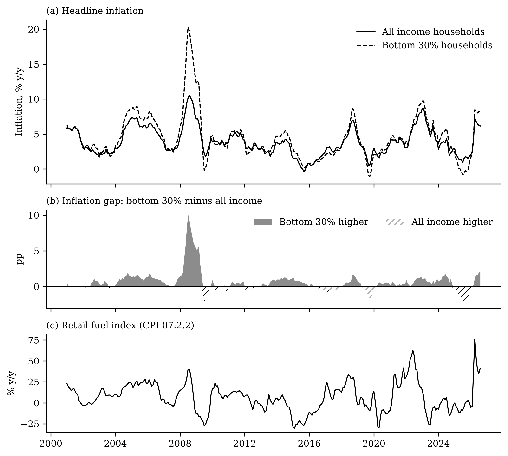
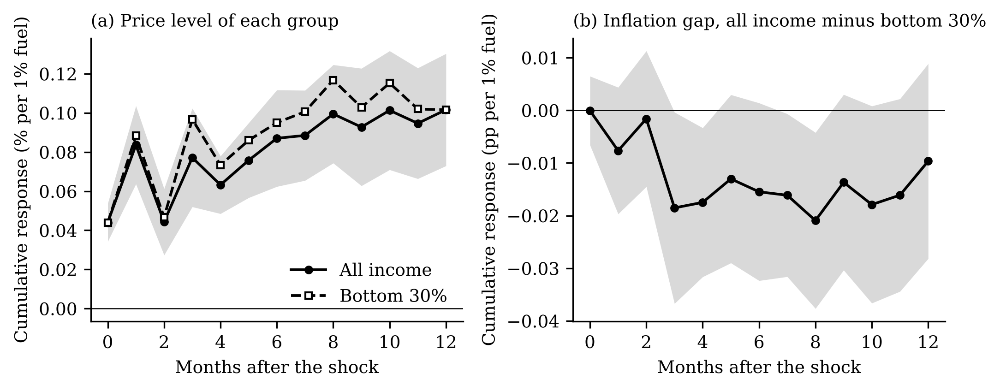
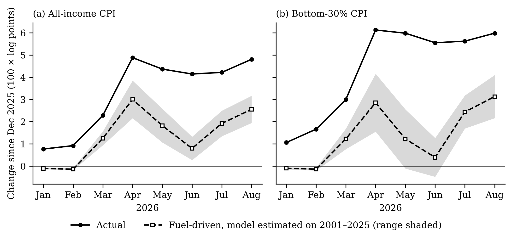

# The proposal in brief

When the price of gasoline and diesel jumps, every Filipino household pays more for almost everything: fares, rice, fish and cooking gas. But do poor households pay *more* than the average household? The best international study says no. Using data from 122 countries, @kpodar_liu_2022 find that fuel price increases are *progressive*: they raise prices more for richer households, because richer households spend more on cars and fuel. If that is true in the Philippines, a broad cut in fuel taxes mainly helps the better-off.

This proposal asks whether the finding holds in the Philippines, using the country's own official statistics. The Philippine Statistics Authority (PSA) publishes a monthly consumer price index (CPI) for all households and a separate CPI for the bottom 30% of households by income. We will apply the method of @kpodar_liu_2022, a regression called a *local projection*, to these two indices and to the PSA's index of pump prices, from 2001 to August 2026. The question is urgent: in 2026 an oil shock caused by conflict in the Middle East pushed pump prices up 76% in a year, and the government had to choose quickly between tax relief, subsidies and transfers.

The study asks three questions. How much, and how fast, do pump prices pass through to the prices paid by all households and by the bottom 30%? Do the bottom 30% face larger price increases, and why? And what did the 2026 shock cost a poor family, and which policy responses reached them? This national version needs only free, public data and open-source software, and can be completed in one semester.

# 1. Why this question matters

## 1.1 The Philippines is exposed to oil shocks

The Philippines imports almost all the oil it uses, so world oil prices reach Filipino pumps within weeks. From pumps they spread to jeepney and bus fares, to food that must be pumped, trucked and shipped between islands, and to almost every other good. In 2026 this happened at speed. The PSA's pump price index rose 76% above its level a year earlier by April. Headline inflation, the yearly rise in the CPI, went from 2.4% in February to 7.2% in April, and inflation for the bottom 30% reached 8.5% (Figure 1, panel a).

{width=82%}

## 1.2 Every policy response assumes an answer to our question

The government responded in three ways. Republic Act 12316 allowed the President to suspend fuel excise taxes when world crude oil is expensive [@ra12316_2026]; the excise was suspended for liquefied petroleum gas (LPG) and kerosene but not for gasoline and diesel. Jeepney and bus drivers received fuel subsidies. The central bank, the Bangko Sentral ng Pilipinas, raised its policy rate three times, from 4.25% in February to 5.00% in August. Cash transfers to poor families were the remaining option.

Each choice rests on a belief about who bears the cost. Cutting gasoline and diesel taxes makes sense if the burden falls on everyone in proportion to fuel use; it is wasteful if the poor bear the burden mostly through food. Transfers need a size: how many pesos does a fuel shock cost a poor family? The Finance Secretary justified not cutting gasoline and diesel taxes by calling such relief "not progressive". No study has measured this with Philippine data.

## 1.3 Why the cross-country answer may not hold here

There are good reasons to doubt that fuel shocks are progressive in the Philippines. Poor Filipino households spend 54.9% of their budget on food, against 37.7% for all households, and only 1.59% on fuel for their own vehicles, against 2.39%. They ride jeepneys rather than drive, and cook with LPG, kerosene, wood or charcoal. Fuel reaches them mostly *indirectly*, through food and fares. History also points the other way: in 2008 the annual inflation of the bottom 30% exceeded that of all households by 5.7 percentage points, and the poor's inflation was higher in 18 of the 25 years from 2001 to 2025 (Figure 1, panel b).

# 2. The research questions

**Main question.** When pump prices rise, do poor Filipino households face larger price increases than the average household?

**RQ1. Pass-through.** By how much, and how quickly, does a 1% rise in pump prices raise the price level of all households and of the bottom 30%?

**RQ2. Who pays more, and why.** Does the bottom 30%'s price level rise more or less than that of all households? Is the difference due to what each group buys (budget shares) or to different price changes within the same spending categories?

**RQ3. The 2026 shock and policy.** How much of the 2026 price surge was caused by fuel, what did it cost a poor family in pesos, and how well did each policy response reach the poor?

**Hypotheses.** H1: pass-through is positive and builds up over several months. H2 has two competing versions. H2a, the cross-country finding, is that the effect is *progressive*: prices rise more for all households than for the bottom 30%. H2b, the alternative suggested by the Philippine budget shares, is that it is *regressive*: prices rise more for the bottom 30%. The study is designed so that either result is informative.

# 3. How other economists have answered this question

Economists have approached the question from three directions. Table 1 summarises the studies this proposal builds on most directly.

**How much fuel prices pass through to inflation.** @kpodar_abdallah_2017 built a database of monthly retail fuel prices for 162 countries and showed that a rise in world crude prices reaches pump prices within about six months. @choi_etal_2018 found, for 72 countries, that a 10% rise in world oil prices raises inflation by about 0.4 percentage points on impact, less today than in the past. Both use *local projections* [@jorda_2005]: instead of building a full model of the economy, they run one regression for each month after the shock, which tells directly how prices respond one, two, … twelve months later. In the Philippines, @allon_pineda_etal_2026 used the same tool and found that oil and food price shocks have large and lasting effects on national inflation, but they did not look at income groups.

**Who bears fuel price changes.** Studies of fuel subsidies ask who gains when fuel is cheap. Reviewing many countries, @arze_etal_2012 and @coady_etal_2015 found that the richest fifth of households receives several times more of a fuel subsidy in pesos than the poorest fifth, but that the loss from a price rise is similar *as a share of income*, more than half of it through indirect effects on other prices. In the Philippines, @domingo_etal_2009 showed that the effect of rice and fuel price increases differs by income, sector and location. These studies use household budget surveys and fixed input–output links; they do not observe how prices actually move after a shock.

**Whether the poor face different inflation.** @hobijn_lagakos_2005 and @kaplan_schulhofer_2017 found, in the United States, that inflation differs across households, and that poorer households often face higher inflation, partly because they buy different items *within* the same category. @jaravel_2021 shows that this can only be seen with detailed prices; @easterly_fischer_2001 found that the poor are also more likely to name inflation as a top concern.

**The study we replicate.** @kpodar_liu_2022 combined these strands. For 122 countries they rebuilt a CPI for each income fifth from household survey budget shares, and estimated local projections of each CPI, and of the ratio of the richest to the poorest fifth's CPI, on retail fuel prices. They found that a 1% fuel price rise raises inflation by about 0.044 percentage points on impact in advanced economies and 0.018 in developing ones, that crude oil prices understate this, and that the effect is progressive.

Table: Table 1. Key studies and what this proposal takes from each.

| Study | Sample and method | Main finding | What we take |
|---|---|---|---|
| @kpodar_liu_2022 | 122 countries; local projections; quintile CPIs rebuilt from budget shares | Fuel price rises pass through and are progressive | The full specification and the main hypothesis (H2a) |
| @jorda_2005; @teulings_zubanov_2014 | Methods papers | One regression per horizon; control for later shocks | The estimator |
| @choi_etal_2018 | 72 countries; local projections | Oil shocks raise inflation, less than in the past | Benchmark for the size of the effect |
| @arze_etal_2012; @coady_etal_2015 | Reviews of fuel subsidy incidence | Indirect effects are large; subsidies favour the rich | Why indirect channels matter (H2b) |
| @kaplan_schulhofer_2017; @jaravel_2021 | United States; household price indices | The poor's inflation differs within categories | The "within-category" explanation (RQ2) |
| @deaton_1989 | Thailand; household budgets | A price rise costs a household its budget-share-weighted price change | Peso cost of the shock (RQ3) |
| @allon_pineda_etal_2026 | Philippines; local projections | Oil and food shocks raise national inflation | Philippine benchmark; no income groups |

**What is missing.** No study has measured the distributional effect of fuel price shocks with *official* income-group price indices. The cross-country method gives every income group the same price for each spending category and lets only the budget shares differ, so it cannot see that the poor buy different items, such as rice rather than meat, whose prices respond differently. The Philippines is one of the few countries where the statistics office publishes a CPI for the poor every month, which makes it the ideal place to test the cross-country result.

# 4. How we will use their approach with Philippine data

The study follows @kpodar_liu_2022 as closely as the data allow and replaces each of their ingredients with an official Philippine one. Table 2 shows the mapping.

Table: Table 2. From the cross-country design to the Philippine design.

| Ingredient | @kpodar_liu_2022 | This study (national) |
|---|---|---|
| Fuel price | Retail gasoline price database (not public) | PSA CPI sub-index 07.2.2, fuels for personal transport |
| Price index of the poor | Rebuilt from survey budget shares | PSA's official bottom-30% CPI |
| Price index of all households | National CPI | PSA's all-income CPI |
| Distribution outcome | CPI ratio, richest to poorest fifth | Inflation gap, all-income minus bottom-30% |
| Method | Local projections with 12 lags and leads of the shock | The same specification |
| Crude oil comparison | World crude price | Dubai crude in pesos (World Bank, BSP) |
| Period | 2000–2019, 122 countries | January 2001 to August 2026, monthly |
| Application | None | The 2026 shock and its peso cost |

## 4.1 Data

All the price data are monthly, free and downloadable from PSA OpenSTAT [@psa_openstat_2026]: the all-income CPI and its 13 spending divisions from 1994, the bottom-30% CPI from 2000 (and its divisions from 2012), and the pump price index 07.2.2, all on the 2018 = 100 base. The PSA's pump price index moves almost one-for-one with actual pump prices: its monthly changes correlate at 0.87 with the World Bank's Manila pump price over 2016–2025. Supporting series are Dubai crude oil [@worldbank_cmo_2026], the peso–dollar rate and the policy rate (BSP), and the official poverty lines (PSA). The two budget baskets (2018 weights) and the national poverty line give the "why" and the peso cost.

## 4.2 Method

The tool is the local projection of @jorda_2005, specified as in @kpodar_liu_2022. Let $f_t$ be the monthly percentage change in pump prices in month *t* and $\pi_t$ the monthly inflation of a CPI. For each month *h* = 0, 1, …, 12 after a shock, we run one regression:

$$\pi_{t+h} = \alpha_h + \beta_h f_t + \sum_{q=1}^{12} \gamma_{q}\, \pi_{t-q} + \sum_{q=1}^{12} \lambda_{q}\, f_{t-q} + \sum_{l=1}^{h-1} \rho_{l}\, f_{t+l} + \delta_h\, t + \varepsilon_{t+h} \qquad\qquad (1)$$

In words: inflation *h* months from now is explained by today's fuel price change, while twelve months of past inflation and past fuel price changes are held constant, together with the fuel price changes between today and month *t* + *h* [@teulings_zubanov_2014] and a time trend. The coefficient $\beta_h$ is the answer: how much inflation in month *t* + *h* rises when pump prices rise 1% today. Adding them up, $B_h = \beta_0 + \dots + \beta_h$, gives the effect on the price level after *h* months. For example, $B_{12} = 0.10$ would mean that a 10% rise in pump prices makes consumer prices 1% higher a year later. Standard errors allow for correlation between neighbouring months [@newey_west_1987].

RQ1 runs equation (1) for the all-income and the bottom-30% CPI. RQ2 runs it for the *inflation gap*, all-income inflation minus bottom-30% inflation: a negative response means the poor's prices rise more (regressive, H2b), a positive one that they rise less (progressive, H2a). To explain the gap, we compare it with the gap that budget shares alone would produce, using the responses of the 13 spending divisions. RQ3 estimates the model only on data up to December 2025, applies it to the actual 2026 fuel price changes, and compares the predicted with the actual price rise. Following @deaton_1989, the rise in the bottom-30% CPI times the poverty line gives the extra pesos a poor family needs each month to buy the same basket. Before using real data, the estimator is checked on simulated data with a known answer.

Three checks test how solid the results are: replacing the pump price index with Dubai crude in pesos, a price set in world markets; adding the exchange rate, the policy rate and world food prices as controls; and dropping 2020, the pandemic year.

# 5. Preliminary evidence: the idea works

A first run of the national model, using the full pipeline already built, shows that the study is feasible and that the answer is interesting (Figure 2).

{width=95%}

**Pass-through is fast and lasting (RQ1).** A 1% rise in pump prices raises the all-income price level by 0.044% within the month and by 0.102% after a year, and the bottom-30% price level by about the same amount (0.044 and 0.102). A 10% rise in pump prices thus makes prices about 1.0% higher a year later. The impact effect is as large as the average for advanced economies in @kpodar_liu_2022. World crude prices capture only about 40% of this, which is why the study uses the pump price.

**The effect is not progressive (RQ2).** The response of the inflation gap is negative at every horizon: $−0.0155$ after six months and $−0.0097$ after a year. The poor's prices rise slightly more, the opposite of the cross-country finding. Nationally the estimate is imprecise: it is significant at the 10% level only at 3, 4, 7, 8 months. Budget shares alone would predict a *progressive* effect (+0.0101 after a year), so the regressive sign must come from larger price increases within the categories the poor buy, such as food and household fuels. Adding macroeconomic controls shrinks the gap to $−0.0046$, so the full study must take this check seriously.

**The 2026 shock (RQ3).** A model estimated only on data up to December 2025 explains 2.55 of the 4.81% rise in the all-income price level between December 2025 and August 2026, and 3.13 of the 5.98% rise for the bottom 30% (Figure 3). For a family of five at the poverty line, the fuel-driven part alone costs about PHP 467 a month. The LPG excise suspension saves such a family about PHP 37 per 11-kg tank, roughly 8% of that cost.

{width=95%}

# 6. Expected contributions

The study will make three contributions. First, it provides the first test of the cross-country finding with *official* income-group price indices, in a country where the finding may be reversed. Second, it shows *why*, by separating the effect of budget shares from that of price changes within categories, which reconstructed indices cannot capture. Third, it turns the estimates into numbers policymakers can use directly: the pass-through of pump prices to the cost of living, the peso cost of a fuel shock to a poor family, and a simple test of whether fuel tax relief or cash transfers reach the poor better. The method needs only data that the PSA publishes every month, so the estimates can be updated whenever a new shock hits.

# 7. Scope, work plan and resources

**Scope.** This is the lean, national version of the study. It uses the national series only, one estimator and three robustness checks. Two extensions are natural once the national results are in: a panel of the 17 regions, which gives more precise estimates and shows whether remote and poorer regions are hit harder, and a full replication of the code in Stata.

**Resources.** The study needs no budget for data: every series is free from the PSA, the World Bank and the BSP. The analysis runs in Python, which is free; the code, the data and every output are kept in one repository that rebuilds all results with one command, so an adviser or referee can check any number. The only inputs are the researcher's time and a laptop.

Table: Table 3. Work plan (one semester).

| Weeks | Task | Output |
|---|---|---|
| 1–3 | Download and clean the PSA, World Bank and BSP series; document every source | Clean monthly data set, source log |
| 4–5 | Describe trends, fuel price episodes and the inflation gap | Descriptive chapter |
| 6–9 | Estimate RQ1 and RQ2; simulation check; robustness checks | Results chapter, tables and figures |
| 10–11 | Apply the model to 2026; peso cost; policy assessment (RQ3) | Policy chapter |
| 12–14 | Write the paper; adviser review | Draft working paper |
| 15–16 | Revise and present | Final paper and presentation |

**Risks.** Three risks are known in advance. The pump price index is a domestic price, so part of its effect may come from the exchange rate or strong demand; the crude-oil and macro-control checks address this. The bottom-30% CPI before 2018 is the PSA's own back-calculated series, joined to the current one; we test whether the join months matter. And the national estimates may be imprecise, as the first run suggests; the regional panel is the planned remedy.

# References

::: {#refs}
:::
