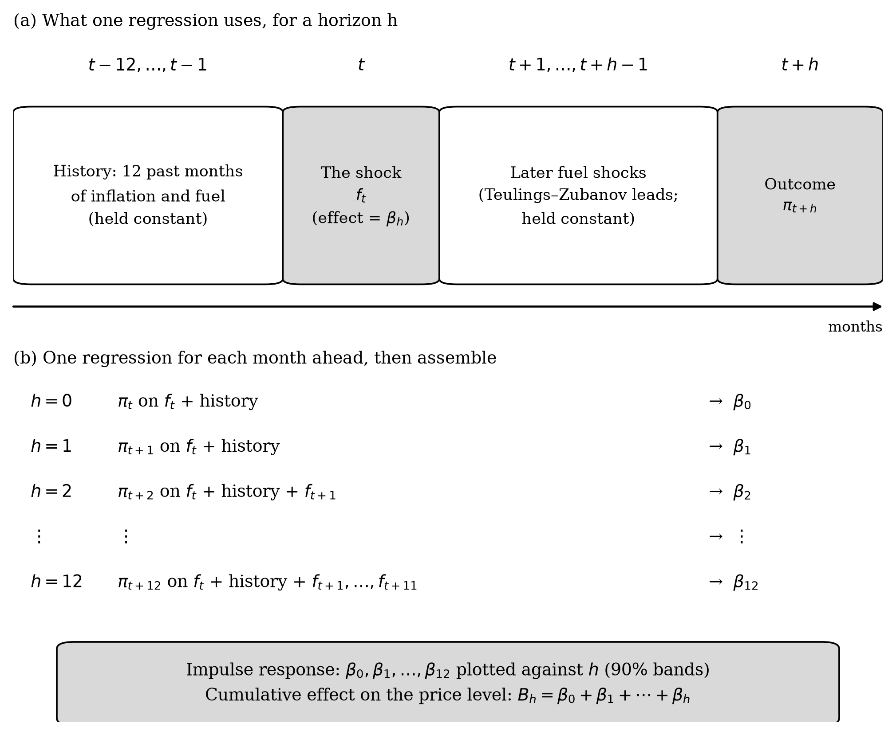
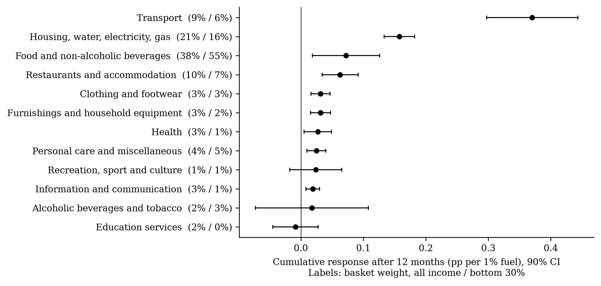
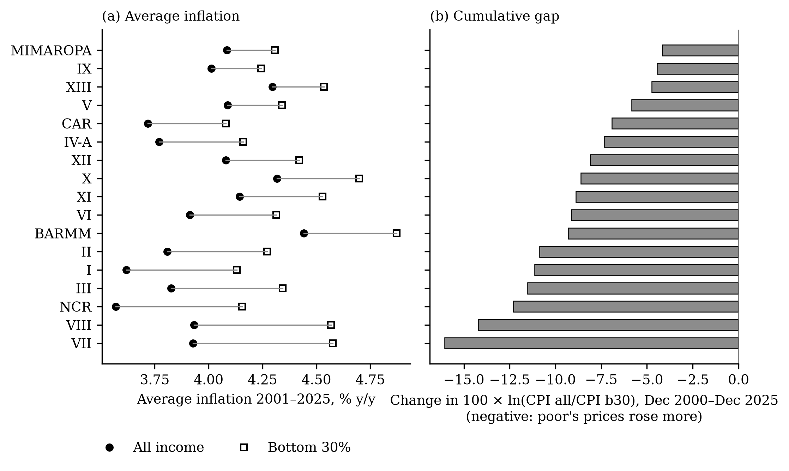

[^aff]: {{ affiliation }}.

# Chapter 1. Introduction

## 1.1 Background of the study

The Philippines imports almost all of the oil it uses. When world oil prices rise, Filipino households feel it quickly: at the pump, in the price of liquefied petroleum gas (LPG) for cooking, in jeepney and bus fares, and in the price of food, which must be grown, pumped, milled and trucked. The country has lived through several oil price surges since 2000: the run-up of 2004–2006, the spike of 2008 that coincided with the global rice crisis, the surge of 2021–2022 after the pandemic, and, in 2026, the oil shock caused by the conflict in the Middle East.

The 2026 shock was among the sharpest. The consumer price index (CPI) sub-index for retail motor fuels was {{ n.yoy_fuel_mar }}% higher in March 2026 than a year earlier and {{ n.yoy_fuel_apr }}% higher in April. Headline inflation, the yearly change in the CPI, rose from {{ n.yoy_all_feb }}% in February to {{ n.yoy_all_mar }}% in March and {{ n.yoy_all_apr }}% in April, above the 2–4% target of the Bangko Sentral ng Pilipinas (BSP), and was still {{ n.yoy_all_aug }}% in August. Inflation measured by the Philippine Statistics Authority's (PSA) CPI for the bottom 30% income households was higher still: {{ n.yoy_b30_apr }}% in April and {{ n.yoy_b30_aug }}% in August.

The government responded in several ways. Republic Act (RA) 12316, approved on 25 March 2026, gives the President standby authority to suspend or reduce excise taxes on petroleum products for up to three months at a time whenever Dubai crude averages USD 80 per barrel or more [@ra12316_2026]. The law itself covers all petroleum products. The executive orders that used it in 2026 suspended the excise taxes on LPG and kerosene only, from April to July and again from late September, and left gasoline and diesel out, on the grounds that relief on these fuels would not be progressive. Fuel subsidies were given to drivers of public utility vehicles, the jeepney minimum fare rose by one peso at the end of September, and the BSP raised its policy rate {{ n.n_hikes_word }} times between March and August, from {{ n.policy_feb }}% to {{ n.policy_aug }}%.

## 1.2 Rationale

Each of these responses rests on an assumption about who bears the cost of a fuel price shock. The best cross-country evidence answers that question in a way that would favour broad measures. @kpodar_liu_2022, using retail fuel prices for 122 countries and price indices for income groups rebuilt from household surveys, find that fuel price increases are *progressive*: prices rise more for the richest households, because they spend more on cars and fuel.

There are three reasons to doubt that this holds in the Philippines. First, poor Filipino households spend more than half of their budget on food ({{ n.w_food_b30 }}% in the 2018 basket, against {{ n.w_food_all }}% for all households) and travel by public transport, so the indirect effects of fuel on food and fares may matter more to them than the direct effect on motor fuel. Second, the cross-country method gives every income group the same price for each spending category and lets only the budget shares differ. If the poor buy different items within a category, and those items' prices respond differently, that method cannot see it. The Philippines is one of the few countries whose statistical agency publishes an official CPI for poor households, monthly and by region, so the question can be tested directly. Third, the Philippines is an archipelago with large regional differences in poverty, diets and transport costs; a national or cross-country estimate cannot show whether households in some regions bear more of the shock.

The 2026 shock gives the question practical urgency. Relief was designed in weeks. Whether it reached the people who needed it depends on facts this study can establish.

## 1.3 Objectives of the study

The general objective is to determine how fuel price shocks affect the prices faced by poor households compared with all households in the Philippines, nationally and across regions, from 2001 to 2026, and what this implies for policy.

**Objective 1 (descriptive statistics and trend analysis)** is to describe the levels, trends and volatility of retail fuel prices, all-income inflation and bottom-30% inflation in the Philippines and its regions from 2001 to 2026, and how the gap between the two groups behaved during episodes of high fuel prices.

**Objective 2 (estimation)** is to estimate how fuel price shocks pass through to consumer prices, using the local projection model of @kpodar_liu_2022. It answers two research questions. **RQ1** asks how much, and how fast, a rise in retail fuel prices raises the price level of all households and of the bottom 30%. **RQ2** asks whether the bottom 30% face larger price increases than all households, nationally and across the 17 regions, and why.

**Objective 3 (policy implications)** is to apply the estimates to the 2026 oil shock. **RQ3** asks what the 2026 shock cost poor families, nationally and by region, which goods drove the poor's extra inflation, and how well the 2026 policy instruments (excise relief, fuel subsidies, fares, monetary policy and transfers) were targeted to the poor.

**Hypotheses.** For RQ1, hypothesis H1 is that fuel prices pass through positively and persistently to the price level. For RQ2 there are two competing hypotheses. H2a, the cross-country finding, is that the effect is progressive: all-income prices rise more. H2b, the alternative, is that the effect is regressive: bottom-30% prices rise more, because of food, household fuels and fares. RQ3 applies the estimates and is not a hypothesis test.

## 1.4 Significance of the study

The study matters to several groups. For the Department of Finance and the Bureau of Internal Revenue, RA 12316 creates a recurring decision on fuel excise relief until 2028; the study shows which fuels' relief reaches the poor and how much it is worth to them. For the Department of Social Welfare and Development, it turns a fuel shock into a monthly peso amount for a family at the poverty line, by region, which can be used to size and time emergency transfers. For the Department of Transportation, the Land Transportation Franchising and Regulatory Board (LTFRB) and the Department of Agriculture, it shows that fares and rice, rather than motor fuel, are the main channels through which the poor feel oil shocks. For the BSP, it measures how large and how lasting the effect of retail fuel prices on inflation is, and how it differs between income groups. For the PSA, it shows the value of the bottom-30% CPI and its regional detail. For researchers, it offers a within-country test of a cross-country finding and a fully reproducible data and code package in Python and Stata.

## 1.5 Scope and limitations

The study covers the Philippines and its 17 regions, as defined in PSA's long-run price series, monthly from January 2001 to August 2026. It uses published price indices, not household survey records.

The study has six main limitations. First, the fuel price is measured by the CPI sub-index for fuels and lubricants for personal transport, because the retail price database of the reference study is not public; the sub-index tracks pump prices closely but is not itself a pump price. Second, the comparison is between the bottom 30% and all households, not between the poorest and the richest; because the all-income index includes the poor, the true gap between rich and poor is larger than the one measured here. Third, retail fuel prices may partly respond to conditions inside the Philippines; the study checks the results with world crude oil prices but does not isolate a pure world oil supply shock. Fourth, the bottom-30% series before 2018 are PSA back-calculations on the 2018 basket. Fifth, the 2026 analysis covers eight months, and the effect of rice prices cannot be separated from trade policy. Sixth, price indices measure the cost of a fixed basket and ignore the fact that households can switch to cheaper goods, and that some households also earn more when prices rise.

## 1.6 Definition of terms

Throughout, *t* is the month, *r* the region, *k* a spending category, and *g* the household group: *A* for all income households and *B* for the bottom 30%.

**Consumer price index (CPI).** The cost of a fixed basket of goods and services compared with the base year 2018 (= 100). PSA computes it as a weighted average of item prices, with weights equal to each group's 2018 budget shares $w^g_k$ (which add up to one):

$$P^g_t = 100 \times \sum_k w^g_k \, \frac{p_{k,t}}{p_{k,2018}} \qquad\qquad (1)$$

**Bottom-30% CPI.** PSA's official CPI for households in the poorest 30% of the income distribution. It uses the same prices as the all-income CPI but the budget shares of poor households from the Family Income and Expenditure Survey.

**Log change.** 100 times the change in the natural logarithm of a series, $100\,\Delta\ln X_t = 100\,(\ln X_t - \ln X_{t-1})$. For small changes it equals the percentage change, and changes over several months add up.

**Fuel price shock.** The monthly log change in the retail fuel index $F$ (PSA CPI 07.2.2): $f_t = 100\,\Delta\ln F_t$. A shock of 5 means pump prices rose about 5% in that month.

**Inflation.** Monthly inflation for group *g* is $\pi^g_t = 100\,\Delta\ln P^g_t$. Annual inflation, the figure reported in the news, is the change over twelve months.

**Pass-through.** The change in a group's monthly inflation *h* months after a 1% rise in the fuel price, holding other things constant, $\beta_h$. **Cumulative pass-through** adds these up and gives the effect on the price level after *h* months: $B_h = \beta_0 + \beta_1 + \dots + \beta_h$. For example, $B_{12} = 0.05$ means a 10% fuel price rise makes prices 0.5% higher a year later.

**Inflation gap.** The difference between the two price levels, in log points; its monthly change is the difference between the two inflation rates:

$$D_t = 100 \times \ln\!\left(\frac{P^A_t}{P^B_t}\right), \qquad \Delta D_t = \pi^A_t - \pi^B_t \qquad\qquad (2)$$

**Progressive and regressive.** A fuel shock is *progressive* if it raises prices more for the average household (the gap $D$ rises) and *regressive* if it raises them more for the poor ($D$ falls). The gap is the study's own construction from the two official indices.

**Local projection.** A method that estimates the effect of a shock on each future month with its own regression (Section 3.4).

# Chapter 2. Review of Related Literature

This chapter reviews {{ n.n_studies }} studies in five themes. Appendix A summarises each in a review matrix (author and year, country or sample, method and key findings). The chapter ends with the theoretical framework, which turns the literature into the equations that the study tests, and the conceptual framework.

## 2.1 How a fuel price becomes a consumer price

Fuel enters almost every price. In the input–output price model of Leontief [@miller_blair_2009], the price of each good covers the cost of its inputs plus wages and profits, so a rise in the price of one input, such as fuel, raises every price in proportion to the fuel used to make it, directly and through its other inputs. @kilian_2008 distinguishes two routes: a *direct* route, through the energy households buy themselves, and an *indirect* route, through the costs of producing and moving other goods. @blanchard_gali_2010 add a *second-round* route through wages and expectations, and show that it weakened after the 1970s as monetary policy became more credible and economies used less oil. Not all oil price changes are alike: their effects depend on whether they come from oil supply, world demand or oil-specific demand [@kilian_2009], and supply disruptions explain more of oil price movements than once thought [@baumeister_hamilton_2019]. @kanzig_2021 isolates oil supply news from OPEC announcements and shows that it raises prices and lowers activity, partly through expectations. Finally, @deaton_1989 shows how to measure who loses from a price change: to a first approximation, a household's loss is its budget share of the good times the price change, so the burden depends on what each household buys.

## 2.2 Evidence on pass-through to inflation

Early studies used crude oil prices and found that the effect of oil on inflation in advanced economies fell sharply after the 1980s [@blanchard_gali_2010]. Cross-country studies find that a 10% rise in world oil prices raises inflation by about 0.4 percentage points on impact, that the effect is larger for increases than decreases and has declined over time [@choi_etal_2018], and that it is larger and lasts longer in oil-intensive economies and where inflation is already high [@gelos_ustyugova_2017]. Crude prices, however, are a poor measure of what consumers pay, because retail prices include taxes and margins and are often regulated. @kpodar_abdallah_2017 built a monthly database of retail fuel prices for 162 countries and showed that a one-cent rise in crude per litre raises pump prices by about 1.2 cents at peak, more for increases than decreases. @kpodar_imam_2021 show that developing-country governments pass world prices through more when changes are moderate and pricing rules flexible. @kpodar_liu_2022, the reference study for this paper, use retail prices for 122 countries and find that fuel prices pass through to inflation, more persistently in developing economies, and that crude prices understate the effect.

In developing Asia, the pass-through of the 2007–2008 food and oil price spike to consumer prices was limited, partly because of subsidies and price controls [@jongwanich_park_2011]. For the Philippines, @allon_pineda_etal_2026 find with local projections that global oil and food shocks have significant and persistent effects on inflation, and that the second-round effects of oil are as large as its direct effects. @valera_etal_2025 find that energy and rice prices raise Philippine inflation more when inflation is already high. Neither study distinguishes income groups or regions.

## 2.3 Who bears fuel price changes

A large literature simulates who bears fuel price changes using household surveys and input–output or general equilibrium models. Reviews of developing countries find that a fuel price increase lowers real incomes by a similar percentage across income groups, with more than half of the effect coming through the indirect route, while fuel subsidies flow mostly to richer households in peso terms [@arze_etal_2012; @coady_etal_2015]. In Nigeria, removing fuel subsidies raises output but can hurt poor households unless transfers compensate them [@siddig_etal_2014], and petrol subsidies benefit the rich while kerosene subsidies are shared more evenly [@soile_mu_2015]. Carbon pricing tends to be progressive in poorer countries, because energy budget shares first rise and then fall with income [@dorband_etal_2019]. In the Philippines, @domingo_etal_2009 show that higher rice and fuel prices affect households very differently by occupation, location and income, with gainers as well as losers. Targeting matters: even a programme aimed at the poor, such as Indonesia's rice subsidy, can reach the poorest least [@satriawan_shrestha_2018].

## 2.4 Do the poor face different inflation?

A related literature measures inflation separately for different households. The poor are more likely than the rich to name inflation as a top concern, and high inflation lowers their share of income [@easterly_fischer_2001]. In the United States, the cost of living of poor households is the most sensitive to gasoline prices [@hobijn_lagakos_2005]; lower-income households face higher inflation, mostly because of the prices they pay for the same kinds of goods [@kaplan_schulhofer_2017]; and measuring this needs detailed price data, because averages hide differences in what each group buys within categories [@jaravel_2021]. In the Philippines, the food price increases of 2006–2008 raised poverty and hit the poorest households hardest [@fujii_2013].

## 2.5 Rice, food prices and policy in Asia

Rice is central to the cost of living of poor Asian households, and governments have long tried to stabilise its price; in Indonesia a rice price spike caused by an import ban pushed about four million people into poverty [@timmer_dawe_2007]. In the Philippines, the 2019 rice tariffication law lowered rice prices and benefited most households, especially the poorest, while hurting net-selling farmers [@balie_etal_2020; @briones_2021]. These studies matter here because an oil shock raises the cost of growing and moving rice, and because rice prices can move for reasons of trade policy at the same time as fuel prices.

## 2.6 Synthesis and research gap

The literature establishes three things: fuel prices pass through to inflation; retail prices capture this better than crude prices; and, from cross-country data, the effect is progressive. It also shows that the poor can face different inflation from the average household, mostly because of the prices they pay within categories. These two findings have not been brought together. There is no within-country test of the cross-country finding using official price indices for income groups, no evidence on whether the effect differs across regions, and no evidence for the 2026 shock. This study fills these three gaps.

## 2.7 Theoretical framework

The study rests on two bodies of theory, written below as equations that lead directly to the tests.

**Cost-push pricing.** By the input–output price model [@miller_blair_2009], if margins and other costs stay the same, a rise in the fuel price raises the price of good *k* in proportion to the total fuel it contains, directly and through its inputs:

$$\pi_{k,t} \approx \phi_k \, f_t \qquad\qquad (3)$$

where $\phi_k$ is the total fuel cost share of good *k*. For pump fuel $\phi_k$ is close to one; for a jeepney fare it is large; for rice it is smaller but not zero.

**The cost of living of each group.** Equation (1) implies that a group's inflation is the weighted average of item inflation with that group's weights, $\pi^g_t \approx \sum_k w^g_k \pi_{k,t}$. Combining this with equation (3) gives the central prediction:

$$\pi^g_t \approx \Phi^g f_t, \qquad \Phi^g = \sum_k w^g_k \phi_k \qquad\qquad (4)$$

A group's pass-through equals the *fuel intensity of its basket*, $\Phi^g$. The shock is progressive (H2a) if the average basket is more fuel-intensive, for example because it holds more gasoline, and regressive (H2b) if the poor basket is, for example because it holds more food and fares. Theory alone cannot say which is true; this is the empirical question of RQ2.

**Where the gap comes from.** The difference in inflation between the groups splits exactly into two parts:

$$\pi^A_t - \pi^B_t = \underbrace{\sum_k (w^A_k - w^B_k)\, \pi^A_{k,t}}_{\text{weights effect}} + \underbrace{\sum_k w^B_k\, (\pi^A_{k,t} - \pi^B_{k,t})}_{\text{within-category effect}} \qquad\qquad (5)$$

The *weights effect* arises because the groups divide their budgets differently across categories, such as food against transport. The *within-category effect* arises because, inside a category, they buy different items (more rice and less meat, for example), so even the two groups' "food" indices can rise at different rates. The cross-country method of @kpodar_liu_2022 captures only the first part; the official bottom-30% CPI captures both. The second half of RQ2 measures each.

**Welfare cost.** Following @deaton_1989, for a small price change the loss of a household's real income, as a share of its spending, is approximately its budget-share-weighted price change. The rise in the bottom-30% CPI is therefore the extra spending a poor family needs to buy the same basket, and multiplied by the poverty line it gives the peso cost of a fuel shock to a poor family (RQ3).

**Oil-specific transmission.** Equations (3) and (4) describe the direct and indirect routes of @kilian_2008. The second-round route of @blanchard_gali_2010, through wages and expectations, adds to the indirect route over time. The empirical model therefore traces the effect month by month for a year, rather than measuring it once.

## 2.8 Conceptual framework

Figure 1 summarises the study. The independent variable (X) is the retail fuel price shock. The dependent variables (Y) are the inflation of all income households and of the bottom 30% (RQ1) and the gap between them (RQ2). The arrow is the pass-through, which the theory predicts depends on the fuel intensity of each group's basket.

{width=90%}

# Chapter 3. Methodology

## 3.1 Research design

The study is quantitative and uses secondary, publicly available monthly data. It combines descriptive time-series analysis (Objective 1), econometric estimation with local projections on national time series and a regional panel (Objective 2), and an out-of-sample and accounting analysis of the 2026 shock (Objective 3). The estimation plan was written down before any Philippine estimate was produced; analyses added after the first results were seen are labelled as such.

## 3.2 Data

### 3.2.1 Sources and variables

Table 1 lists the data. All price data come from PSA OpenSTAT [@psa_openstat_2026] and were downloaded through its public interface on 4 October 2026. Appendix C gives the link to every source and shows which data, script and output file lie behind every table and figure.

| Variable | Symbol | Source | Coverage | Use |
|---|---|---|---|---|
| CPI, all income households, all items and 13 divisions (2018 = 100) | $P^A$ | PSA OpenSTAT | Jan 1994–Aug 2026; national and 17 regions | All objectives |
| CPI, bottom 30% income households (2018 = 100) | $P^B$ | PSA OpenSTAT | Jan 2000–Aug 2026 (divisions from 2012); national and 17 regions | All objectives |
| Retail fuel index: CPI 07.2.2, fuels and lubricants for personal transport | $F$ | PSA OpenSTAT | Jan 1994–Aug 2026; national and 17 regions | Fuel price shock |
| CPI basket weights, both groups (2018) | $w^g_k$ | PSA OpenSTAT | National and regional | Decomposition; peso cost |
| Poverty incidence and poverty threshold | — | PSA | 2018, 2023; regions | Peso cost |
| Dubai crude oil price; peso–dollar rate | — | World Bank; BSP | Monthly | Robustness |
| BSP policy rate; FAO Food Price Index | — | BIS; FAO | Monthly | Robustness |
| Manila pump price (RON 91) | — | World Bank | Jan 2017–Mar 2025 | Check of the fuel index |

Table: Table 1. Data sources and variables

### 3.2.2 Data collection and processing

Data were collected by scripts, not by hand, so that every file can be downloaded again and every step repeated. Each raw file is kept unchanged and recorded in a source log with its link, download date, base year and coverage. Three processing decisions matter for the results.

*Base years.* All series are on PSA's 2018 = 100 base. The bottom-30% index for all items joins PSA's own back-calculated series for 2000–2011 and 2012–2017 to the current series from 2018. The changes in the months where series are joined were checked, and a robustness check adds markers for those months (Appendix B).

*Regions that changed.* In 2024 the Negros Island Region was created from parts of Regions VI and VII. PSA's long history for the bottom 30% exists only under the older 17-region coding, so the study keeps the 17 older regions throughout; the two codings give identical figures for every other region over 2018–2025. For January–August 2026, published only under the new coding, each region's new monthly changes are applied to its old level. The four regions whose boundaries changed (VI, VII, XII and BARMM) are marked, and dropping them in 2026 does not change the results (Appendix B). The regional panel is balanced: all {{ n.n_regions }} regions have every month.

*The fuel price.* The reference study's retail price database is not public. The CPI sub-index 07.2.2 measures retail motor fuel prices; its monthly changes correlate at 0.87 with the World Bank's Manila pump price over 2016–2025 and at 0.99 with PSA's gasoline-only index.

## 3.3 Methods for Objective 1

Monthly changes of the fuel index, both CPIs and the gap are summarised by their average, standard deviation, minimum and maximum, for the full period and for 2001–2012, 2013–2019, 2020–2025 and January–August 2026. Annual inflation is the average of the twelve monthly year-on-year rates. A *fuel-shock episode* is a run of at least three months in which the fuel index was at least 15% above its level a year earlier. For each region the study reports average inflation of both groups over 2001–2025 and the cumulative change in the gap. Augmented Dickey–Fuller tests check whether each series has a stable mean (is *stationary*), which decides whether the model should use levels or monthly changes.

## 3.4 The local projection model

A local projection answers one question, repeated for each month ahead: if the fuel price rises by 1% in month *t*, by how much is inflation higher in month *t + h*, compared with what would have happened otherwise? The answers for *h* = 0, 1, …, 12 form the *impulse response*. @jorda_2005 proposed estimating each answer with its own ordinary least squares (OLS) regression, instead of deriving all of them from a single model of the whole system (a vector autoregression). Figure 2 shows how it works.

{width=95%}

For each horizon *h* = 0, …, 12 the study estimates the model of @kpodar_liu_2022:

$$\pi_{t+h} = \alpha_h + \beta_h f_t + \sum_{q=1}^{12} \gamma_{q}\, \pi_{t-q} + \sum_{q=1}^{12} \lambda_{q}\, f_{t-q} + \sum_{l=1}^{h-1} \rho_{l}\, f_{t+l} + \delta_h\, t + \varepsilon_{t+h} \qquad\qquad (6)$$

The terms are read as follows. The outcome $\pi_{t+h}$ is monthly inflation *h* months after the shock. $\beta_h$ is the pass-through: the effect of today's fuel shock $f_t$. The twelve past values of inflation and of fuel shocks (the *lags*) hold the history constant, so that the shock is not credited with movements that were already under way; because the data are not seasonally adjusted, they also absorb regular seasonal patterns such as December price rises. The fuel shocks between month *t* and month *t + h* (the *leads*) hold later shocks constant, so that $\beta_h$ is not confused with the effect of the further increases that often follow a first one [@teulings_zubanov_2014]; there are none at *h* = 0 and *h* = 1. The term $\delta_h t$ is a linear time trend, $\alpha_h$ a constant and $\varepsilon_{t+h}$ the error.

**From monthly effects to the price level.** $\beta_h$ is an effect on inflation in one month. The effect on the price level after *h* months is the cumulative pass-through $B_h = \beta_0 + \dots + \beta_h$. To obtain it with a correct standard error, the model is re-estimated with the sum of inflation from month *t* to month *t + h* as the outcome. For example, with the estimates of Chapter 4, a cumulative response of {{ n.rq1_all_c12 }} after twelve months means that a 10% fuel price rise makes the price level about {{ n.rq1_all_c12_10pct }}% higher a year later.

**Standard errors.** Because the outcomes of neighbouring months overlap, the errors of equation (6) are correlated over time. National estimates therefore use Newey–West standard errors with *h* + 1 lags [@newey_west_1987]. Confidence bands are 90%, as in the reference study: if a band does not include zero, the effect is significant at the 10% level.

**The regional panel.** For the 17 regions, equation (6) is estimated jointly, with each region's own inflation and fuel index and with *region fixed effects*, which let each region have its own average. All regions are hit by the same national shocks in the same month, so errors are correlated across regions as well as over time; Driscoll–Kraay standard errors allow for both [@driscoll_kraay_1998]. The panel has {{ n.panel_obs_h0 }} observations at *h* = 0 and {{ n.panel_obs_h12 }} at *h* = 12.

## 3.5 Methods for Objective 2

**RQ1.** Equation (6) is estimated nationally with all-income inflation $\pi^A$ and with bottom-30% inflation $\pi^B$ as outcomes, with shock dates from January 2001 to August 2026.

**RQ2.** The outcome is the monthly change in the gap, $\Delta D_t = \pi^A_t - \pi^B_t$. A negative cumulative response supports H2b (regressive); a positive one supports H2a (progressive). The decision rule, fixed in advance, uses the cumulative responses after six and twelve months. The model is estimated nationally and in the 17-region panel.

**Why: the two parts of the gap.** To measure the two parts of equation (5), equation (6) is estimated for each of the 13 CPI divisions of the all-income index. Multiplying each division's twelve-month response by the difference between the two groups' budget shares gives the gap that the weights alone would produce. Comparing this with the estimated gap shows the role of within-category price differences. As a direct check, the same division responses are estimated in both baskets from 2013, when the bottom-30% division indices begin (an exploratory analysis added after the first results).

**Robustness.** Five checks test the main result: crude oil (Dubai, in pesos) instead of retail fuel prices, because no Philippine region can move world crude prices; controls for the exchange rate, the policy rate and world food prices; excluding 2020; splitting the panel into 2001–2012 and 2013–2026; and leaving out one region at a time. The first two can weaken the result and are reported for that reason. Twelve further checks are reported in Appendix B.

## 3.6 Methods for Objective 3

**Out-of-sample test.** The cumulative responses are re-estimated on data ending in December 2025, so that no 2026 data enter, and applied to the actual 2026 fuel path. The fuel-driven change in the price level between December 2025 and month *m* is $\sum_{s} B_{m-s}\, f_s$, summed over the 2026 months up to *m*. This is compared with the actual change.

**Peso cost by region.** The same is done with the regional panel, using each region's own fuel path. The fuel-driven rise in the bottom-30% CPI is turned into pesos for a family of five at the official poverty line (the 2023 regional per-person annual threshold × 5 ÷ 12, carried to December 2025 with the regional bottom-30% CPI).

**Household fuels, fares and cereals.** National responses after twelve months (2013–2026) are estimated for LPG, kerosene, charcoal and wood, passenger fares and cereals, in both baskets, together with their budget shares.

**What drove the 2026 gap.** The actual December 2025–August 2026 change in each index is split into the contributions of each item group, using the 2018 weights (an accounting exercise, not a model).

**Policy assessment.** The results are then used to judge each 2026 instrument by how well it reaches the poor.

## 3.7 Checking the estimator

Before any Philippine estimate was produced, the estimator was tested on simulated data whose true impulse response is known. It recovered the true response within 0.006 at every horizon, recovered the cumulative response, and detected a known difference between groups, with Newey–West, clustered and Driscoll–Kraay standard errors. These tests run automatically every time the analysis is rebuilt.

## 3.8 Software and reproducibility

The analysis is written in Python 3.11 (*pandas*, *statsmodels*, *linearmodels*, *matplotlib*) and, in parallel, in Stata 17. Every number in this paper is inserted by script from the output tables, and one command rebuilds the cleaned data, the estimates, the figures and this document from the raw files. A codebook spreadsheet documents every raw and cleaned variable.

## 3.9 Ethical considerations

The study uses published aggregate statistics; no individual or household data were collected.

# Chapter 4. Results and Discussion

## 4.1 Objective 1: descriptive statistics and trend analysis

### 4.1.1 Summary statistics

Table 2 summarises the monthly changes. Over January 2001–August 2026, all-income prices rose at an average of {{ n.d_all_mean_ann }}% a year and bottom-30% prices at {{ n.d_b30_mean_ann }}%; the gap therefore fell by {{ n.d_gap_mean_ann|replace("−","") }} log points a year on average. Bottom-30% inflation is also more volatile (standard deviation {{ n.d_b30_sd }} against {{ n.d_all_sd }} percentage points a month), and the fuel index far more so (standard deviation {{ n.d_fuel_sd }}, with monthly changes between {{ n.d_fuel_min }}% and +{{ n.d_fuel_max }}%). The difference between the groups was largest in 2001–2012 ({{ n.d_all_p1_ann }}% a year against {{ n.d_b30_p1_ann }}%), narrowed in 2013–2019 ({{ n.d_all_p2_ann }}% against {{ n.d_b30_p2_ann }}%) and 2020–2025 ({{ n.d_all_p3_ann }}% against {{ n.d_b30_p3_ann }}%), and widened again in 2026 ({{ n.d_all_p4_ann }}% against {{ n.d_b30_p4_ann }}% at an annual rate over January–August).

{{ t.d_summary }}

Table: Table 2. Summary statistics of monthly changes (100 × Δln), national

::: {custom-style="Table Note"}
*Source:* PSA CPI (2018 = 100); author's calculations. Annualised mean = 12 × monthly mean.
:::

### 4.1.2 Trends

Figure 3 and Table 3 show the annual pattern. Bottom-30% inflation was higher than all-income inflation in {{ n.d_years_b30_higher }} of the {{ n.d_years_total }} years from 2001 to 2025. The largest gap was in 2008, when the oil price spike coincided with the global rice crisis: bottom-30% inflation averaged {{ n.d_2008_b30 }}% against {{ n.d_2008_all }}%. The gap reversed in some years when food prices fell, most recently in 2025 ({{ n.d_2025_gap }} percentage points).

{width=95%}

{{ t.d_annual }}

Table: Table 3. Annual inflation by group and fuel price change, 2001–2026

::: {custom-style="Table Note"}
*Notes:* Average of monthly year-on-year rates. \*2026: January–August.
:::

### 4.1.3 Fuel-shock episodes

Table 4 lists the {{ n.d_n_episodes }} episodes in which the fuel index stayed at least 15% above its level a year earlier for three months or more. In {{ n.d_episodes_b30_higher }} of them the poor's inflation was higher than the average. The gap was largest in 2008 and second largest in 2026; the long 2021–2022 episode produced only a modest gap.

{{ t.d_episodes }}

Table: Table 4. Fuel-shock episodes

### 4.1.4 Regional patterns

In every region, bottom-30% prices rose more than all-income prices over 2001–2025 (Table 5). The cumulative gap ranges from {{ n.d_cum_gap_min }} log points in {{ n.d_cum_gap_min_reg }} to {{ n.d_cum_gap_max }} in {{ n.d_cum_gap_max_reg }} ({{ n.d_cum_gap_ph }} nationally). Perhaps surprisingly, the gap is *smaller* in poorer and more food-dependent regions (its correlation with poverty incidence is {{ n.d_corr_pov_gap }}, and with the food share {{ n.d_corr_food_gap }}; a less negative gap is a smaller one). The likely reason is composition: where most households are poor, the all-income basket is itself close to the poor's basket, so the two indices move together. Figure B4 in Appendix B shows the regional pattern.

{{ t.d_regional }}

Table: Table 5. Regional summary

::: {custom-style="Table Note"}
*Notes:* Inflation: average year-on-year rate, 2001–2025. Cumulative gap: change in 100 × ln(CPI all/CPI bottom 30%), December 2000 to December 2025; negative values mean the poor's prices rose more.
:::

### 4.1.5 Stationarity

The log levels of the fuel index, both CPIs and their ratio do not have a stable mean (the smallest p-value is {{ n.d_adf_level_pmin }}), while their monthly changes do (p-values of {{ n.d_adf_diff_pmax }} or less) (Table 6). This supports estimating the model in monthly changes and reporting effects on the price level as cumulative responses.

{{ t.d_adf }}

Table: Table 6. Augmented Dickey–Fuller tests, January 2001–August 2026

*Discussion.* The descriptive record already points against the cross-country finding: the poor's prices have risen faster than the average over 25 years and in most fuel-shock episodes. But many things change prices at the same time as fuel, such as rice prices, the exchange rate and policy. Whether fuel shocks themselves raise the poor's prices more is the question for Objective 2.

## 4.2 RQ1: how much do fuel prices pass through?

A 1% rise in the retail fuel index raises the all-income price level by {{ n.rq1_all_c0 }} percentage points within the month (standard error {{ n.rq1_all_c0_se }}), {{ n.rq1_all_c6 }} after six months and {{ n.rq1_all_c12 }} (standard error {{ n.rq1_all_c12_se }}) after a year (Table 7, Figure 4). The bottom-30% price level responds by {{ n.rq1_b30_c0 }} within the month, {{ n.rq1_b30_c6 }} after six months and {{ n.rq1_b30_c12 }} after a year. A 10% fuel price rise therefore makes prices about {{ n.rq1_all_c12_10pct }}% higher a year later. H1 is supported; the effect is still building after twelve months.

The Philippine effect within the month ({{ n.rq1_all_c0 }}) equals the reference study's advanced-economy estimate ({{ n.kl_adv_b0 }}) and is more than twice its developing-economy estimate ({{ n.kl_dev_b0 }}); the six-month cumulative effect ({{ n.rq1_all_c6 }}) is close to the developing-economy total ({{ n.kl_dev_cum6 }}). Motor fuel is {{ n.w_fuel_all }}% of the all-income basket, so the direct effect accounts for about {{ n.direct_share_all }}% of the effect within the month. For the bottom 30%, whose basket holds only {{ n.w_fuel_b30 }}% motor fuel, it accounts for about {{ n.direct_share_b30 }}%: most of what the poor feel comes through the indirect route. With Dubai crude in pesos as the shock, the twelve-month effect is {{ n.crude_c12 }}, about {{ n.crude_share }}% of the retail estimate, confirming that crude prices understate pass-through.

{width=80%}

{{ t.main }}

Table: Table 7. Cumulative responses to a 1% fuel price increase

::: {custom-style="Table Note"}
*Notes:* Cumulative response (percentage points) of 100 × ln of each index. Gap = 100 × ln(CPI all/CPI bottom 30%); negative values mean bottom-30% prices rise more. National: Newey–West standard errors; panel: region fixed effects and Driscoll–Kraay standard errors. Standard errors in parentheses. \* *p* < 0.10, \*\* *p* < 0.05, \*\*\* *p* < 0.01.
:::

## 4.3 RQ2: do the poor pay more?

### 4.3.1 The gap

The cumulative response of the gap is negative at every horizon after the first month (Table 7, Figure 5). Nationally it is {{ n.rq2_c3 }} after three months, {{ n.rq2_c6 }} (standard error {{ n.rq2_c6_se }}) after six and {{ n.rq2_c12 }} after twelve, significant at the 10% level at horizons {{ n.rq2_sig_h }}. In the regional panel, which uses each region's own fuel prices and has far more observations, it is {{ n.pan_c6 }} (standard error {{ n.pan_c6_se }}) after six months and {{ n.pan_c12 }} (standard error {{ n.pan_c12_se }}) after twelve, both significant. H2a (progressive) is rejected; H2b (regressive) is supported in the panel and in sign nationally. In size, a 10% fuel price rise raises the bottom-30% price level about {{ n.gap6_10pct }} percentage points more than the all-income level after six months, against a total rise of about {{ n.all6_10pct }}%.

{width=95%}

### 4.3.2 Why the poor pay more

The budget shares alone cannot explain the regressive gap. The bottom-30% basket gives food {{ n.w_food_b30 }}% against {{ n.w_food_all }}%, but transport only {{ n.w_transport_b30 }}% against {{ n.w_transport_all }}%, and transport is the division whose prices respond most ({{ n.div_transport }} after a year, against {{ n.div_housing }} for housing, water, electricity and gas and {{ n.div_food }} for food; Table B1 in Appendix B). If both groups faced the same price change within each division, the gap after a year would be *progressive* ({{ n.gap_weights_only }}): the cross-country result. Since the estimated gap is regressive, the poor must face larger price increases *within* divisions, the second term of equation (5).

The bottom-30% division indices, available from 2013, confirm this (Table 8). The poor's housing and utilities index rises {{ n.why_c04_b30 }} per 1% fuel price rise against {{ n.why_c04_all }} for all households, and their food index {{ n.why_c01_b30 }} against {{ n.why_c01_all }}; their transport index rises less ({{ n.why_c07_b30 }} against {{ n.why_c07_all }}), because it consists mainly of fares rather than fuel.

{{ t.why }}

Table: Table 8. Response after 12 months of the same divisions in the two baskets, 2013–2026

::: {custom-style="Table Note"}
*Notes:* Cumulative response (percentage points) per 1% fuel price increase; national; Newey–West standard errors in parentheses. Exploratory analysis, added after the first results. \* *p* < 0.10, \*\* *p* < 0.05, \*\*\* *p* < 0.01.
:::

## 4.4 Robustness

The negative gap survives the five core checks in sign (Table 9, Figure 6), and two of them weaken it. With Dubai crude in pesos as the shock, the six-month gap is {{ n.rob_crude }}; excluding 2020 it is {{ n.rob_x20 }}; leaving out one region at a time it stays between {{ n.loo_min }} and {{ n.loo_max }}. With controls for the exchange rate, the policy rate and world food prices, it shrinks to {{ n.rob_macro }} and is no longer significant. Splitting the panel shows why: the six-month gap is {{ n.split_p1 }} (standard error {{ n.split_p1_se }}) over 2001–2012 but {{ n.split_p2 }} (standard error {{ n.split_p2_se }}) over 2013–2026. The regressive effect was strongest in the 2000s, the period of the 2008 rice crisis, and has weakened since. The twelve further checks in Appendix B tell the same story.

{width=85%}

{{ t.robust }}

Table: Table 9. Robustness of the gap

::: {custom-style="Table Note"}
*Notes:* Cumulative response of 100 × ln(CPI all/CPI bottom 30%) per 1% fuel price increase. Standard errors in parentheses. \* *p* < 0.10, \*\* *p* < 0.05, \*\*\* *p* < 0.01.
:::

*Discussion of Objective 2.* Fuel price shocks pass through to Philippine prices quickly and lastingly. Their effect on the distribution is the opposite of the cross-country finding: not progressive but, if anything, regressive. The explanation lies not in how the poor divide their budget, which by itself would make the shock progressive, but in the prices they pay within the same categories, which the price indices rebuilt from surveys in the cross-country study cannot capture. The effect is strongest in 2001–2012 and sensitive to macroeconomic controls, so it should be read as a robust sign and a fragile size.

## 4.5 RQ3: the 2026 oil shock and the policy response

### 4.5.1 How much of the 2026 surge did fuel explain?

The fuel index rose {{ n.fuel_cum_apr }} log points between December 2025 and April 2026 and was still {{ n.fuel_cum_aug }} points higher in August. A model estimated only on data up to December 2025 attributes {{ n.e1_all_fd }} log points (range {{ n.e1_all_lo }} to {{ n.e1_all_hi }}) of the {{ n.e1_all_act }}-point rise in the all-income CPI by August to fuel, about {{ n.e1_all_share }}%, and {{ n.e1_b30_fd }} ({{ n.e1_b30_lo }} to {{ n.e1_b30_hi }}) of the {{ n.e1_b30_act }}-point rise in the bottom-30% CPI, about {{ n.e1_b30_share }}% (Figure 7). It also predicts that the poor would pay more: {{ n.e1_gap_fd }} of the {{ n.e1_gap_act }}-point actual gap. The historical relationships held in 2026, but explain only about half of what happened. Prices did not fall when fuel prices eased in May and June, as the model predicted they would, consistent with prices being slow to fall and with other shocks, including a {{ n.peso_dep_feb_aug }}% depreciation of the peso between February and August.

{width=95%}

### 4.5.2 The cost to poor families, by region

For a family of five at the poverty line (about PHP {{ n.e3_ph_line }} a month), the fuel-driven rise in the cost of its basket by August 2026 was about PHP {{ n.e3_ph_cost }} a month nationally, from PHP {{ n.e3_min }} in {{ n.e3_min_reg }} to PHP {{ n.e3_max }} in the {{ n.e3_max_reg }} (Table 10). Counting all price increases, not only those driven by fuel, the cost was about PHP {{ n.e3_ph_actual_cost }} a month. The fuel-driven rises were similar across regions because pump prices moved together, but the actual rise in the poor's prices was much higher in {{ n.e2_top_names }} than in the National Capital Region. Fuel explains about {{ n.e2_luz_share }}% of the rise in Luzon's core regions (NCR, CAR and Regions I to IV-A) but only {{ n.e2_mind_share }}% in Mindanao.

{{ t.regional2026 }}

Table: Table 10. The 2026 shock by region, December 2025 to August 2026

::: {custom-style="Table Note"}
*Notes:* 100 × log points. Fuel-driven rise: panel responses estimated to December 2025, applied to each region's fuel path (national model for the Philippines); indicative range in brackets. Extra cost: for a family of five at the official poverty line. †Boundary changed in 2024.
:::

### 4.5.3 What drove the poor's extra inflation?

Between December 2025 and August 2026, the bottom-30% CPI rose {{ n.e5_b30_total }}% and the all-income CPI {{ n.e5_all_total }}%, a gap of {{ n.e5_total_gap }} percentage points (Figure 8). Rice and other cereals contributed {{ n.e5_cereals_gap }} points: cereal prices rose {{ n.e5_cereal_pct_b30 }}% in the poor's basket against {{ n.e5_cereal_pct_all }}% in the average, and cereals weigh {{ n.e5_cereal_w_b30 }}% of the poor's basket against {{ n.e5_cereal_w_all }}%. Passenger fares added {{ n.e5_fares_gap }} points and household fuels {{ n.e5_hhfuel_gap }}. Private vehicle fuel ({{ n.e5_ownfuel_gap }}) and rents ({{ n.e5_rent_gap }}) worked the other way. Historically, cereal prices barely respond to pump prices within a year ({{ n.e4_f0111_b30 }} to {{ n.e4_f0111_all }}; Table 11), so the 2026 rice increase probably reflects higher fertilizer and freight costs and changes in rice import policy [@usda_fas_2026] more than the direct pass-through of fuel; the data cannot separate these causes.

{width=85%}

Table 11 shows the household fuels, fares and cereals behind these results. LPG prices respond equally in both baskets ({{ n.e4_e0452_all }} and {{ n.e4_e0452_b30 }}), and LPG has the same budget share in both ({{ n.e4_e0452_all_w }}% and {{ n.e4_e0452_b30_w }}%). Kerosene responds strongly but is only {{ n.e4_e0453_b30_w }}% of even the poor's basket. Charcoal and wood are {{ n.e4_e0454_b30_w }}% of the poor's basket against {{ n.e4_e0454_all_w }}% of the average, and do not respond to oil prices. The poor's fares have historically responded little ({{ n.e4_t073_b30 }} against {{ n.e4_t073_all }}).

{{ t.household }}

Table: Table 11. Household fuels, fares and cereals: budget shares and responses after 12 months, 2013–2026

::: {custom-style="Table Note"}
*Notes:* Cumulative response (percentage points) per 1% fuel price increase, national, Newey–West standard errors in parentheses. Budget shares from the 2018 baskets. \* *p* < 0.10, \*\* *p* < 0.05, \*\*\* *p* < 0.01.
:::

### 4.5.4 How well were the 2026 instruments targeted?

Table 12 brings the evidence together.

| Instrument (2026) | Evidence from this study | Assessment |
|---|---|---|
| Excise relief on gasoline and diesel (allowed by RA 12316, not used) | Motor fuel is {{ n.w_fuel_all }}% of the all-income basket and {{ n.w_fuel_b30 }}% of the poor's; private vehicle fuel lowered the poor's relative inflation by {{ n.e5_ownfuel_gap|replace("−","") }} points in 2026 | Would mainly benefit better-off households. Leaving it unused is consistent with the evidence. |
| Excise suspension on LPG and kerosene (April–July and from late September 2026) | LPG responds equally in both baskets and has the same budget share; kerosene responds strongly but is {{ n.e4_e0453_b30_w }}% of the poor's basket; relief of about PHP 37 per 11-kg tank ≈ {{ n.lpg_relief_share }}% of the fuel-driven monthly cost of a poverty-line family | Neutral between groups (LPG) or well aimed but small (kerosene); limited protection for the poor. Charcoal and wood users gain nothing. |
| Fuel subsidies for public utility vehicle drivers | The poor's fares historically responded little to fuel ({{ n.e4_t073_b30 }}); in 2026 their fares rose {{ n.e5_fares_pct_b30 }}% against {{ n.e5_fares_pct_all }}% | Helps the poor indirectly by delaying fare increases; worth continuing if tied to fare restraint. |
| Policy rate increases (to {{ n.policy_aug }}%) | Pass-through builds for at least 12 months; crude-based estimates understate it by more than half | Appropriate against lasting price effects, but does not change who bears the burden. |
| Targeted cash transfers | Fuel-driven cost PHP {{ n.e3_ph_cost }} and total price-driven cost PHP {{ n.e3_ph_actual_cost }} a month for a poverty-line family of five by August 2026; regional range PHP {{ n.e3_min }}–{{ n.e3_max }} | Best targeted; can be sized and allocated by region with the bottom-30% CPI. |
| Rice price and supply measures | Rice and cereals contributed {{ n.e5_cereals_gap }} of the {{ n.e5_total_gap }}-point gap in 2026 | The largest channel of the poor's extra inflation in 2026; should be part of the response to an oil shock. |

Table: Table 12. Assessment of the 2026 policy instruments against the evidence

## 4.6 Synthesis

The three objectives give a consistent picture. The descriptive record (Objective 1) shows that the poor's prices have risen faster than average over 25 years and in most fuel-shock episodes. The model (Objective 2) shows that fuel shocks themselves contribute to this, the opposite of the cross-country finding, through larger price increases within the categories the poor buy, especially in the 2000s. The 2026 analysis (Objective 3) shows that the historical model still predicts about half of the price surge and the direction of the gap, but that the poor's extra inflation in 2026 came mostly through rice, a channel that relief at the pump does not reach. Fuel subsidies and excise relief remain poorly targeted, as the cross-country evidence suggests, but not because fuel shocks spare the poor: they reach the poor through food and fares, which fuel tax relief does not touch.

# Chapter 5. Summary, Conclusions and Recommendations

## 5.1 Summary of findings

**Objective 1.** From 2001 to 2025, bottom-30% prices rose faster than all-income prices on average ({{ n.d_infl_b30_ph }}% against {{ n.d_infl_all_ph }}% a year) and in {{ n.d_years_b30_higher }} of {{ n.d_years_total }} years, adding up to a {{ n.d_cum_gap_ph|replace("−","") }}-log-point difference nationally and a difference in every region. The poor's inflation was higher in {{ n.d_episodes_b30_higher }} of {{ n.d_n_episodes }} fuel-shock episodes, most of all in 2008 and 2026. In August 2026 it was {{ n.yoy_b30_aug }}% against {{ n.yoy_all_aug }}%.

**Objective 2.** A 1% fuel price rise raises the price level by {{ n.rq1_all_c0 }} percentage points within the month and {{ n.rq1_all_c12 }} within a year; crude oil prices capture only about {{ n.crude_share }}% of this (RQ1). The effect is not progressive: in the regional panel, the poor's prices rise {{ n.pan_c6|replace("−","") }} points more after six months, through larger price increases within food, utilities and other categories, while the budget shares alone would predict the opposite (RQ2). The effect was strongest in 2001–2012 and is sensitive to macroeconomic controls.

**Objective 3.** The historical model explains about half of the 2026 price surge and predicts that the poor would pay more. The fuel-driven cost for a poverty-line family of five reached about PHP {{ n.e3_ph_cost }} a month by August 2026, and the total price-driven cost about PHP {{ n.e3_ph_actual_cost }}. Rice and cereals accounted for most of the poor's extra inflation. LPG excise relief is neutral between groups; gasoline and diesel tax relief would mainly help better-off households (RQ3).

## 5.2 Conclusions

Fuel price shocks pass through quickly, broadly and lastingly to Philippine consumer prices, and analyses based on crude oil prices understate them. The cross-country finding that fuel shocks are progressive does not hold in the Philippines: the burden is at best neutral and often falls harder on poor households. The reason is not the poor's budget shares, which by themselves would make the shock progressive, but the price changes they face within categories: their food, their household fuels and, in 2026, their fares. The 2026 shock confirmed the historical relationships but added a large rice-price channel that fuel-focused relief does not reach. Instruments that work through fuel taxes are therefore poorly targeted to the poor, while transfers sized with the bottom-30% CPI, fare policy and rice policy are better targeted.

## 5.3 Recommendations

*For policy.* The Department of Finance should reserve excise relief under RA 12316 for fuels whose budget share is clearly higher for the poor, such as kerosene, avoid broad relief on gasoline and diesel, and use the revenue saved for targeted transfers. The Department of Social Welfare and Development should use existing registries of poor households to release emergency transfers when a fuel shock occurs, sized with the bottom-30% CPI (on the 2026 evidence, PHP {{ n.e3_ph_cost }}–{{ n.e3_ph_actual_cost }} a month for a poverty-line family of five), allocated by regional bottom-30% inflation rather than regional pump prices, and kept for at least a year, because prices do not fall back when fuel eases. The Department of Transportation and the LTFRB should treat fuel subsidies for public transport operators as protection for poor commuters, tie them to fare restraint, and monitor local fares, such as tricycle fares, that are not set nationally. The Department of Agriculture should include rice in the response to oil shocks by monitoring fertilizer and freight costs and using import and buffer-stock policy in time. The BSP should gauge the inflationary effect of oil shocks with retail fuel prices rather than crude prices, recognising that it builds over at least a year. The PSA should continue and publicise the bottom-30% CPI and its regional and commodity detail, and publish technical notes on its back-calculated series.

*For research.* Future work should use a pure world oil supply shock [@kilian_2009; @baumeister_hamilton_2019; @kanzig_2021] to instrument retail fuel prices; compare the poorest and the richest households directly with indices for the top of the income distribution; study the fertilizer–rice channel of oil shocks over longer horizons; extend the 2026 analysis as later months are released, including the September 2026 fare increase and the second excise suspension; and examine the income effects of fuel prices on drivers, farmers and fisherfolk alongside their price effects.

# References

::: {#refs}
:::

# Appendix A. Review matrix

The matrix summarises the {{ n.n_studies }} studies reviewed in Chapter 2, grouped by theme. Methodological references (Jordà 2005; Teulings and Zubanov 2014; Newey and West 1987; Driscoll and Kraay 1998) are cited in Chapter 3.

{{ t.review_matrix }}

# Appendix B. Supplementary results

This appendix reports analyses that support the main text but are not needed to answer the research questions: the response of every CPI division, the comparison of groups of regions, the remaining robustness checks, the cross-correlations and the regional figure. All were specified in the estimation plan except where noted.

{{ t.divisions }}

Table: Table B1. Response after 12 months by CPI division, all income households, and the gap implied by budget shares alone

::: {custom-style="Table Note"}
*Notes:* Cumulative response (percentage points) per 1% fuel price increase, national, Newey–West standard errors in parentheses. Last column: response × (all-income share − bottom-30% share) ÷ 100; positive values push toward a progressive gap.
:::

{width=85%}

**Groups of regions.** The estimation plan also tested whether the gap is wider in four groups of regions, defined before estimation from PSA data: high poverty (2018 poverty incidence above the median of the 17 regions), high food share (food above the median share of the regional basket), Mindanao (Regions IX to XIII and BARMM) and island regions (MIMAROPA, VI, VII and VIII). After a year the gap is {{ n.grp_mindanao|replace("−","") }} points larger in Mindanao (standard error {{ n.grp_mindanao_se }}), {{ n.grp_island|replace("−","") }} in island regions ({{ n.grp_island_se }}) and {{ n.grp_high_poverty|replace("−","") }} in high-poverty regions ({{ n.grp_high_poverty_se }}), and {{ n.grp_high_food }} *smaller* where the food share is high ({{ n.grp_high_food_se }}) (Table B2, Figure B2). None of these differences survives a correction for testing four groups, so the study does not claim that any group of regions bears more of the shock.

{{ t.groups }}

Table: Table B2. The gap in groups of regions

::: {custom-style="Table Note"}
*Notes:* 17-region panel; each row adds the fuel shock × group dummy G. Driscoll–Kraay standard errors in parentheses.
:::

{width=80%}

{{ t.robust_app }}

Table: Table B3. Further robustness checks

::: {custom-style="Table Note"}
*Notes:* As in Table 9. "Excluding 2008" and "National, 2013–2026" were specified after the first results.
:::

{width=85%}

{{ t.d_crosscorr }}

Table: Table B4. Correlations of this month's fuel price change with price changes k months later

{width=95%}

# Appendix C. Data appendix

This appendix gives what is needed to reproduce every figure and table. The replication package (the repository <https://github.com/liancataytayjk-coder/oil-shock-distribution>, also supplied as a zip file) contains the raw files exactly as downloaded, the cleaned data as CSV files, the full code in Python (`code/python/`) and Stata 17 (`code/stata/`), and a codebook spreadsheet (`codebook/codebook.xlsx`) that documents every raw and cleaned variable: name, label, units, source and link, transformation and coverage. With Python 3.11, the command `./run_all.sh` rebuilds everything from the raw files; in Stata, running `code/stata/00_master.do` does the same and compares its key results with the Python results. PSA tables are read through the OpenSTAT interface at the addresses below; opening an address in a browser shows the table's description, and the download script sends the query that returns the data. All files were downloaded on 4 October 2026.

## C.1 Data sources

{{ t.sources_wp }}

## C.2 Sources and scripts behind each figure and table

{{ t.results_wp }}

Table: Table C1. Sources, scripts and output files

::: {custom-style="Table Note"}
*Notes:* Scripts are in `code/python/` and `code/stata/`; outputs in `output/tables/` and `output/figures/`. Every number in the text comes from `output/tables/paper_numbers.json`, written by `07_papers.py`.
:::
