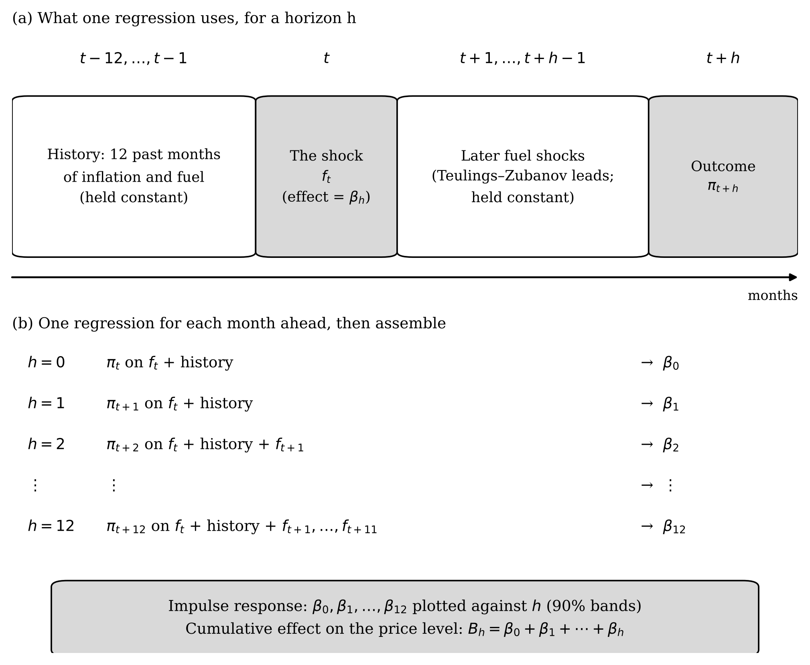
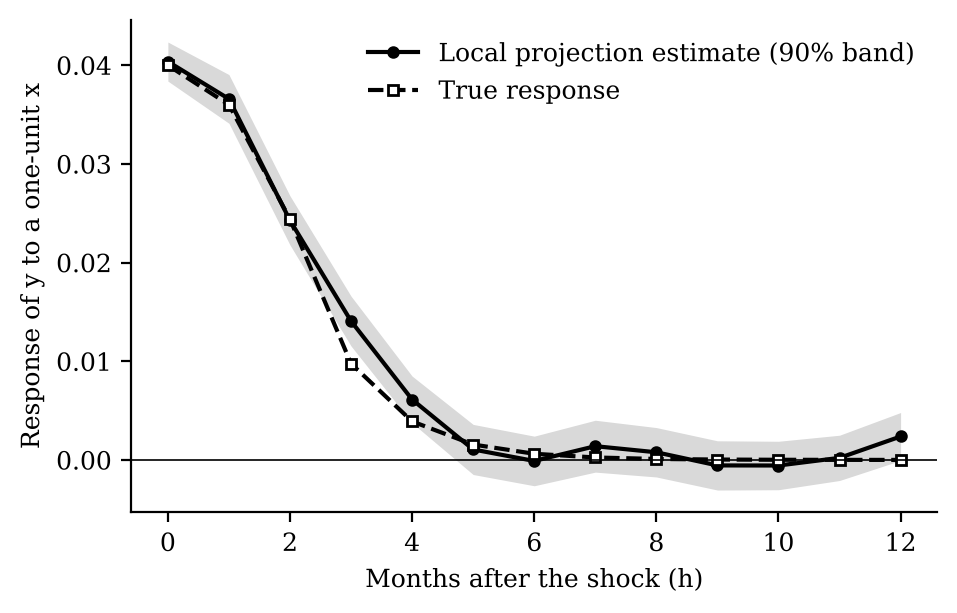
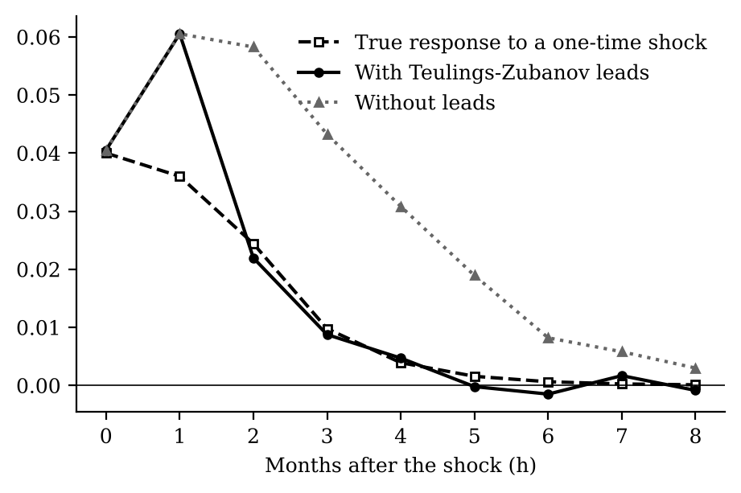
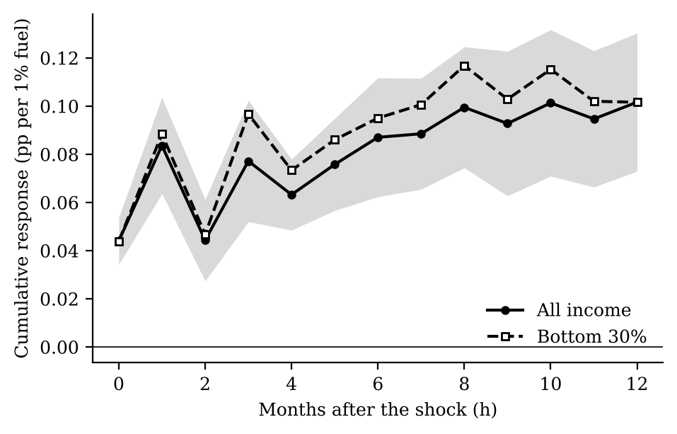

# Local projections: a hands-on tutorial

*How to estimate how a shock spreads over time — the theory, the code, and the traps — using the
oil-shock study in this repository as the worked example.*

A longer, printable version with exercises is the booklet [`lp_booklet.pdf`](lp_booklet.pdf) (Word: `lp_booklet.docx`;
built by `build_booklet.py`).

Every number and figure below is produced by [`lp_tutorial.py`](lp_tutorial.py). Run it from the
repository root:

```bash
.venv/bin/python tutorial/lp_tutorial.py
```

**Contents**

1. [The question a local projection answers](#1-the-question-a-local-projection-answers)
2. [The idea: one regression per horizon](#2-the-idea-one-regression-per-horizon)
3. [The specification, term by term](#3-the-specification-term-by-term)
4. [From monthly effects to the price level](#4-from-monthly-effects-to-the-price-level)
5. [Standard errors](#5-standard-errors)
6. [Step 1 — prove it works on simulated data](#6-step-1--prove-it-works-on-simulated-data)
7. [Step 2 — why the "leads" matter](#7-step-2--why-the-leads-matter)
8. [Step 3 — the national model, by hand](#8-step-3--the-national-model-by-hand)
9. [Step 4 — the same with the project's estimator](#9-step-4--the-same-with-the-projects-estimator)
10. [Step 5 — the regional panel](#10-step-5--the-regional-panel)
11. [The same in Stata](#11-the-same-in-stata)
12. [Common pitfalls](#12-common-pitfalls)
13. [Reading the results](#13-reading-the-results)
14. [References](#14-references)

---

## 1. The question a local projection answers

Suppose pump prices rise by 1% this month. How much higher will consumer prices be next month? In
three months? In a year? — *compared with what would have happened without the rise*.

The list of answers, one for each month ahead, is called the **impulse response**. It is the
standard way economists describe how a shock (an "impulse") spreads through the economy over time.

You cannot read it off a single regression of inflation on fuel prices, for two reasons:

- the effect **unfolds over time** (pump prices hit fares and food with a delay); and
- both series **depend on their own past** (inflation is persistent, and fuel price rises tend to
  come in runs), so the same-month correlation mixes today's shock with old and future ones.

## 2. The idea: one regression per horizon

The traditional tool is the **vector autoregression (VAR)**: estimate one system of equations that
explains each variable by the past of all variables, then *simulate* the system forward after a
shock. Every horizon then depends on the whole system being correctly specified; a small mistake in
the lag structure is compounded at each step of the simulation.

Jordà (2005) proposed something simpler. To find the effect *h* months ahead, **regress the outcome
*h* months ahead directly on today's shock**, holding the past constant. Do this separately for
*h* = 0, 1, …, 12. Each regression is ordinary least squares (OLS); the coefficient on today's shock
*is* the response at that horizon.

| | VAR | Local projection |
|---|---|---|
| How the response at horizon *h* is obtained | Simulate a single estimated system forward *h* steps | Estimate a separate regression for horizon *h* |
| Sensitivity to misspecification | Errors compound across horizons | Each horizon stands on its own |
| Precision at long horizons | Higher (if the model is right) | Lower |
| Ease of adding controls, interactions, panels | Harder | Easy — it is just OLS |
| Same population target? | Yes — with enough lags both estimate the same impulse response (Plagborg-Møller and Wolf 2021) | |

<p align="center"><br>
<em>How a local projection works: (a) what one regression uses; (b) one regression per horizon.</em></p>

## 3. The specification, term by term

Notation: *t* is the month, $f_t = 100\,\Delta\ln F_t$ is the **fuel price shock** (the monthly
percentage change in the retail fuel index), and $\pi_t = 100\,\Delta\ln P_t$ is **monthly
inflation** of a consumer price index *P*. For each horizon *h* = 0, …, 12 the study estimates the
model of Kpodar and Liu (2022):

$$
\pi_{t+h} = \alpha_h + \beta_h f_t
 + \sum_{q=1}^{12}\gamma_q\,\pi_{t-q}
 + \sum_{q=1}^{12}\lambda_q\,f_{t-q}
 + \sum_{l=1}^{h-1}\rho_l\,f_{t+l}
 + \delta_h\,t + \varepsilon_{t+h}
$$

| Term | What it is | Why it is there |
|---|---|---|
| $\pi_{t+h}$ | Inflation *h* months after the shock | The outcome we want to trace |
| $\beta_h f_t$ | Today's fuel shock and its coefficient | **$\beta_h$ is the impulse response at horizon *h*** |
| $\sum \gamma_q \pi_{t-q}$ | 12 past months of inflation | Holds the history of prices constant; with seasonally *unadjusted* data, the 12th lag also absorbs seasonal patterns (e.g. December) |
| $\sum \lambda_q f_{t-q}$ | 12 past fuel shocks | Removes the delayed effects of *earlier* shocks, so $\beta_h$ is about *today's* shock only |
| $\sum \rho_l f_{t+l}$ | Fuel shocks *between* today and *t + h* (the "leads") | Teulings–Zubanov (2014) correction: a rise today is often followed by further rises; without these terms $\beta_h$ would include their effects (see Step 2) |
| $\delta_h t$, $\alpha_h$ | Linear trend and constant | Absorb slow drifts |
| $\varepsilon_{t+h}$ | Error | Correlated across neighbouring *t* (see Section 5) |

Every coefficient carries an *h* subscript because each horizon is a *separate* regression.

## 4. From monthly effects to the price level

$\beta_h$ is the effect on inflation **in one month** (month *t + h*). Policy questions are usually
about the **price level**: *how much higher are prices after a year?* That is the **cumulative
response**

$$B_h = \beta_0 + \beta_1 + \cdots + \beta_h .$$

To get $B_h$ *with a correct standard error*, re-estimate the model with the **sum** of inflation from
*t* to *t + h* on the left-hand side (which equals $\ln P_{t+h} - \ln P_{t-1}$ times 100):

$$\sum_{j=0}^{h} \pi_{t+j} = \alpha_h + B_h f_t + (\text{same controls}) + u_{t+h}.$$

> **Worked example.** For the all-income CPI, $B_{12} = 0.102$: a 10% rise in pump prices makes
> consumer prices about 1.0% higher a year later.

In a finite sample the running sum of the per-horizon estimates and the directly estimated $B_h$
differ (at *h* = 6 in Step 3: 0.100 against 0.087), because each regression uses a slightly different
set of months; report the direct estimate, which comes with its own standard error.

## 5. Standard errors

Because the outcome at horizon *h* overlaps with the outcomes of the neighbouring months, the errors
$\varepsilon_{t+h}$ are **serially correlated** even if the model is right. Ordinary OLS standard
errors would be too small.

- **Single time series:** use **Newey–West** (heteroskedasticity- and autocorrelation-consistent)
  standard errors with *h* + 1 lags (Newey and West 1987).
- **Panel of regions:** regions are hit by the same national shocks in the same month, so errors are
  correlated **across regions** as well as over time. Use **Driscoll–Kraay** standard errors
  (Driscoll and Kraay 1998), again with *h* + 1 lags.

Bands in this study are **90%** ($\hat\beta_h \pm 1.645 \times \text{s.e.}$), as in the reference
study. A band that excludes zero means the effect is significant at the 10% level.

---

## 6. Step 1 — prove it works on simulated data

Before trusting any estimator on real data, check that it recovers a **known** answer. We simulate

$$y_t = 0.4\,y_{t-1} + 0.04\,x_t + 0.02\,x_{t-1} + 0.01\,x_{t-2} + e_t ,$$

whose true response to a one-unit, one-time $x_t$ is 0.040, 0.036, 0.024, 0.010, … and estimate the
local projection, one horizon at a time, with this function (the heart of the method — about 15 lines):

```python
import pandas as pd
import statsmodels.api as sm

def one_horizon(df, y, x, h, p=12):
    X = pd.DataFrame({"x": df[x]})                       # today's shock
    for q in range(1, p + 1):
        X[f"y_l{q}"] = df[y].shift(q)                    # p lags of the outcome
        X[f"x_l{q}"] = df[x].shift(q)                    # p lags of the shock
    for lead in range(1, h):
        X[f"x_f{lead}"] = df[x].shift(-lead)             # Teulings-Zubanov leads
    X["trend"] = df["t"]
    dep = df[y].shift(-h)                                # the outcome h months ahead
    d = X.assign(dep=dep).dropna()
    res = sm.OLS(d["dep"], sm.add_constant(d.drop(columns="dep"))).fit(
        cov_type="HAC", cov_kwds={"maxlags": h + 1})    # Newey-West
    return res.params["x"], res.bse["x"]

estimates = [one_horizon(df, "y", "x", h) for h in range(13)]
```

Result (3,000 simulated months): the estimates track the truth at every horizon; the largest error is
0.004, within sampling noise.

| h | 0 | 1 | 2 | 3 | 4 | 6 | 12 |
|---|---|---|---|---|---|---|---|
| True | 0.0400 | 0.0360 | 0.0244 | 0.0098 | 0.0039 | 0.0006 | 0.0000 |
| Estimate | 0.0404 | 0.0366 | 0.0243 | 0.0141 | 0.0061 | −0.0001 | 0.0024 |
| Standard error | 0.0012 | 0.0015 | 0.0015 | 0.0015 | 0.0014 | 0.0015 | 0.0015 |

<p align="center"></p>

The repository's automated tests (`tests/test_lp.py`) run this check, plus panel versions with
clustered and Driscoll–Kraay errors, every time the analysis is rebuilt.

## 7. Step 2 — why the "leads" matter

Real fuel shocks are not one-off: in our data (2001–2026) a monthly fuel price change is correlated 0.39 with
the previous month's. If shocks come in runs, a rise today *predicts* a rise next month, and next
month's rise has its own effect. A regression on today's shock alone then credits today's shock with
the effects of the shocks it predicts.

Simulate persistent shocks ($x_t = 0.6\,x_{t-1} + u_t$) and estimate with and without the leads:

| h | 0 | 1 | 2 | 3 | 4 | 6 |
|---|---|---|---|---|---|---|
| True response to a one-time shock | 0.040 | 0.036 | 0.024 | 0.010 | 0.004 | 0.001 |
| **With** leads $x_{t+1},\dots,x_{t+h-1}$ | 0.041 | **0.061** | 0.022 | 0.009 | 0.005 | −0.002 |
| **Without** leads | 0.041 | 0.061 | 0.058 | 0.043 | 0.031 | 0.008 |

<p align="center"></p>

Without leads the response is badly overstated at every horizon. With leads it is right from *h* = 2
on — **but not at *h* = 1**, because the lead set $x_{t+1},\dots,x_{t+h-1}$ is *empty* at *h* = 1, so
next month's shock $x_{t+1}$ is not held constant.

> **A note on this study.** The reference paper's tables use exactly this lead set (leads 1 to *h* − 1;
> decision D4 in `CLAUDE.md`), and so does the study. Teulings and Zubanov's own correction
> includes the lead at *t + h* as well. In our data the difference shows up only at *h* = 1–2 —
> it is the source of the small zig-zag at months 1–2 in the pass-through figure — and disappears
> from *h* = 3 on:
>
> | Cumulative response, all-income CPI | h = 1 | h = 2 | h = 3 | h = 6 | h = 12 |
> |---|---|---|---|---|---|
> | Leads 1 to *h* − 1 (paper, this study) | 0.084 | 0.044 | 0.077 | 0.087 | 0.102 |
> | Leads 1 to *h* (Teulings–Zubanov) | 0.064 | 0.062 | 0.077 | 0.088 | 0.101 |
>
> The six- and twelve-month results, on which the conclusions rest, are unaffected (the gap: −0.0155
> vs −0.0160 at *h* = 6; −0.0097 vs −0.0112 at *h* = 12). Read responses at *h* = 1–2 with care.

## 8. Step 3 — the national model, by hand

Now the real data: `data/clean/national_monthly.csv` (one row per month, 1994–2026).
`d_cpi_all` is all-income monthly inflation and `d_fuel` the fuel shock, both 100 × Δln.

Three practical rules, all in the code below:

1. **Use a complete monthly calendar.** If a month is missing and rows are simply stacked, "lag 1"
   silently becomes a two-month lag.
2. **Build lags and leads first, restrict the sample second.** The sample starts in January 2001,
   but the twelve lags of the first months come from 2000; restricting first would throw them away.
3. **Drop incomplete rows last** (`dropna`), so every horizon uses all usable months — which is why
   the number of observations falls from 308 at *h* = 0 to 296 at *h* = 12.

```python
nat = pd.read_csv("data/clean/national_monthly.csv", parse_dates=["date"]).sort_values("date")

def national_lp(h, cumulative=True):
    X = pd.DataFrame({"x": nat["d_fuel"]})
    for q in range(1, 13):
        X[f"y_l{q}"] = nat["d_cpi_all"].shift(q)
        X[f"x_l{q}"] = nat["d_fuel"].shift(q)
    for lead in range(1, h):
        X[f"x_f{lead}"] = nat["d_fuel"].shift(-lead)
    X["trend"] = nat["t"]
    if cumulative:                                              # sum of inflation, t .. t+h
        dep = sum(nat["d_cpi_all"].shift(-j) for j in range(h + 1))
    else:                                                       # inflation in month t+h only
        dep = nat["d_cpi_all"].shift(-h)
    d = X.assign(dep=dep)[nat["date"] >= "2001-01-01"].dropna() # restrict AFTER building lags
    res = sm.OLS(d["dep"], sm.add_constant(d.drop(columns="dep"))).fit(
        cov_type="HAC", cov_kwds={"maxlags": h + 1})
    return res.params["x"], res.bse["x"], int(res.nobs)
```

| h | $\beta_h$ (one month) | s.e. | Running sum of $\beta$ | $B_h$ (cumulative outcome) | s.e. | Obs. |
|---|---|---|---|---|---|---|
| 0 | 0.0440 | 0.0059 | 0.0440 | **0.0440** | 0.0059 | 308 |
| 3 | 0.0127 | 0.0073 | 0.0772 | **0.0772** | 0.0153 | 305 |
| 6 | 0.0127 | 0.0060 | 0.1001 | **0.0870** | 0.0150 | 302 |
| 12 | 0.0059 | 0.0071 | 0.1176 | **0.1016** | 0.0174 | 296 |

<p align="center"><br>
<em>Cumulative responses of the all-income and bottom-30% price levels (90% band for all income).</em></p>

## 9. Step 4 — the same with the project's estimator

The function `local_projection` in [`code/python/lp.py`](../code/python/lp.py) does all of the above
for every horizon at once, and adds panels, controls, interactions and dummy variables:

```python
import sys; sys.path.insert(0, "code/python")
from lp import local_projection

res = local_projection(nat, y="d_cpi_all", x="d_fuel", time="t",
                       horizons=12, p=12, se="newey_west", cumulative=True,
                       sample=nat["date"] >= "2001-01-01")
# one row per horizon: h, term, beta, se, lo, hi (90% band), nobs, n_units, r2
```

Its estimates match the hand-made version above **exactly** (maximum difference 0). Useful options:

| Option | What it does | Example in the study |
|---|---|---|
| `cumulative=True` | Sum of the outcome from *t* to *t + h* | All reported responses |
| `unit="region"` | Panel with unit fixed effects | The 17-region panel |
| `se=` | `"newey_west"`, `"driscoll_kraay"`, `"cluster"`, `"robust"` | National / panel |
| `controls=(...)` | Extra variables, entered with *p* lags | Exchange rate, policy rate, world food prices |
| `exog=(...)` | Variables entered in the same month only | Dummies for the base-change months |
| `interact=("G",)` | Adds shock × G; returns its coefficient too | Region groups; asymmetry (shock × [shock > 0]) |
| `sample=mask` | Restricts shock dates *after* lags are built | 2001–2012 vs 2013–2026 |

## 10. Step 5 — the regional panel

With 17 regions, stack the regions and estimate the same equation with each region's own outcome
and fuel index, plus **region fixed effects** $u_r$ (each region gets its own average):

$$\Delta D_{r,t+h} = u_r + \beta_h f_{r,t} + (\text{12 lags of } \Delta D_r \text{ and } f_r)
+ (\text{leads}) + \delta_h t + \varepsilon_{r,t+h}.$$

Here the outcome is the change in the **inflation gap** $\Delta D = \pi^{\text{all}} - \pi^{\text{bottom 30\%}}$;
a negative response means the poor's prices rise more.

```python
reg = pd.read_csv("data/clean/regional_panel.csv", parse_dates=["date"]).sort_values(["region", "date"])
pan = local_projection(reg, y="d_ratio", x="d_fuel", time="t", unit="region",
                       horizons=12, p=12, se="driscoll_kraay", cumulative=True,
                       sample=reg["date"] >= "2001-01-01")
```

Lags and leads are built **within** each region (the estimator groups by `unit` before shifting), so
a region's lag never borrows another region's data.

| h | National gap | s.e. | Panel gap | s.e. | Panel obs. |
|---|---|---|---|---|---|
| 0 | −0.0000 | 0.0040 | −0.0006 | 0.0032 | 5,219 |
| 3 | −0.0185 | 0.0110 | −0.0149 | 0.0075 | 5,168 |
| 6 | −0.0155 | 0.0103 | **−0.0214** | 0.0084 | 5,117 |
| 12 | −0.0097 | 0.0113 | **−0.0173** | 0.0085 | 5,015 |

The panel uses 17 times more observations, so its estimates are more precise: the national gap is
significant at only four horizons (3, 4, 7 and 8 months), the panel gap at every horizon from 3 to 12 months.

**Group differences.** To test whether a group of regions (say, Mindanao, $G_r = 1$) responds
differently, add the interaction $f_{r,t} \times G_r$ with `interact=("mindanao",)`. Its coefficient
$\theta_h$ is the *extra* response in the group; because $G_r$ never changes, its own effect is
absorbed by the fixed effects.

## 11. The same in Stata

The study's full Stata 17 pipeline is in `code/stata/` (written, not yet run in Stata; see its README). The core of one horizon looks like this
(national model, cumulative outcome, Newey–West; panel with Driscoll–Kraay needs
`ssc install xtscc`):

```stata
import delimited "data/clean/national_monthly.csv", clear
gen mdate = monthly(date_str, "YM")
format mdate %tm
tsset mdate

local h = 6
* outcome: sum of inflation from t to t+h
gen dep = d_cpi_all
forvalues j = 1/`h' {
    replace dep = dep + F`j'.d_cpi_all
}
* leads 1..h-1 (none when h < 2)
local leads ""
if `h' >= 2 local leads "F(1/`=`h'-1').d_fuel"

newey dep d_fuel L(1/12).d_cpi_all L(1/12).d_fuel `leads' t ///
    if mdate >= tm(2001m1), lag(`=`h'+1')
* the coefficient on d_fuel is B_h

* regional panel (after importing regional_panel.csv and: encode region, gen(rid); xtset rid mdate)
* xtscc dep d_fuel L(1/12).d_ratio L(1/12).d_fuel `leads' t if mdate >= tm(2001m1), fe lag(`=`h'+1')
```

Stata's time-series operators (`L.`, `F.`) respect the calendar declared by `tsset`/`xtset`, so gaps
and region boundaries are handled automatically. Point estimates should match Python's; standard errors
can differ slightly because the packages use different small-sample corrections. (This snippet has not
yet been run in Stata.)

## 12. Common pitfalls

| Pitfall | What goes wrong | Fix |
|---|---|---|
| Missing months stacked together | "Lag 1" becomes a two-month lag | Reindex to a complete monthly calendar |
| Restricting the sample before lagging | The first months lose their lags | Build lags and leads, *then* restrict |
| Lagging across units in a panel | Region A's lag is region B's last month | Shift within units (`groupby` / `xtset`) |
| Too few lags with unadjusted data | Seasonality leaks into the errors | 12 lags for monthly unadjusted data |
| No leads when shocks are persistent | Response overstated (Step 2) | Include the Teulings–Zubanov leads |
| Reading $\beta_h$ as the effect on the price level | Confuses a monthly rate with a level | Report the cumulative $B_h$ |
| Plain OLS standard errors | Bands far too narrow | Newey–West; Driscoll–Kraay for panels |
| Testing many groups or horizons | Some "significant" results by chance | Say how many tests; correct (e.g. Bonferroni) |
| Treating a domestic price as a pure shock | Reverse causality | Check with an outside shock (here, world crude oil) |

## 13. Reading the results

- **A response is a "what if".** $B_{12} = 0.102$ means: *if* fuel prices rise 1% this month and
  nothing else unusual happens, prices are 0.102% higher a year later than otherwise.
- **The units matter.** With variables in 100 × Δln, coefficients are percentage points per 1%.
  Scale them to a realistic shock: the 2026 shock raised the fuel index by about 54 log points
  between December 2025 and April 2026.
- **Bands, not stars.** Look at whether the whole band is on one side of zero, and at how it moves
  with *h*. Responses at long horizons are less precise.
- **Applying the responses to a real episode.** Because responses add up, the fuel-driven change in
  the price level after a sequence of shocks $f_1, \dots, f_m$ is $\sum_s B_{m-s} f_s$. This is how
  the study computes the fuel-driven part of the 2026 price surge (RQ3).

## 14. References

- Driscoll, J. C., and A. C. Kraay. 1998. "Consistent Covariance Matrix Estimation with Spatially
  Dependent Panel Data." *Review of Economics and Statistics* 80 (4): 549–560.
- Jordà, Ò. 2005. "Estimation and Inference of Impulse Responses by Local Projections." *American
  Economic Review* 95 (1): 161–182.
- Kpodar, K., and B. Liu. 2022. "The Distributional Implications of the Impact of Fuel Price
  Increases on Inflation." *Energy Economics* 108: 105909.
- Montiel Olea, J. L., and M. Plagborg-Møller. 2021. "Local Projection Inference Is Simpler and More
  Robust Than You Think." *Econometrica* 89 (4): 1789–1823.
- Newey, W. K., and K. D. West. 1987. "A Simple, Positive Semi-Definite, Heteroskedasticity and
  Autocorrelation Consistent Covariance Matrix." *Econometrica* 55 (3): 703–708.
- Plagborg-Møller, M., and C. K. Wolf. 2021. "Local Projections and VARs Estimate the Same Impulse
  Responses." *Econometrica* 89 (2): 955–980.
- Teulings, C. N., and N. Zubanov. 2014. "Is Economic Recovery a Myth? Robust Estimation of Impulse
  Responses." *Journal of Applied Econometrics* 29 (3): 497–514.
